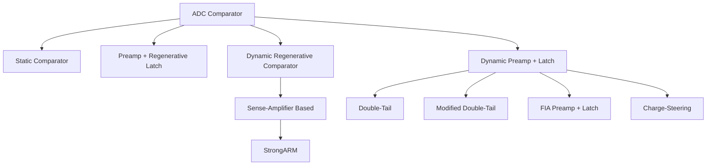
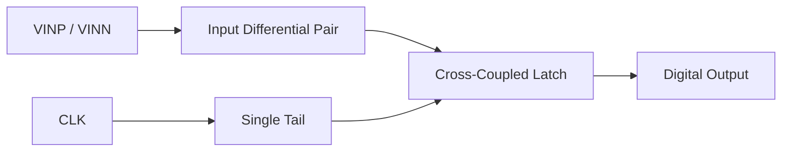
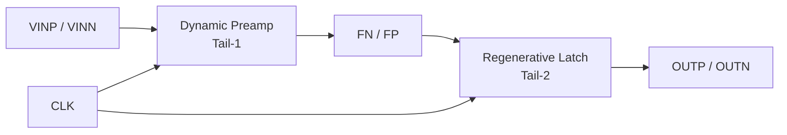
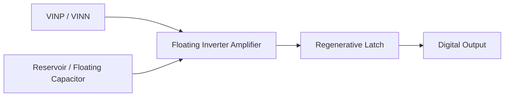
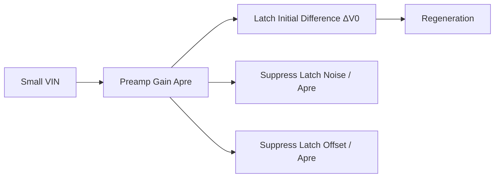
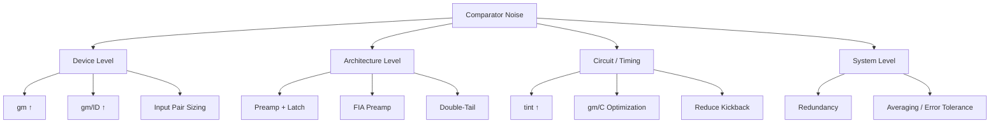
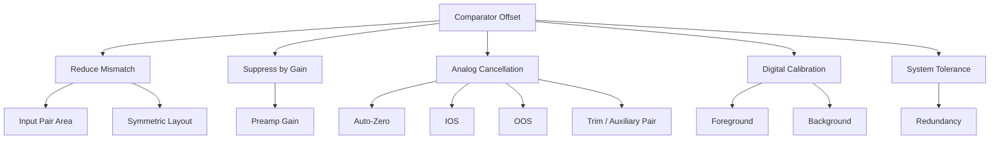
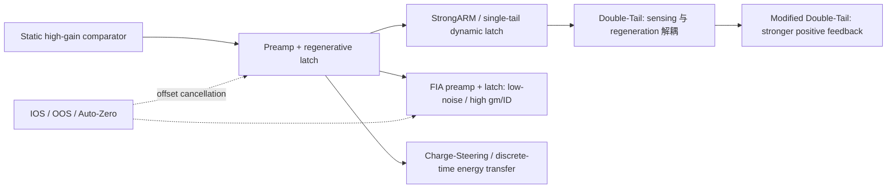

# ADC 比较器：架构、关键指标与设计方法

> [!abstract] 核心定位
> 按典型架构、核心指标、噪声与失调机理、ADC 系统约束及仿真验证，建立比较器设计与选型框架。

## 目录

1. ADC 比较器基础与系统定位
2. ADC 比较器的典型架构
3. ADC 比较器的核心性能指标
4. Dynamic Comparator 的核心工作机理
5. Comparator Noise：来源、分析与优化
6. Comparator Offset：来源、分析与经典优化方法
7. Comparator Speed 与 Metastability
8. 器件尺寸与电路参数设计
9. Kickback、输入接口与 ADC 前端交互
10. PVT、Mismatch 与版图设计
11. Comparator 在不同 ADC 架构中的设计要求
12. Pipeline-SAR 中 Comparator 的特殊设计
13. Comparator 仿真与验证方法
14. Comparator 设计流程与总结
15. 经典论文、架构演进与推荐阅读

---

## 1. ADC 比较器基础与系统定位

### 1.1 比较器在 ADC 中的作用

比较器的本质任务是对两个模拟量进行符号判决。对于差分输入：

$$
V_{id}=V_{ip}-V_{in}
$$

理想比较器输出满足：

$$
D=
\begin{cases}
1, & V_{id}>0\\
0, & V_{id}<0
\end{cases}
$$

但实际 ADC 比较器存在输入等效噪声、失调、有限比较时间、Kickback、输入电容、亚稳态以及 PVT 漂移，因此真实判决更接近概率事件：

$$
P(D=1)\approx \Phi\left(\frac{V_{id}+V_{OS}}{\sigma_{n,in}}\right)
$$

其中 $\Phi(\cdot)$ 为标准正态累积分布函数。

不同 ADC 架构中比较器的角色不同：

- **SAR ADC**：每一位都需要一次比较，速度、能量/次比较、Kickback、输入电容非常关键；
- **Pipeline ADC**：比较器通常位于 sub-ADC，重点关注阈值精度、速度和冗余范围；
- **Pipeline-SAR**：兼具 SAR 比较器的高调用频率与级间余差范围约束；
- **Flash ADC**：需要大量并行比较器，offset、功耗和面积决定整体可行性；
- **Time-Interleaved ADC**：除了单个比较器性能，还要关注通道间 mismatch、供电和时钟耦合一致性。

### 1.2 理想比较器与实际比较器

实际比较器可以抽象为：

$$
V_{eff}=V_{id}+V_{OS}+v_n(t)+v_{dyn}(t)
$$

其中：

- $V_{OS}$：静态输入等效失调；
- $v_n(t)$：随机噪声；
- $v_{dyn}(t)$：由时钟、寄生、Kickback、历史状态等引起的动态扰动。

最终比较器是否可用，不是只看某一个参数，而是看：

$$
\boxed{
\text{Accuracy} + \text{Speed} + \text{Input Interface} + \text{Energy} + \text{Robustness}
}
$$

### 1.3 ADC 对比较器的系统级要求

对于有冗余的 ADC，第一级比较器通常不需要机械地满足最终 ADC 的 $0.5\,\mathrm{LSB}$。更合理的系统约束是：

$$
k\sigma_{cmp}+|V_{OS}|+|V_{DACerr}|+|V_{settle}|+|V_{kick}|<V_{red}
$$

其中 $V_{red}$ 为折算到当前级输入端的冗余窗口。

这说明比较器规格应该由 **系统误差预算** 反推，而不是孤立设计。

---

## 2. ADC 比较器的典型架构

### 2.1 比较器架构分类与选型维度

ADC 中常见比较器可按工作方式分为：

架构选型时重点比较：

- Speed
- Input-referred noise
- Input-referred offset
- Kickback
- Input capacitance
- Static power
- Energy per decision
- Low-$V_{DD}$ capability
- Input common-mode range
- Calibration friendliness
- Circuit / clock complexity

> [!tip] 架构选型直觉
> 下图只是用于建立“速度/能效”和“精度/低噪声”的相对直觉，不代表统一 FoM 或绝对性能排名。

---

### 2.2 Static Comparator

#### 2.2.1 基本结构

典型形式为：

$$
\text{Differential Pair}\rightarrow \text{Gain Stage}\rightarrow \text{Output Buffer}
$$

可采用单级差分放大器、多级 OTA、Folded-Cascode、Telescopic 等连续时间结构。

#### 2.2.2 工作原理

依靠连续时间增益：

$$
V_o=A_v(V_{ip}-V_{in})
$$

当 $A_v$ 足够大时，小输入差分被放大到数字后级可识别范围。

#### 2.2.3 优点

- 工作点清晰，容易做 AC / noise / loop 分析；
- 输入输出隔离较好，Kickback 小；
- 可通过多级增益降低后级 offset/noise 的输入折算；
- 输出不会依赖强再生过程，行为相对平滑；
- 适合精密阈值判决和低频连续监测。

#### 2.2.4 缺点

- 存在静态偏置电流；
- 高速下功耗迅速增加；
- 多级放大带来额外延迟与补偿问题；
- 低电压先进工艺下 headroom 受限；
- 能量效率通常不如动态比较器。

#### 2.2.5 典型应用场景

适合：

- 精度优先而速度要求中等；
- 允许静态功耗；
- 需要连续时间比较；
- 校准/reference comparator。

典型 ADC：低速/中速精密 ADC、部分 Flash 前端、监测型辅助比较器。

不适合：超低功耗 SAR、数百 MS/s～GS/s 的主比较器。

---

### 2.3 Preamp + Regenerative Latch Comparator

#### 2.3.1 基本结构

$$
V_{in}\rightarrow A_{pre}\rightarrow \text{Regenerative Latch}\rightarrow \text{Digital}
$$

#### 2.3.2 工作原理

前置放大器先产生：

$$
\Delta V_{pre}=A_{pre}\Delta V_{in}
$$

再由锁存器利用正反馈完成全摆幅判决。

#### 2.3.3 优点

- 前置增益降低 latch 输入等效噪声：

$$
\sigma_{latch,in}\approx \frac{\sigma_{latch}}{A_{pre}}
$$

- 前置增益降低 latch 输入等效失调：

$$
V_{OS,latch,in}\approx \frac{V_{OS,latch}}{A_{pre}}
$$

- Preamp 可隔离 latch 大摆幅翻转，Kickback 较小；
- 适合小输入残差判决；
- 精度通常优于单纯 regenerative latch。

#### 2.3.4 缺点

- 如果 preamp 为静态结构，会增加静态功耗；
- 多一级建立时间，延迟增加；
- 第一级自身 noise/offset 直接成为总精度瓶颈；
- 电路面积与时钟控制复杂度增加。

#### 2.3.5 典型应用场景

适合：高精度 ADC、Pipeline sub-ADC、高精度 SAR、Pipeline-SAR 后级、小 residue 判决以及对 Kickback 很敏感的 CDAC 顶板。

---

### 2.4 Sense-Amplifier-Based Comparator

#### 2.4.1 基本结构

利用交叉耦合正反馈把很小的初始差分迅速再生为全摆幅结果。

#### 2.4.2 工作原理

再生阶段可近似描述为：

$$
\Delta V(t)=\Delta V_0 e^{t/\tau_{reg}}
$$

#### 2.4.3 优点

- 再生速度非常快；
- 等效增益极高；
- 动态功耗低；
- 晶体管数量少，数字 CMOS 兼容性好。

#### 2.4.4 缺点

- 对 mismatch 敏感；
- 小输入差分时亚稳态明显；
- 输入与大摆幅再生节点隔离有限；
- Kickback 可能较大；
- delay 对输入差分呈明显非线性。

#### 2.4.5 典型应用场景

适合高速、低功耗、中等精度判决；常见于 SRAM sense amplifier、Flash ADC、SAR ADC 以及各类动态比较器。StrongARM 可视为其中一个最经典具体实现。

---

### 2.5 StrongARM Comparator

#### 2.5.1 基本结构

StrongARM 通常由：

- 输入差分对；
- 单个 clocked tail；
- 交叉耦合 regenerative latch；
- reset/precharge 管；

组成。

> [!note] 结构理解
> StrongARM 的核心是“输入感知与正反馈再生高度耦合”。其命名源于 DEC StrongARM 处理器中的应用，而基本拓扑更早已有类似实现。Razavi 的 2015 年综述是理解其工作相位、失调和再生过程的经典入口。[R2]

#### 2.5.2 工作原理

**Reset：** tail 关闭，内部节点预充，基本无静态电流。

**Evaluation：** tail 打开，输入对产生微小电流差，随后 latch 正反馈把初始差分指数放大。

#### 2.5.3 优点

1. **零静态功耗**

$$
P_{static}\approx 0
$$

2. **速度快**：正反馈强，适合高速 SAR；
3. **结构简单**：晶体管数少、面积小、时钟简单；
4. **Energy/decision 很低**；
5. 设计经验成熟，广泛用于高速低功耗 ADC。

#### 2.5.4 缺点

1. **Kickback 较大**：input pair 与 latch 大摆幅节点耦合紧密；
2. **Offset 较大**：缺少独立高增益 preamp 对 latch mismatch 的抑制；
3. **噪声优化空间受限**：高精度时通常需要额外前级；
4. **低电压与输入共模范围受限**；
5. **Metastability 明显**：$|V_{in}|\rightarrow 0$ 时 delay 迅速增加。

#### 2.5.5 典型应用场景

非常适合：

- 高速 + 低功耗 SAR ADC；
- TI-SAR 子 ADC；
- 粗量化级；
- 比较器调用次数高、能量预算严格的场景。

不太适合：极低噪声、小 residue 直接判决、对 Kickback 极敏感的高阻输入节点。

---

### 2.6 Double-Tail Dynamic Comparator

#### 2.6.1 基本结构

Double-Tail 本质是：

$$
\text{Dynamic Preamp}\rightarrow \text{Dynamic Latch}
$$

两个 tail 分别控制输入 sensing 和 latch regeneration，因此称为 Double-Tail。

> [!note] 经典来源
> Schinkel 等人在 ISSCC 2007 的经典工作通过“输入级与交叉耦合再生级分离”实现 double-tail sense amplifier，并报告了 90 nm CMOS、1.2 V 下约 92 fJ/decision、1.5 mV input-equivalent noise、8 mV 的 1σ offset 和 18 ps setup+hold time。这里的数字只用于理解该架构的历史定位，不应直接拿来作为先进工艺的设计目标。[R3]

#### 2.6.2 工作原理

Reset 时内部节点预充；Evaluation 时第一级输入对先在 FN/FP 节点建立差分，随后第二级 latch 再生。

#### 2.6.3 优点

1. 输入级与 latch 相对解耦；
2. Kickback 通常小于 StrongARM；
3. 前置动态增益可降低 latch 输入等效噪声；
4. 前置动态增益可降低 latch 输入等效 offset；
5. 两级分离有利于低 $V_{DD}$；
6. 仍保持近似零静态功耗。

#### 2.6.4 缺点

- 晶体管数量和内部节点增多；
- FN/FP 寄生电容直接影响速度；
- Tail sizing 与 latch trigger timing 需要联合优化；
- 动态增益依赖 transient 状态，不像静态 OTA 那样固定；
- 左右寄生不对称容易产生 dynamic offset。

#### 2.6.5 典型应用场景

特别适合：

- 高速 + 较高精度 + 低电压 SAR；
- Pipeline-SAR；
- TI-SAR；
- 对 Kickback、offset 和 noise 比 StrongARM 更敏感的场景。

---

### 2.7 Modified Double-Tail Comparator

#### 2.7.1 基本结构

在传统 Double-Tail 基础上，对 intermediate nodes、current path 或 regenerative path 进行增强，例如：

- cross-coupled intermediate devices；
- positive-feedback preamp；
- dynamic current boosting；
- conditional discharge；
- early regeneration；
- internal-node capacitance reduction。

#### 2.7.2 工作原理

核心目标是提高：

$$
\frac{d\Delta V_F}{dt}
$$

或者在相同时间内获得更大的 latch initial differential。

#### 2.7.3 优点

- Preamp 差分建立更快；
- latch 初始差分更大；
- regeneration delay 更短；
- 可进一步改善低电压工作；
- 某些结构能降低 energy/decision。

#### 2.7.4 缺点

- 额外正反馈可能放大 mismatch；
- 寄生更复杂；
- PVT sensitivity 增加；
- 某些 boosting 结构会增大动态功耗和 Kickback；
- 版图与时钟设计难度上升。

#### 2.7.5 典型应用场景

适合极短 bit-cycle、高速 SAR、低 $V_{DD}$ 和传统 Double-Tail 已成为速度瓶颈的设计。

#### 2.7.6 代表性文献与阅读重点

- **Babayan-Mashhadi and Lotfi, IEEE TVLSI 2014**：对 dynamic comparator delay 做了系统分析，并通过加强再生阶段的正反馈提出改进型 Double-Tail，是“如何从延迟公式反推拓扑修改”的代表性论文。[R4]
- 阅读时注意：很多所谓 modified double-tail 都是在改变**内部节点放电斜率、正反馈建立时间或 latch 初始差分**，而不是改变 comparator 的基本两级思想。

---

### 2.8 FIA Preamp + Latch Comparator

#### 2.8.1 基本结构

$$
V_{in}\rightarrow \text{FIA}\rightarrow \text{Regenerative Latch}
$$

FIA 为 Floating Inverter Amplifier，利用 CMOS inverter 的 NMOS 与 PMOS 同时提供跨导。

#### 2.8.2 工作原理

有效跨导近似为：

$$
g_{m,FIA}\approx g_{mn}+g_{mp}
$$

通过 floating / reservoir capacitor 在动态相位向 inverter-based amplifier 提供能量，在保持低静态功耗的同时获得较高 $g_m/I_D$ 和前置增益。

#### 2.8.3 优点

1. **Noise efficiency 高**：NMOS/PMOS current reuse 提高有效 $g_m$；
2. **Preamp gain 较高**，可明显压低 latch noise：

$$
\sigma_{cmp}^2\approx \sigma_{FIA}^2+\frac{\sigma_{latch}^2}{A_{FIA}^2}
$$

3. 同时降低 latch input-referred offset；
4. 对 latch Kickback 有良好隔离；
5. 静态功耗低；
6. 适合低电压先进工艺。

#### 2.8.4 缺点

- 需要 floating/reservoir capacitor；
- 虽然 floating supply 有利于减弱 input-CM 对性能的影响、并可使 preamp 输出共模在积分过程中保持较稳定，但 **CRES、reset 电平、寄生不对称和 charge sharing** 仍必须专门设计；
- FIA 自身 noise/offset 会成为一级主导；
- Clock phase 与 charge sharing 更复杂；
- 对 parasitic、PVT、储能电容大小敏感；
- 面积可能因 reservoir capacitor 增加。

#### 2.8.5 典型应用场景

特别适合：

- 低噪声 + 高能效 + 低电压；
- 高精度 SAR；
- Pipeline-SAR 后级；
- 小 residue comparator；
- noise-limited ADC。

如果某一级主要追求极致速度、noise budget 很宽，则 FIA 未必比 StrongARM 更合适。

#### 2.8.6 代表性文献与阅读重点

- **Tang et al., JSSC 2020**：FIA comparator 的核心参考。其 preamp 采用由 floating reservoir capacitor 供能的 inverter-based input pair，实现 current reuse 与 dynamic bias，提高 $g_m/I_D$ 并降低噪声；180 nm prototype 报告 46 μV input-referred noise、1 pJ/comparison，并相对 StrongARM 显示显著的能效提升。[R5]
- 该工作还强调 FIA 对 **input common-mode variation、process corner、noise、offset 与 delay** 的鲁棒性改善。
- 进一步阅读时应关注 $C_{RES}$、积分节点电容、动态 source degeneration、reset 电平以及 latch 触发条件，而不是只看“inverter 的 $g_{mn}+g_{mp}$”。

---

### 2.9 Charge-Steering Comparator

#### 2.9.1 基本结构

依靠预充电电容和电荷重分配完成差分放大，而不是依靠持续静态尾电流。

#### 2.9.2 工作原理

核心关系：

$$
Q=CV
$$

典型过程为：

$$
\text{Precharge}\rightarrow \text{Charge Steering}\rightarrow \text{Regeneration}
$$

#### 2.9.3 优点

- 零/极低静态功耗；
- 低 voltage headroom；
- 适合 scaled CMOS；
- Energy efficiency 高；
- 可获得较强动态增益。

#### 2.9.4 缺点

- $kT/C$ noise；
- Charge injection；
- Clock feedthrough；
- Capacitor mismatch；
- Timing complexity；
- 对 parasitic 非常敏感。

#### 2.9.5 典型应用场景

适合低 $V_{DD}$、极低功耗和高速动态 ADC，尤其在先进工艺中具有吸引力。

#### 2.9.6 代表性文献与阅读重点

- **Razavi, CICC 2013, “Charge Steering: A Low-Power Design Paradigm”**：从 current-steering 到 charge-steering 的设计范式转换，展示离散时间储能/放电如何用于高速低功耗放大、锁存与 ADC。[R9]
- Charge-Steering 并不是“某一个固定 comparator schematic”，更像是一类以**预存电荷取代持续尾电流**的设计方法，因此不同论文中的时钟相位和再生结构差异可能很大。

---

### 2.10 典型架构横向比较

| 架构 | Speed | Noise | Offset | Kickback | Static Power | Low-$V_{DD}$ | Complexity | 典型应用 |
|---|---|---|---|---|---|---|---|---|
| Static | 中 | 低 | 低 | 低 | 高 | 一般 | 中 | 精密/低速 ADC |
| Preamp + Latch | 高 | 低 | 低 | 低 | 取决于 preamp | 中 | 高 | 高精度 ADC |
| StrongARM | 很高 | 中 | 中~较大 | 较大 | 0 | 中 | 低 | 高速低功耗 SAR |
| Double-Tail | 很高 | 较低 | 较低 | 较低 | 0 | 好 | 中 | 高速高精度 SAR / Pipeline-SAR |
| Modified Double-Tail | 极高 | 较低 | 结构相关 | 中~低 | 0 | 很好 | 高 | 超高速 SAR |
| FIA + Latch | 高 | 很低 | 较低 | 低 | 极低 | 很好 | 高 | 低噪声、高精度 SAR / Pipeline-SAR |
| Charge-Steering | 高 | 中~低 | 中 | 中 | 0 | 很好 | 高 | 低压、低能耗 ADC |

> [!warning] 表格使用方式
> 上表是**架构级定性比较**，不是绝对排序。最终 noise、offset、delay 和 kickback 仍强烈依赖工艺、输入共模、器件尺寸、时钟边沿、负载以及校准方法。尤其 FIA 与 Double-Tail 都可能通过不同实现覆盖很宽的性能区域。

按目标粗略选型：

$$
\boxed{
\begin{aligned}
\text{极致速度/简单/低能量} &\rightarrow \text{StrongARM}\\
\text{高速+低压+更低 Kickback} &\rightarrow \text{Double-Tail}\\
\text{更低噪声/更高精度} &\rightarrow \text{FIA + Latch}\\
\text{极低 }V_{DD}\text{ / charge-domain} &\rightarrow \text{Charge-Steering}\\
\text{精度第一、功耗次要} &\rightarrow \text{Preamp + Latch}
\end{aligned}
}
$$

---

## 3. ADC 比较器的核心性能指标

### 3.1 输入等效噪声

通常使用 RMS input-referred noise：

$$
\boxed{\sigma_{n,in}}
$$

它直接影响 ADC 的随机判决误差、SNDR、ENOB 和 DNL。

### 3.2 输入等效失调

比较器 50% switching point 相对理想零点的偏移：

$$
\boxed{V_{OS}}
$$

工程上应同时报告：

$$
\mu_{VOS},\qquad \sigma_{VOS}
$$

用于区分 systematic offset 与 random mismatch offset。

### 3.3 比较延迟

$$
\boxed{t_{cmp}}
$$

动态比较器的 delay 不是常数，而是：

$$
t_{cmp}=f(V_{in},V_{CM},V_{DD},T,\text{corner})
$$

最关键的是 small-signal delay。

### 3.4 亚稳态

当 $|V_{in}|\rightarrow 0$ 时，再生时间迅速增加。系统更有意义的指标是：

$$
P(t_{cmp}>T_{available})
$$

即比较器未在可用时序内完成判决的概率。

### 3.5 Kickback

定义比较器开启前后输入节点的扰动：

$$
\Delta V_{KB}=V_{input,after}-V_{input,before}
$$

需要区分：

- Common-mode kickback：$\Delta V_{CM,KB}$；
- Differential kickback：$\Delta V_{diff,KB}$。

后者更容易形成判决误差。

### 3.6 输入电容

比较器输入电容：

$$
C_{in}=C_{gs}+C_{gd}+C_{db}+C_{routing}+\cdots
$$

它会增加 CDAC 顶板负载、影响 settling，并与 Kickback 共同形成输入接口问题。

### 3.7 输入共模范围

需要在有效范围内保证：

- $g_m$；
- tail current；
- dynamic gain；
- noise；
- offset；
- delay；

均满足要求。

### 3.8 Reset / Recovery Time

必须满足：

$$
t_{reset}<T_{reset,available}
$$

否则会产生 memory effect。

### 3.9 输出负载与驱动能力

应区分：

$$
t_{core}
$$

与：

$$
t_{core+buffer}
$$

比较器 core 不应直接驱动过大的 fanout。

### 3.10 功耗与 Energy per Comparison

对于 dynamic comparator，比平均功耗更有意义的是：

$$
\boxed{E_{cmp}=\frac{P_{avg}}{f_{cmp}}}
$$

常用单位为 fJ/decision。

### 3.11 电源与时钟敏感度

关注：

$$
\frac{\partial V_{OS}}{\partial V_{DD}},\qquad
\frac{\partial t_{cmp}}{\partial V_{DD}}
$$

以及 clock slew、duty cycle、clock feedthrough、clock skew 对 delay/offset 的影响。

### 3.12 PVT / Monte Carlo 鲁棒性

至少验证：TT / FF / SS / FS / SF、$V_{DD,min/typ/max}$、低温/常温/高温，以及 mismatch MC。

### 3.13 Decision Error Probability

最终系统真正关心的是：

$$
\boxed{P_{err}(V_{in})}
$$

它综合反映 noise、offset、metastability、insufficient settling 和 Kickback。

---

## 4. Dynamic Comparator 的核心工作机理

### 4.1 Reset / Precharge / Evaluation

动态比较器一般由 Reset 与 Evaluation 两个大相位组成。Double-Tail 还可进一步分成 preamp integration 与 latch regeneration。

### 4.2 动态差分电流产生

输入对在小信号近似下产生：

$$
\Delta I\approx g_mV_{in}
$$

### 4.3 动态积分

差分电流在内部节点电容上积分：

$$
\Delta V_F(t)\approx \frac{g_m}{C_F}V_{in}t
$$

### 4.4 动态预放大增益

$$
\boxed{
A_{pre}(t)=\frac{\Delta V_F(t)}{V_{in}}\approx \frac{g_mt_{int}}{C_F}
}
$$

与静态 OTA 不同，这是 transient 积分形成的动态增益。

### 4.5 最大积分时间与最大动态增益

内部节点不能无限下降。对 NMOS 输入对，可粗略认为：

$$
V_F\gtrsim V_{CM}-V_{TH}
$$

因此可用共模下降幅度约为：

$$
\Delta V_{max}\approx V_{DD}-V_{CM}+V_{TH}
$$

最大动态增益受 input overdrive、节点摆幅与 latch trigger timing 共同限制。

### 4.6 Latch 再生原理

再生时间：

$$
t_{reg}\approx \tau_{reg}\ln\left(\frac{V_{logic}}{\Delta V_0}\right)
$$

其中：

$$
\tau_{reg}\approx \frac{C_L}{g_{m,latch}}
$$

而 latch 初始差分近似为：

$$
\Delta V_0\approx A_{pre}V_{in}
$$

因此 preamp 不仅改善噪声/失调，也能缩短再生时间。

### 4.7 动态 Comparator 的“带宽”

动态比较器没有严格固定的小信号 -3 dB bandwidth，更适合使用：

$$
\omega_{eff}\sim \frac{g_m}{C_F}
$$

描述动态建立能力。

### 4.8 Preamp 与 Latch 的协同

---

## 5. Comparator Noise：来源、分析与优化

### 5.1 Noise 来源

主要包括：

1. 输入对 thermal noise；
2. Preamp noise；
3. Latch regeneration noise；
4. Reset noise；
5. $kT/C$ noise；
6. Clock coupling；
7. Kickback-induced disturbance；
8. 数字翻转耦合。

### 5.2 总输入等效噪声

对 preamp + latch：

$$
\boxed{
\sigma_{n,in,total}^2
\approx
\sigma_{n,pre}^2+
\frac{\sigma_{n,latch}^2}{A_{pre}^2}
+
\sigma_{n,kick}^2+
\sigma_{n,reset}^2
}
$$

设计目标通常是让第一级成为主要噪声源，后级贡献被前置增益充分压低。

> [!note] 非平稳噪声
> Dynamic comparator 的噪声发生在 reset、积分和再生等瞬态过程中，严格来说不是简单的稳态宽平稳噪声问题。Sepke 等人的工作是理解 comparator-based circuits 非平稳噪声分析的经典参考。[R7]

### 5.3 提高输入对 $g_m$

MOS 热噪声电流近似：

$$
\overline{i_n^2}=4kT\gamma g_m
$$

但 input-referred noise 通常随有效跨导增大而下降。因此：

$$
\boxed{g_m\uparrow\Rightarrow v_{n,in}\downarrow}
$$

### 5.4 提高 $g_m/I_D$ 与优化 $V_{ov}$

强反型近似：

$$
g_m\approx \frac{2I_D}{V_{ov}}
$$

固定电流下：

$$
V_{ov}\downarrow\Rightarrow g_m/I_D\uparrow
$$

但过低 $V_{ov}$ 可能增加 PVT sensitivity 与 parasitic。

### 5.5 输入管尺寸优化

增大输入对通常可以降低随机失调并提高 $g_m$，但会同时增加：

- $C_{in}$；
- $C_F$；
- Kickback；
- CDAC 顶板负载。

因此需要优化的是：

$$
\frac{g_m}{C_F}
$$

而不是单纯增大 W。

### 5.6 延长有效积分时间

动态 comparator 中：

$$
A_{pre}\approx \frac{g_mt_{int}}{C_F}
$$

且输入等效噪声趋势可粗略理解为：

$$
\overline{v_{n,in}^2}\propto \frac{1}{g_mt_{int}}
$$

因此延长 $t_{int}$ 有利于噪声，但直接牺牲速度。

### 5.7 提高 Preamp Gain

$$
\sigma_{latch,in}\approx \frac{\sigma_{latch}}{A_{pre}}
$$

但当：

$$
\frac{\sigma_{latch}}{A_{pre}}\ll \sigma_{pre}
$$

继续提高增益收益开始饱和。

### 5.8 FIA Preamp 降噪

FIA 利用 inverter current reuse：

$$
g_{m,FIA}\approx g_{mn}+g_{mp}
$$

因此可在较低电流下获得较高有效跨导和较好的 noise efficiency。

总噪声近似：

$$
\boxed{
\sigma_{cmp}^2\approx \sigma_{FIA}^2+
\frac{\sigma_{latch}^2}{A_{FIA}^2}
}
$$

合理设计目标是：

$$
\frac{\sigma_{latch}}{A_{FIA}}\lesssim \sigma_{FIA}
$$

避免为了过高 FIA gain 牺牲过多速度、面积和功耗。Tang 等人的 FIA comparator 进一步指出，floating reservoir capacitor 不只是“供电电容”，还通过动态偏置/源退化改善 $g_m/I_D$，并减弱输入共模对噪声、失调与延迟的影响。[R5]

### 5.9 Multi-Stage Preamp

若：

$$
V_{in}\rightarrow A_1\rightarrow A_2\rightarrow Latch
$$

则：

$$
\sigma_{in}^2\approx
\sigma_1^2+
\frac{\sigma_2^2}{A_1^2}+
\frac{\sigma_{latch}^2}{A_1^2A_2^2}
$$

这是经典 first-stage-noise-dominance 原则。

### 5.10 Latch Noise 优化

重点不是单纯增大 latch 尺寸，而是提高：

$$
\boxed{\frac{g_{m,latch}}{C_L}}
$$

并减小输出 fanout、routing parasitic 和不必要的大节点电容。

### 5.11 Internal Node Capacitance

增加电容可降低节点瞬时 $kT/C$ 电压噪声，但会降低：

$$
\frac{g_m}{C}
$$

因此应通过 transient-noise 仿真寻找 optimum，而不是机械地加大电容。

### 5.12 Kickback 降噪

经典方法：

- Preamp 隔离；
- Double-Tail；
- FIA；
- 输入对合理 sizing；
- 对称 routing；
- clock slew 优化；
- isolation switch；
- 减少 latch 大摆幅耦合路径。

### 5.13 Auto-Zero 对噪声并非总是有利

Auto-Zero 主要消除 DC / slowly-varying offset，却会额外引入：

$$
\sigma_V\sim \sqrt{\frac{kT}{C}}
$$

以及 noise folding / clock feedthrough，因此不能把 AZ 简单理解成“同时把 noise 消掉”。

### 5.14 Noise 优化方法总结

---

## 6. Comparator Offset：来源、分析与经典优化方法

### 6.1 Offset 来源

主要包括：

- Input pair threshold mismatch；
- $\beta$ mismatch；
- Preamp load mismatch；
- FN/FP parasitic mismatch；
- Latch mismatch；
- Clock feedthrough mismatch；
- Clock skew；
- Output loading mismatch；
- Layout systematic asymmetry。

### 6.2 Offset 输入折算

$$
\boxed{
V_{OS,total}\approx V_{OS,pre}+\frac{V_{OS,latch}}{A_{pre}}+V_{OS,dyn}
}
$$

其中第一级自身 offset 不能被自己的增益抑制。

### 6.3 Pelgrom Mismatch 与尺寸优化

$$
\sigma(\Delta V_{TH})\approx \frac{A_{Vt}}{\sqrt{WL}}
$$

增大面积可以降低随机 offset，但会增加输入电容、内部节点电容和 Kickback。

### 6.4 提高 Preamp Gain

只对后级 offset 有效：

$$
V_{OS,latch,in}\approx \frac{V_{OS,latch}}{A_{pre}}
$$

### 6.5 版图匹配优化

经典措施：

- Common-centroid；
- 相同 orientation；
- Dummy；
- FN/FP 完全对称；
- Clock routing 对称；
- Output loading 对称；
- Via/contact 数量一致；
- Guard ring 与环境密度对称。

### 6.6 Auto-Zero

Calibration phase 中令：

$$
V_{id}=0
$$

测得 $V_{OS}$ 并生成：

$$
V_{CAL}\approx -V_{OS}
$$

正常比较：

$$
V_{eff}=V_{in}+V_{OS}+V_{CAL}\approx V_{in}
$$

**优点：** offset suppression 强。

**缺点：** 多相时钟、闭环建立、$kT/C$、charge injection、noise folding。

### 6.7 IOS：Input Offset Storage

在输入侧 capacitor 存储 input-referred offset：

$$
V_C\approx V_{OS}
$$

比较时：

$$
V_{eff}=V_{in}+V_{OS}-V_C\approx V_{in}
$$

**优点：** cancellation 直接发生在输入域；结构概念清晰，适合把 preamp 自身 offset 周期性存储在输入耦合电容上。

**缺点：** input loading、$kT/C$、charge injection、settling 代价明显。经典分析还指出，在有限 preamp gain 和开关注入误差存在时，IOS 的 residual offset 可能要求较大的增益或存储电容才能压低。[R1]

### 6.8 OOS：Output Offset Storage

在 preamp output 侧存储：

$$
V_C\approx A_{pre}V_{OS}
$$

正常比较：

$$
A_{pre}(V_{in}+V_{OS})-V_C\approx A_{pre}V_{in}
$$

**优点：** offset storage 位于 preamp 输出侧，通常具有更小的输入电容；经典分析中，在相似 preamp 条件下 OOS 可获得比 IOS 更低的 residual offset，因此长期用于高精度并行/子量化比较器。[R1]

**缺点：** preamp output / latch input 节点电容增加，影响后续建立和再生速度；同时由于 cancellation 时 preamp 多为开环，preamp gain 不能无限做大，否则 $A_{pre}V_{OS}$ 可能使输出进入饱和，限制可用增益与输入范围。[R1]

### 6.9 AZ / IOS / OOS 对比

| 方法 | offset 存储/校正位置 | 速度 | 主要代价 | 高速 ADC 适用性 |
|---|---|---|---|---|
| Auto-Zero | 辅助校准环路 | 慢 | 多相时钟、建立、$kT/C$ | 中~低 |
| IOS | 输入端 | 中~慢 | $C_{in}$、settling、$kT/C$ | 中 |
| OOS | Preamp 输出 | 较快 | 输出节点电容、$kT/C$、开环输出范围 | 较高 |

> [!reference] Offset cancellation 经典文献
> Razavi 与 Wooley 1992 年的 JSSC 论文直接比较了 IOS 与 OOS 的残余失调、输入电容和前置放大器增益限制，是理解这两种方法最值得优先阅读的原始资料之一。[R1]

### 6.10 Analog Trim

#### Capacitive Trim

利用：

$$
C_{trim,p}-C_{trim,n}
$$

人为改变动态节点速度。

#### Current Trim

$$
\Delta I_{trim}=I_{trim,p}-I_{trim,n}
$$

抵消 mismatch current。

#### Gate-Voltage Trim

利用小 DAC 产生 $V_{CAL}$，通过辅助输入管修正 threshold。

#### Body-Bias Trim

利用 body effect 调节：

$$
V_{TH}(V_{BS})
$$

适用于工艺允许独立 body control 的情况。

### 6.11 Auxiliary Pair Calibration

增加小型辅助差分对：

$$
g_{m,C}V_{CAL}
$$

产生可控修正电流，在不大幅改变主 input pair 的情况下校准 offset。

### 6.12 Digital Foreground Calibration

上电或空闲时短接输入，通过数字 SAR-search 寻找：

$$
P(D=1)\approx 50\%
$$

对应的 trim code，并存储用于正常工作。

### 6.13 Background Offset Calibration

持续估计：

$$
V_{OS}(t)
$$

并动态更新：

$$
Code_{OS}(t)
$$

用于追踪温漂、电源变化与 aging。

### 6.14 Chopping

Chopping 可同时抑制 DC offset 与 $1/f$ noise，但会引入额外调制时钟、ripple、switching spike 和带宽限制，因此不属于几百 MS/s～GS/s SAR 主比较器的主流方案。

### 6.15 Redundancy-Based Offset Tolerance

对有冗余的 ADC：

$$
|V_{OS}|<V_{red}
$$

时，系统可以选择 **容忍并数字修正**，而不是在模拟端彻底消除 offset。

### 6.16 Offset 优化方法总结

---

## 7. Comparator Speed 与 Metastability

### 7.1 总延迟组成

$$
\boxed{t_{cmp}\approx t_{pre}+t_{reg}+t_{buf}}
$$

### 7.2 Preamp Delay

若 latch 需要内部节点达到 $\Delta V_{req}$：

$$
t_{pre}\approx \frac{C_F\Delta V_{req}}{g_m|V_{in}|}
$$

因此小输入差分是最坏情况。

### 7.3 Regeneration Delay

$$
t_{reg}\approx \frac{C_L}{g_{m,latch}}\ln\left(\frac{V_{logic}}{A_{pre}|V_{in}|}\right)
$$

### 7.4 Input Differential 对 Delay 的影响

$$
|V_{in}|\downarrow \Rightarrow t_{cmp}\uparrow
$$

比较器 delay 应以 $t_{cmp}(V_{in})$ 曲线表征，而不是只报一个 nominal 数字。

### 7.5 Latch Trigger Timing

**触发过早：**

- $t_{int}$ 短；
- $A_{pre}$ 小；
- latch noise/offset 折算大；
- 速度快但精度差。

**触发过晚：**

- $A_{pre}$ 大；
- 精度好；
- 总比较时间增加。

本质是：

$$
\boxed{\text{Speed}\leftrightarrow A_{pre}\leftrightarrow \text{Noise/Offset}}
$$

### 7.6 Tail Current 与速度

Tail 管变大通常增加放电能力，但也可能让内部节点共模下降过快，缩短有效积分时间，因此：

$$
I_{tail}\uparrow \not\Rightarrow A_{pre}\uparrow
$$

### 7.7 Metastability

当：

$$
|V_{in}|\rightarrow 0
$$

latch initial differential 趋近于 0，导致 regeneration delay 长尾化。

系统上应评估：

$$
P_{meta}=P(t_{cmp}>T_{available})
$$

而不是只看平均 delay。

> [!warning] 读图方式
> 图中曲线只是由再生模型生成的概念示意。真正的 $t_{cmp}(V_{in})$ 必须用目标 PVT、真实输入共模、负载和 clock slew 进行 transient / Monte Carlo 提取。

### 7.8 Reset Speed 与 Memory Effect

Reset 不完全会使上一周期内部状态影响下一周期：

$$
\text{Previous Decision}\rightarrow \text{Current Threshold Shift}
$$

高速 SAR 中应检查连续 0/1、交替 0/1、最坏输出历史等模式。

---

## 8. 器件尺寸与电路参数设计

### 8.1 Input Pair

主要影响：

$$
g_m,\ C_{in},\ C_F,\ V_{OS},\ v_n,\ Kickback
$$

输入管过小：$g_m$ 不足、noise/offset 大、速度慢。

输入管过大：$C_{in}$、$C_F$、Kickback 增大，速度可能饱和甚至恶化。

### 8.2 First Tail Transistor

增大 tail：

**优点**：电流建立更快、低压/SS 角速度更好。

**缺点**：积分时间缩短、Kickback/clock load 增加、动态功耗上升。

### 8.3 Internal Node Capacitance

增加 $C_F$：

- 有利：降低节点瞬时噪声、延长积分时间；
- 不利：降低 $g_m/C_F$、拖慢 preamp、增加 reset 时间。

### 8.4 Precharge Devices

过小：reset 不充分。

过大：内部节点寄生、clock feedthrough 和动态功耗增加。

### 8.5 Intermediate Devices

Double-Tail/Modified Double-Tail 中 intermediate devices 决定 preamp 到 latch 的耦合强度和触发时机，需要关注其 gate/drain parasitic 对 FN/FP 的加载。

### 8.6 Latch Devices

优化目标不是单纯 W 大，而是：

$$
\boxed{\frac{g_{m,latch}}{C_L}}
$$

### 8.7 Output Buffer

推荐：

$$
\text{Comparator Core}\rightarrow \text{Small Buffer}\rightarrow \text{Digital Logic}
$$

避免 core 直接带大 fanout。

### 8.8 Clock Driver

需要关注：

- clock slew；
- dynamic load；
- clock feedthrough；
- duty cycle；
- clock skew；
- supply bounce。

### 8.9 关键 Trade-off 总表

| 优化动作 | 有利影响 | 不利影响 |
|---|---|---|
| 输入对 W 增大 | $g_m$↑、noise↓、offset↓ | $C_{in}$↑、Kickback↑、$C_F$↑ |
| 输入对 L 增大 | mismatch↓、$1/f$ noise↓ | 速度↓、电容↑ |
| Tail 增大 | 放电更快、低压速度好 | $t_{int}$↓、Kickback↑、clock load↑ |
| $C_F$ 增大 | 节点噪声↓、积分时间↑ | 速度↓、reset 更慢 |
| Latch 管增大 | $g_m$↑、再生更强 | $C_L$↑、前级负载↑ |
| 提高 $A_{pre}$ | latch noise/offset↓、regeneration 快 | preamp 时间/功耗/复杂度↑ |

---

## 9. Kickback、输入接口与 ADC 前端交互

### 9.1 Kickback 形成机理

> [!reference] 经典参考
> Figueiredo 与 Vital 2006 年的工作系统讨论了 CMOS latched comparator 的 Kickback 形成与降低方法，是这一主题的经典入口。[R6]

内部节点和 latch 输出发生快速变化，通过：

$$
C_{gd},\ C_{gs},\ C_{db}
$$

耦回比较器输入和 CDAC 顶板。

### 9.2 StrongARM 的 Kickback

由于 sensing 与 latch 高度耦合，StrongARM 通常 Kickback 较大。

### 9.3 Double-Tail 的隔离作用

Dynamic preamp 在 CDAC 与 latch 之间形成隔离，因此通常能降低 latch 大摆幅直接回踢。

### 9.4 FIA 的隔离作用

FIA 同样可在输入和 latch 之间形成较强增益/阻隔，尤其适合小 residue、高精度判决。

### 9.5 Comparator Input Capacitance

CDAC 顶板实际看到：

$$
C_{load}=C_{DAC}+C_{in,cmp}+C_{par}
$$

输入管 sizing 必须与 CDAC settling 联合优化。

### 9.6 Differential / Common-Mode Kickback

真正容易改变比较结果的是：

$$
\Delta V_{diff,KB}
$$

而 common-mode kickback 主要影响输入工作点和下一周期恢复。

### 9.7 历史输出状态

不同前一周期输出状态可能改变内部节点初值、charge injection 和 kickback，因此 kickback 需要按 output history 仿真。

### 9.8 Post-Layout Parasitic

PEX 后左右 routing、via、shield、clock coupling 的不对称会把原本主要是 common-mode 的扰动转换成 differential error。

---

## 10. PVT、Mismatch 与版图设计

### 10.1 Process Corner

- SS：驱动电流小、$g_m$ 低、速度慢；
- FF：速度快，但 Kickback、动态功耗可能更大；
- FS/SF：左右器件类型不一致时可能影响 internal common-mode 与 regeneration balance。

### 10.2 Supply Voltage

Low $V_{DD}$ 会降低：

- tail current；
- input overdrive；
- preamp dynamic gain；
- latch regeneration strength。

### 10.3 Temperature

高温：迁移率下降、thermal noise 增加。

低温：迁移率升高但 $V_{TH}$ 可能升高，低 $V_{DD}$ 下仍需验证 overdrive。

### 10.4 Input Common Mode

对 NMOS input pair：

- $V_{CM}$ 太低：$V_{ov}$ 不足、速度变慢；
- $V_{CM}$ 太高：可用积分摆幅和 $t_{int}$ 变小。

### 10.5 Monte Carlo Mismatch

重点提取：

$$
\mu_{VOS},\quad \sigma_{VOS},\quad t_{cmp}\text{ distribution}
$$

必要时结合 transient noise。

### 10.6 Systematic Offset

PEX 后 offset 变大常见原因：

- 左右内部节点寄生不对称；
- clock routing 不对称；
- output load 不对称；
- 不同 metal/via 环境；
- dummy/guard-ring 环境不同；
- 电源 IR / coupling 不对称。

### 10.7 Comparator 版图原则

- Input pair：common-centroid / interdigitation；
- FN/FP：等长、等层、等 via 数；
- Latch：镜像/对称；
- Clock：中心分叉、等路径；
- Supply：对称、低阻；
- Dummy：两侧环境一致；
- Guard ring：完整且对称；
- 后级负载：左右一致。

---

## 11. Comparator 在不同 ADC 架构中的设计要求

### 11.1 SAR ADC

重点：

- Energy/decision；
- bit-cycle delay；
- Kickback；
- $C_{in}$；
- small-input metastability；
- reset speed。

### 11.2 Pipeline ADC

重点：

- sub-ADC threshold accuracy；
- comparator offset 与 redundancy；
- 多比较器匹配；
- 时钟同步。

### 11.3 Pipeline-SAR ADC

兼具 SAR 的高速逐次比较与 Pipeline 的 residue/redundancy 约束。

### 11.4 Flash ADC

大量并行比较器决定：

- 功耗；
- 面积；
- offset yield；
- threshold mismatch；
- thermometer bubble error。

### 11.5 Time-Interleaved ADC

除了单通道性能，还需关注：

- 通道间 comparator offset mismatch；
- clock path mismatch；
- supply coupling；
- 环境热梯度；
- calibration consistency。

---

## 12. Pipeline-SAR 中 Comparator 的特殊设计

### 12.1 第一级与第二级 Comparator 的不同任务

第一级通常摆幅大、速度压力大，并可利用 redundancy 容忍一定 offset/noise。

第二级 residue 较小、精度更高，因此 comparator noise 和 offset 往往更严格。

### 12.2 Comparator Noise Budget

应由系统级 residue range、后级 LSB 与总体 SNDR 反推，而不是直接套最终 ADC $0.5\,\mathrm{LSB}$。

### 12.3 Comparator Offset Budget

关键是保证第一阶段错误不会把 residue 推出第二级可校正范围。

### 12.4 Redundancy Window

$$
\boxed{
k\sigma_{cmp}+|V_{OS}|+|V_{DACerr}|+|V_{settle}|+|V_{kick}|<V_{red}
}
$$

### 12.5 第一级 Comparator

优化重点：

- 高速；
- 最差 PVT 小输入仍能按时比较；
- Kickback 可接受；
- 亚稳态受控；
- offset/noise 不越过 redundancy window。

### 12.6 第二级 Comparator

优化重点：

- 更低 input-referred noise；
- 更低 offset；
- 小 residue 可靠判决；
- 可以考虑 FIA preamp 或更高 preamp gain；
- speed 仍需满足后级 SAR bit-cycle。

### 12.7 Comparator 与 MTS / Metastability Calibration

当一级比较器接近亚稳态时，可通过 time-sensing / MTS 检测长期未再生状态，把“比较器偶发错误”转化为可数字处理的标志。

### 12.8 Comparator 与数字校准协同

高速 ADC 中更推荐：

$$
\boxed{\text{Analog Moderate Accuracy}+\text{Redundancy}+\text{Digital Calibration}}
$$

而不是无限提高单个 comparator 的模拟精度。

---

## 13. Comparator 仿真与验证方法

### 13.1 基础功能仿真

检查 Reset / Evaluation 是否完整、输出逻辑极性是否正确、内部节点无异常 memory。

### 13.2 Delay vs Input Differential

建议 sweep：

$$
1\,\mathrm{LSB},\ 2\,\mathrm{LSB},\ 4\,\mathrm{LSB},\ 8\,\mathrm{LSB},\ \ldots
$$

并增加更小差分用于 metastability 尾部评估。

记录：

- FN/FP differential build-up；
- latch start time；
- output crossing time；
- valid time；
- long-tail delay。

### 13.3 Delay vs Common Mode

绘制：

$$
t_{cmp}(V_{CM})
$$

避免只在 nominal common-mode 下验证。

### 13.4 Transient Noise

优先用于动态 comparator 的总输入等效噪声评估。

### 13.5 Input-Referred Noise Extraction

可将输入短接在临界点附近，通过多次 transient-noise 仿真得到输出概率曲线并拟合 $\sigma_{n,in}$。

### 13.6 Offset Monte Carlo

对每个 MC sample sweep 输入差分，寻找 50% switching point：

$$
V_{OS}=V_{in}|_{P(D=1)=50\%}
$$

最终统计：

$$
\mu_{OS},\qquad \sigma_{OS}
$$

### 13.7 Kickback 仿真

应连接真实 CDAC 顶板环境，重点检查：

- 输入差分接近 0；
- 最后一位比较；
- CDAC 顶板高阻；
- 不同上一周期输出历史；
- PEX；
- FF / high-$V_{DD}$。

### 13.8 Metastability 仿真

提取：

$$
P(t_{cmp}>T_{available})
$$

并观察极小输入下 delay distribution。

### 13.9 Reset / Memory Effect

测试：

- 连续 0；
- 连续 1；
- 010101；
- 101010；
- 极端大信号后立即小信号。

### 13.10 Energy per Comparison

计算：

$$
E_{cmp}=\int V_{DD}i_{DD}(t)dt
$$

按单次 decision 统计更有意义。

### 13.11 PVT Sweep

至少：TT / FF / SS / FS / SF，$V_{DD,min/typ/max}$，低温/常温/高温。

### 13.12 PVT + MC + Transient Noise

最坏情况通常不是单一 corner，需要组合检查。

### 13.13 Post-Layout PEX

重点检查：

- systematic offset；
- FN/FP mismatch；
- clock asymmetry；
- output loading；
- kickback；
- delay degradation。

### 13.14 与真实 CDAC 联合仿真

独立 comparator 仿真无法准确反映输入 loading 和 kickback，最终必须与真实 CDAC 联合。

### 13.15 ADC 系统级验证

Comparator 最终是否“够好”应通过 ADC 指标验证：

- SNDR / ENOB；
- SFDR；
- DNL / INL；
- Bit error；
- Metastability error；
- PVT yield。

---

## 14. Comparator 设计流程与总结

### 14.1 从 ADC 系统指标反推 Comparator Spec

先确定：

- 当前级分辨率；
- 冗余窗口；
- residue range；
- bit-cycle；
- noise budget；
- power budget；
- CDAC top-plate load。

### 14.2 Noise / Offset Budget

将总误差拆成：

$$
\sigma_{cmp},\ V_{OS},\ V_{DACerr},\ V_{settle},\ V_{kick}
$$

并给出合理 margin。

### 14.3 Timing Budget

明确：

$$
T_{bit}=T_{DAC-settle}+T_{cmp}+T_{logic}+T_{margin}
$$

### 14.4 架构选择

- StrongARM：极致速度、简单、低能量；
- Double-Tail：高速 + 低压 + 更低 Kickback；
- FIA + Latch：低噪声、高精度、高能效；
- Charge-Steering：低 $V_{DD}$、charge-domain；
- Static / Preamp+Latch：精度优先、功耗次要。

### 14.5 Transistor Sizing

重点联合优化：

$$
\boxed{g_m,\ C_{in},\ C_F,\ A_{pre},\ t_{int},\ g_{m,latch}/C_L}
$$

### 14.6 Preamp Gain / Latch Timing Optimization

核心关系：

$$
A_{pre}\approx \frac{g_mt_{int}}{C_F}
$$

以及：

$$
t_{reg}\approx \frac{C_L}{g_{m,latch}}\ln\left(\frac{V_{logic}}{A_{pre}V_{in}}\right)
$$

### 14.7 Kickback Optimization

不要只看 comparator core，要在真实 CDAC 环境中优化。

### 14.8 PVT / MC

必须从 schematic 到 PEX 全流程覆盖。

### 14.9 Layout / PEX

比较器 layout 的第一原则是：

$$
\boxed{\text{Symmetry} + \text{Matched Environment} + \text{Controlled Parasitics}}
$$

### 14.10 最终总结

ADC comparator 的设计不能被简化为“把输入管做大、tail 做强、latch 做快”。真正的设计对象是：

$$
\boxed{
\text{Noise}
+\text{Offset}
+\text{Delay}
+\text{Metastability}
+\text{Kickback}
+\text{Input Load}
+\text{Energy}
+\text{PVT/MC}
}
$$

对于动态 preamp + latch 比较器，最核心的关系仍然是：

$$
\boxed{A_{pre}\approx \frac{g_mt_{int}}{C_F}}
$$

$$
\boxed{t_{reg}\approx \frac{C_L}{g_{m,latch}}\ln\left(\frac{V_{logic}}{A_{pre}V_{in}}\right)}
$$

$$
\boxed{\sigma_{n,in,total}^2\approx \sigma_{n,pre}^2+\frac{\sigma_{n,latch}^2}{A_{pre}^2}}
$$

$$
\boxed{V_{OS,total}\approx V_{OS,pre}+\frac{V_{OS,latch}}{A_{pre}}+V_{OS,dyn}}
$$

因此高速 ADC comparator 的真正优化目标，是在 **第一级动态增益、再生速度、噪声、失调、Kickback、输入负载和能量** 之间找到系统级最优点，而不是单独追求某一个器件或某一个指标的极值。

---

## 15. 经典论文、架构演进与推荐阅读

### 15.1 为什么需要单独建立“比较器文献脉络”

比较器的很多设计结论具有强烈的**拓扑和工作相位依赖性**。例如“增大输入管会降低噪声”“增加 preamp gain 会降低总 offset”都只在明确噪声来源、内部节点电容和后级输入折算关系后才成立。因此建议把经典论文按“问题”而不是仅按“年份”阅读。

### 15.2 推荐阅读主线

#### A. 高精度比较器与 Offset Cancellation

1. **[R1] Razavi & Wooley, JSSC 1992**：高速度/高分辨率 comparator 的经典论文，重点阅读 IOS、OOS、preamplifier + regenerative stages 以及 residual offset 的来源。
2. **[R11] Mehr & Dalton, JSSC 1999** 与 **[R13] Mehr & Singer, JSSC 2000**：观察 auto-zero / offset cancellation 如何真正嵌入高速 Nyquist ADC。
3. **[R10] Li et al., A-SSCC 2017**：动态 comparator 的 IOS 在 hybrid pipelined/subranging-SAR ADC 中的实际应用。
4. **[R12] Zhang et al., 2026**：IOS 与 FIA 结合，是“低静态功耗 preamp + offset storage”的较新方向。

#### B. StrongARM 与动态再生

1. **[R2] Razavi, 2015**：StrongARM 最优先阅读。
2. **[R8] Razavi, 2020**：从设计流程角度理解 comparator 的 speed/noise/offset trade-off。

#### C. Double-Tail 与低压高速比较器

1. **[R3] Schinkel et al., ISSCC 2007**：Double-Tail 经典来源。
2. **[R4] Babayan-Mashhadi & Lotfi, TVLSI 2014**：Modified Double-Tail 的代表性分析。

#### D. 低噪声与高能效 Comparator

1. **[R7] Sepke et al., TCSI 2009**：比较器非平稳噪声分析。
2. **[R5] Tang et al., JSSC 2020**：FIA comparator，重点理解 current reuse、dynamic bias 和 $g_m/I_D$。

#### E. Kickback 与输入接口

1. **[R6] Figueiredo & Vital, TCSII 2006**：Kickback noise 的经典综述与降低方法。

#### F. Charge-Steering 与离散时间低功耗思想

1. **[R9] Razavi, CICC 2013**：把 charge steering 作为高速低功耗设计范式理解，而不是只记某张 comparator schematic。

### 15.3 经典架构演进图

### 15.4 建议的阅读顺序

如果目标是**高速 SAR / Pipeline-SAR comparator 设计**，推荐顺序：

$$
\boxed{
R8\rightarrow R2\rightarrow R3\rightarrow R4\rightarrow R6\rightarrow R7\rightarrow R5\rightarrow R1
}
$$

即先建立 comparator 设计和 StrongARM 直觉，再看 Double-Tail 与 modified Double-Tail，随后补 Kickback、Noise、FIA，最后系统读高精度 offset cancellation。

### 15.5 参考文献

完整 BibTeX 数据库见 [[学习记录/ADC 比较器/attachment/ADC_Comparator_References.bib|ADC Comparator References]]。

- **[R1]** B. Razavi and B. A. Wooley, “Design Techniques for High-Speed, High-Resolution Comparators,” *IEEE JSSC*, vol. 27, no. 12, pp. 1916–1926, 1992. DOI: 10.1109/4.173122.
- **[R2]** B. Razavi, “The StrongARM Latch [A Circuit for All Seasons],” *IEEE Solid-State Circuits Magazine*, vol. 7, no. 2, pp. 12–17, 2015. DOI: 10.1109/MSSC.2015.2418155.
- **[R3]** D. Schinkel, E. Mensink, E. A. M. Klumperink, E. van Tuijl, and B. Nauta, “A Double-Tail Latch-Type Voltage Sense Amplifier with 18ps Setup+Hold Time,” *ISSCC*, pp. 314–315, 2007. DOI: 10.1109/ISSCC.2007.373420.
- **[R4]** S. Babayan-Mashhadi and R. Lotfi, “Analysis and Design of a Low-Voltage Low-Power Double-Tail Comparator,” *IEEE TVLSI*, vol. 22, no. 2, pp. 343–352, 2014. DOI: 10.1109/TVLSI.2013.2241799.
- **[R5]** X. Tang *et al.*, “An Energy-Efficient Comparator With Dynamic Floating Inverter Amplifier,” *IEEE JSSC*, vol. 55, no. 4, pp. 1011–1022, 2020. DOI: 10.1109/JSSC.2019.2960485.
- **[R6]** P. M. Figueiredo and J. C. Vital, “Kickback Noise Reduction Techniques for CMOS Latched Comparators,” *IEEE TCSII*, vol. 53, no. 7, pp. 541–545, 2006. DOI: 10.1109/TCSII.2006.875308.
- **[R7]** T. Sepke, P. Holloway, C. G. Sodini, and H.-S. Lee, “Noise Analysis for Comparator-Based Circuits,” *IEEE TCSI*, vol. 56, no. 3, pp. 541–553, 2009. DOI: 10.1109/TCSI.2008.2002547.
- **[R8]** B. Razavi, “The Design of a Comparator [The Analog Mind],” *IEEE Solid-State Circuits Magazine*, vol. 12, no. 4, pp. 8–14, 2020. DOI: 10.1109/MSSC.2020.3021865.
- **[R9]** B. Razavi, “Charge Steering: A Low-Power Design Paradigm,” *IEEE CICC*, 2013. DOI: 10.1109/CICC.2013.6658443.
- **[R10]** W. Li, F. Li, J. Liu, H. Li, and Z. Wang, “A 13-bit 160MS/s Pipelined Subranging-SAR ADC With Low-Offset Dynamic Comparator,” *IEEE A-SSCC*, pp. 225–228, 2017. DOI: 10.1109/ASSCC.2017.8240257.
- **[R11]** I. Mehr and D. Dalton, “A 500-MSample/s, 6-bit Nyquist-Rate ADC for Disk-Drive Read-Channel Applications,” *IEEE JSSC*, vol. 34, no. 7, pp. 912–920, 1999. DOI: 10.1109/4.772405.
- **[R12]** H. Zhang *et al.*, “A Comparator With IOS-FIA Pre-Amplifier for Flash ADC-Based High-Precision ΔΣ Modulators,” *International Journal of Circuit Theory and Applications*, 2026. DOI: 10.1002/cta.70511.
- **[R13]** I. Mehr and L. Singer, “A 55-mW, 10-bit, 40-Msample/s Nyquist-Rate CMOS ADC,” *IEEE JSSC*, vol. 35, no. 3, pp. 318–325, 2000. DOI: 10.1109/4.826813.

---

## 附录 A：比较器架构快速选型表

| 设计目标 | 优先考虑 |
|---|---|
| 极低能量/高速度 | StrongARM |
| 高速且降低 Kickback | Double-Tail |
| 更低噪声、更高精度 | FIA + Latch |
| 极低 VDD / charge-domain | Charge-Steering |
| 精度优先，允许静态功耗 | Preamp + Latch / Static |
| 超高速、传统 Double-Tail 已不够 | Modified Double-Tail |

## 附录 B：Comparator Verification Checklist

- [ ] Functional reset/evaluation 正确
- [ ] $t_{cmp}(V_{in})$ sweep
- [ ] $t_{cmp}(V_{CM})$ sweep
- [ ] Small-input metastability
- [ ] Transient-noise input-referred noise
- [ ] Monte Carlo offset：$\mu_{OS}$ / $\sigma_{OS}$
- [ ] Differential / common-mode kickback
- [ ] Input capacitance extraction
- [ ] Reset / memory effect
- [ ] Energy per decision
- [ ] TT/FF/SS/FS/SF
- [ ] $V_{DD,min/typ/max}$
- [ ] Temperature sweep
- [ ] PVT + MC
- [ ] PEX systematic offset
- [ ] PEX kickback
- [ ] Real CDAC joint simulation
- [ ] ADC-level SNDR / SFDR / DNL / INL

---

## 附录 C：公式与设计直觉速查

| 关系 | 设计直觉 | 备注 |
|---|---|---|
| $A_{pre}\sim g_m t_{int}/C_F$ | $g_m$、积分时间增加有利于动态增益 | 仅作为动态积分的一阶近似 |
| $t_{reg}\sim (C_L/g_m)\ln(V_{logic}/\Delta V_0)$ | 初始差分越大、latch 的 $g_m/C$ 越高，再生越快 | 接近亚稳态时最敏感 |
| $V_{OS,latch,in}\sim V_{OS,latch}/A_{pre}$ | 前置增益压低后级失调 | 不能压低第一级自身 offset |
| $\sigma_{latch,in}\sim \sigma_{latch}/A_{pre}$ | 前置增益压低后级噪声 | 第一极最终可能成为 noise bottleneck |
| $\sigma(\Delta V_T)\propto 1/\sqrt{WL}$ | 增大面积降低随机失配 | 代价是 $C_{in}$、内部电容和 Kickback |
| $\tau_{reg}\sim C_L/g_{m,latch}$ | 优化 latch 应看 $g_m/C$ | 不是简单“管子越大越快” |
| $E_{cmp}=P_{avg}/f_{cmp}$ | Dynamic comparator 更适合用 energy/decision | 注意是否计入 buffer/clock |

## 附录 D：Tape-out 前 Comparator Sign-off Checklist

- [ ] schematic-level TT：功能正确，reset/evaluation 无异常；
- [ ] $t_{cmp}$ 对 $|V_{in}|$ sweep，覆盖极小输入差分；
- [ ] $t_{cmp}$ 对 $V_{CM}$、VDD、温度、clock slew sweep；
- [ ] transient noise 提取 input-referred $\sigma_n$；
- [ ] Monte Carlo 提取 $\mu_{OS}$、$\sigma_{OS}$；
- [ ] 检查 dynamic/systematic offset 与 layout parasitic asymmetry；
- [ ] 真实 CDAC top-plate 环境下测 differential/common-mode Kickback；
- [ ] 检查上一周期输出历史对下一周期判决的 memory effect；
- [ ] 检查 output buffer/fanout 后的实际 valid time；
- [ ] PVT × MC 的关键 worst cases；
- [ ] PEX C-only、RC、必要时 coupling extraction 逐级比较；
- [ ] Comparator + CDAC + SAR logic 联合仿真；
- [ ] 将 noise/offset/delay/kickback 重新折算回 ADC redundancy/error budget；
- [ ] 最终以 SNDR/SFDR/DNL/INL/BER 或 metastability error rate 做系统闭环确认。