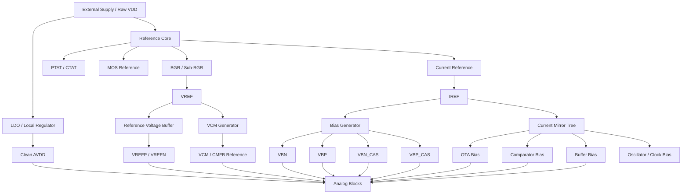
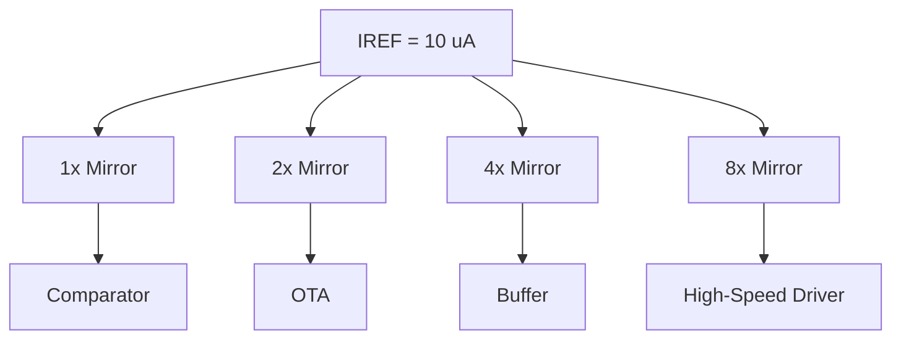
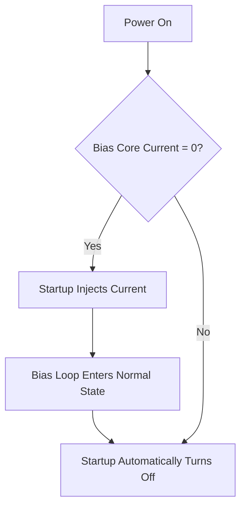
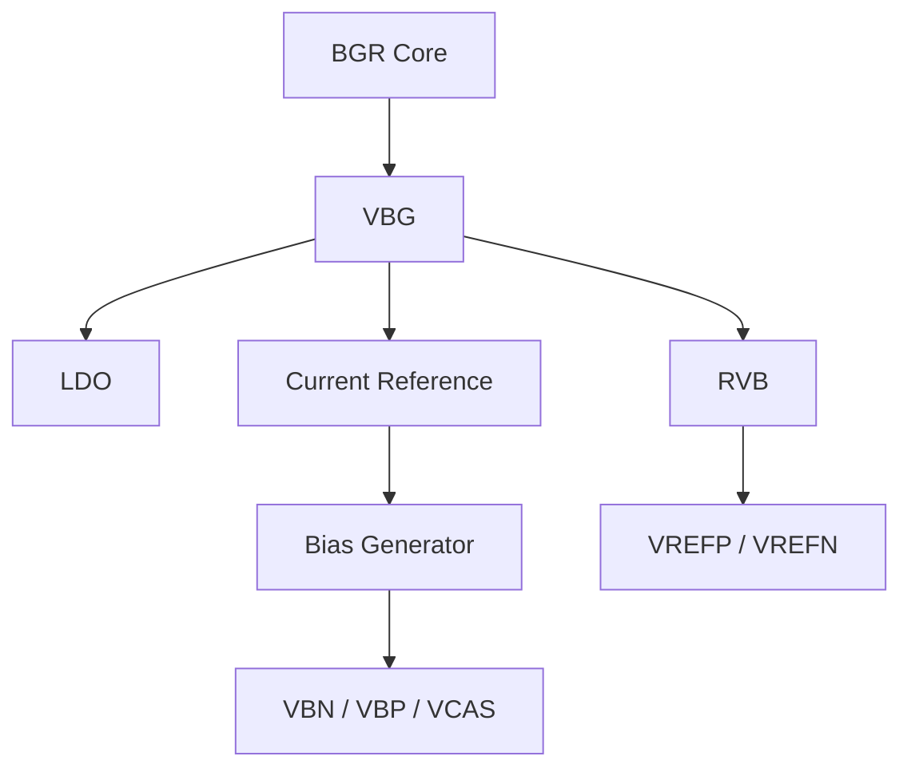
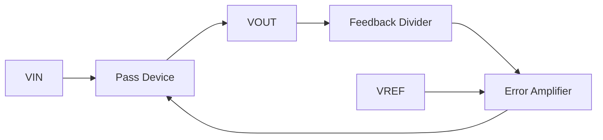
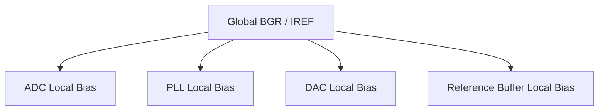

> **阅读主线：** 先从 Power / Reference / Bias 三张网络建立系统认知，再沿“电流源”和“电压源”两条主线深入，最后落到 PVT、噪声、版图和高速 ADC 应用。
>
> 本版采用 **10 个主章节 → 37 个主题小节 → 具体电路知识点** 的层级，而不是把几十个知识点全部并列编号。

# 1. 总论：模拟 IC 偏置系统的统一框架

## 1.1 从 Reference、Power 到 Bias：建立全局视角

### 一句话建立全局认知

模拟 IC 中的偏置系统，本质是在芯片内部建立一组尽可能不受 **Process、Voltage、Temperature、负载、噪声和动态扰动** 影响的参考量，并将这些参考量转换、缓冲、复制和分发到各个模拟模块。

可以把整个系统概括为：


$$
\boxed{
\text{Reference Generation}
\rightarrow
\text{Regulation}
\rightarrow
\text{Buffering}
\rightarrow
\text{Bias Generation}
\rightarrow
\text{Distribution}
\rightarrow
\text{Local Operating Point}
}
$$


对于一个大型 mixed-signal IC，尤其是高速 ADC，可以进一步拆成三张基础设施网络：


$$
\boxed{\text{Power Network}}
$$


$$
\boxed{\text{Reference Network}}
$$


$$
\boxed{\text{Bias Network}}
$$


其中：

- **Power Network**：解决“供电是否干净、稳定”
- **Reference Network**：解决“参考值是否准确、能否驱动动态负载”
- **Bias Network**：解决“晶体管工作点、$g_m$、$V_{OV}$、电流是否合理且 PVT 稳定”

---


### 模拟 IC 偏置系统的总架构



一个很实用的记忆方式是：

- **BGR：准**
- **LDO：稳**
- **RVB：强**
- **Current Mirror：复制**
- **Replica / Self Bias：跟踪**
- **Startup：保证能起来**
- **Local Bias：让模块真正工作在目标工作点**

---


## 1.2 两条主线：电压型偏置与电流型偏置

### 两条主线：电压源与电流源

整个偏置体系可以先分成两大类：

#### 电压型偏置系统

最终产生某个电压量：


$$
\boxed{V_{REF},\;V_{CM},\;V_{BN},\;V_{BP},\;V_{CAS},\;V_{DD,\mathrm{reg}}}
$$


典型模块包括：

- Bandgap Reference
- Sub-Bandgap
- MOS Voltage Reference
- LDO
- Reference Voltage Buffer
- VCM Generator
- Diode-connected MOS Bias
- Cascode Bias
- Replica Bias
- Self-Biased Voltage Generator

#### 电流型偏置系统

最终产生某个电流量：


$$
\boxed{I_{REF},\;I_{BIAS},\;I_{TAIL},\;I_{OTA},\;I_{BUF}}
$$


典型模块包括：

- $V/R$ Current Reference
- PTAT / CTAT Current
- Bandgap-derived Current
- Beta Multiplier
- Constant-$g_m$ Bias
- Basic Current Mirror
- Cascode Mirror
- Wide-Swing Cascode
- Wilson Mirror
- Regulated Cascode
- Adaptive / Dynamic Bias

---


### Reference 与 Bias：必须彻底区分

这是整个知识体系里最容易混淆的概念之一。

#### Reference

Reference 强调：


$$
\boxed{\text{Absolute Accuracy}}
$$


例如：


$$
V_{REF}=0.6000\mathrm{V}
$$


或者：


$$
I_{REF}=10.00\mu\mathrm{A}
$$


关注：

- 温度系数 TC
- 初始误差
- Line Regulation
- PSRR
- Noise
- Long-term Drift
- Supply Range
- Startup

#### Bias

Bias 更强调：


$$
\boxed{\text{Operating Point}}
$$


例如 $V_{BN}=0.43\mathrm{V}$ 本身不一定必须“绝对准确”。

真正关心的往往是：


$$
I_D
$$


$$
g_m
$$


$$
V_{OV}
$$


$$
V_{DS}
$$


$$
g_m/I_D
$$


以及晶体管是否保持在预期工作区。

因此：


$$
\boxed{\text{Reference 更关注 Accuracy}}
$$


$$
\boxed{\text{Bias 更关注 Tracking 与 Operating Point}}
$$


---


## 1.3 偏置为什么决定模拟电路性能

### 为什么偏置决定模拟电路性能

MOS 管的核心关系：


$$
V_{OV}=V_{GS}-V_{TH}
$$


强反型长沟道近似：


$$
I_D=\frac{1}{2}\mu C_{ox}\frac{W}{L}V_{OV}^2
$$


$$
g_m=\frac{2I_D}{V_{OV}}
$$


$$
r_o\approx \frac{1}{\lambda I_D}
$$


于是偏置电流一旦变化，就会改变：

- $g_m$
- $r_o$
- 增益
- 带宽
- 相位裕度
- Slew Rate
- Noise
- 共模范围
- Output Swing
- Settling
- Comparator speed

例如 OTA：


$$
A_v\approx g_mr_o
$$


$$
GBW\approx \frac{g_m}{2\pi C_L}
$$


$$
SR\approx \frac{I}{C_L}
$$


因此偏置系统绝不是“辅助电路”，而是模拟系统性能的底层决定因素。

---


## 1.4 统一功能视角与核心概念辨析

### 横向统一：所有偏置技术到底在解决什么

除了“电压源 / 电流源”的纵向分类，还可以横向按功能分为四类：

#### Reference

解决：


$$
\boxed{\text{值是多少}}
$$


典型：

- BGR
- PTAT
- CTAT
- Beta Multiplier
- MOS Reference

#### Regulation

解决：


$$
\boxed{\text{外界变化时能否保持}}
$$


典型：

- LDO
- Feedback
- RGC
- CMFB

#### Buffering

解决：


$$
\boxed{\text{能不能驱动负载}}
$$


典型：

- SF
- SSF
- FVF
- Class-AB
- RVB

#### Replication / Distribution

解决：


$$
\boxed{\text{如何复制并送到几十个模块}}
$$


典型：

- Current Mirror
- Bias Tree
- Replica Bias
- Local Bias

---


### 三个最容易混淆的关系

#### BGR vs LDO

BGR：


$$
\boxed{\text{产生准确 reference}}
$$


LDO：


$$
\boxed{\text{产生稳定 power rail}}
$$


#### LDO vs RVB

LDO：


$$
\boxed{\text{Regulated Supply}}
$$


RVB：


$$
\boxed{\text{Low-Impedance Precision Reference}}
$$


#### Current Reference vs Current Mirror

Current Reference：


$$
\boxed{\text{定义电流值}}
$$


Current Mirror：


$$
\boxed{\text{复制电流值}}
$$


---


### 理想电压源与理想电流源的对偶关系

理想电压源：


$$
R_{out}=0
$$


所以：

- LDO
- RVB
- Voltage Buffer

都在努力让：


$$
R_{out}\rightarrow0
$$


理想电流源：


$$
R_{out}=\infty
$$


所以：

- Current Mirror
- Cascode
- RGC

都在努力让：


$$
R_{out}\rightarrow\infty
$$


这是理解“电压型 bias”和“电流型 bias”最统一的物理视角。

---


# 2. 电流型偏置：Current Reference 与 Current Mirror

## 2.1 基本电流镜：原理、误差与核心指标

### 电流镜：偏置分发体系的基础

#### 最基本的 MOS 电流镜

一个最基本 NMOS mirror：

- M1 diode-connected
- M2 mirror transistor
- 两管共享 $V_{GS}$

理想情况下：


$$
V_{GS1}=V_{GS2}
$$


因此：


$$
I_{OUT}
=
I_{REF}
\frac{(W/L)_2}{(W/L)_1}
$$


如果尺寸相同：


$$
I_{OUT}=I_{REF}
$$


其本质不是“电流直接复制”，而是：


$$
\boxed{
I_{REF}
\rightarrow
V_{GS}
\rightarrow
I_{OUT}
}
$$


diode-connected MOS 实现：


$$
I\rightarrow V_{GS}
$$


mirror MOS 再实现：


$$
V_{GS}\rightarrow I
$$


---

#### Diode-connected MOS 为什么自然处于饱和区

对于 NMOS：


$$
V_G=V_D
$$


所以：


$$
V_{DS}=V_{GS}
$$


饱和条件：


$$
V_{DS}\geq V_{GS}-V_{TH}
$$


代入：


$$
V_{GS}\geq V_{GS}-V_{TH}
$$


只要器件导通，该条件自然成立。

---

#### Basic Mirror 的主要误差来源

考虑沟道长度调制：


$$
I_D
\approx
\frac12\mu C_{ox}\frac WL V_{OV}^2
(1+\lambda V_{DS})
$$


于是：


$$
\frac{I_{OUT}}{I_{REF}}
\approx
\frac{(W/L)_2}{(W/L)_1}
\frac{1+\lambda V_{DS2}}
{1+\lambda V_{DS1}}
$$


可见：


$$
V_{DS1}\neq V_{DS2}
$$


会直接造成镜像误差。

一个非常重要的结论：

> 高精度电流镜不应该只追求 $V_{GS1}=V_{GS2}$，还应尽可能让 $V_{DS1}=V_{DS2}$、$V_{SB1}=V_{SB2}$。

---

#### 电流镜的核心指标

#### 镜像精度


$$
\frac{I_{OUT}}{I_{REF}}
$$


#### 输出电阻

理想：


$$
r_{out}\rightarrow\infty
$$


基本 MOS：


$$
r_o\approx\frac{1}{\lambda I_D}
$$


#### Compliance Voltage

NMOS 保持饱和：


$$
V_{OUT,min}\approx V_{OV}
$$


#### PVT 稳定性

受：


$$
\mu,\;V_{TH},\;C_{ox},\;\lambda,\;R,\;V_{DD},\;T
$$


影响。

#### Matching

Pelgrom：


$$
\sigma(\Delta V_{TH})
=
\frac{A_{VTH}}{\sqrt{WL}}
$$


通常面积越大匹配越好。

---


## 2.2 高输出阻抗电流镜家族

### Cascode Current Mirror

Cascode 的目标是显著提高：


$$
r_{out}
$$


基本 mirror：


$$
r_{out}\approx r_o
$$


cascode mirror：


$$
r_{out}\approx g_mr_o^2
$$


因此大约提升一个：


$$
g_mr_o
$$


倍。

优点：

- Current accuracy 提高
- PSRR 提高
- Output resistance 提高
- 适合高增益 OTA

缺点：

- Headroom 增大
- 节点数增加
- 高频寄生增加

---


### Wide-Swing Cascode

传统 cascode 在低压工艺中最大问题是 headroom。

Wide-Swing Cascode 的目标是：


$$
\boxed{
r_{out}\uparrow
\quad\text{同时}\quad
V_{headroom}\downarrow
}
$$


理想情况下最低输出电压接近：


$$
V_{OUT,min}\approx 2V_{OV}
$$


而不是浪费额外的：


$$
V_{TH}
$$


对于 1 V 及以下电源，wide-swing bias 是非常关键的低压技术。

---


### Wilson Mirror

Wilson mirror 使用局部负反馈抑制输出电压引起的电流变化。

优点：

- 输出阻抗高
- 镜像精度较高

缺点：

- Headroom 较大
- 高频节点增加
- 高速系统中未必优于 cascode / regulated cascode

---


### Regulated Cascode（RGC）

RGC 通过局部放大器强制镜像管的：


$$
V_{DS}
$$


保持近似恒定。

因此：


$$
\Delta V_{DS}\approx 0
$$


可显著抑制 Channel-Length Modulation。

如果局部放大器增益为 $A$，则：


$$
r_{out}
\sim
A g_mr_o^2
$$


因此可以把 RGC 理解为：


$$
\boxed{\text{Gain-Boosted Cascode Current Source}}
$$


其思想与 Gain-Boosted OTA 本质相通。

---


## 2.3 NMOS/PMOS 镜像、比例缩放与 Bias Tree

### PMOS Mirror 与 NMOS Mirror

NMOS mirror 常用于：


$$
\boxed{\text{Current Sink}}
$$


PMOS mirror 常用于：


$$
\boxed{\text{Current Source}}
$$


所以一个完整模拟 IC 的 bias generator 通常至少需要产生：


$$
V_{BN}
$$


$$
V_{BP}
$$


如果存在 cascode，还可能需要：


$$
V_{BN,CAS}
$$


$$
V_{BP,CAS}
$$


---


### Current Ratio 与 Bias Tree

通过尺寸比例：


$$
\frac{(W/L)_2}{(W/L)_1}=N
$$


即可产生：


$$
I_2=NI_1
$$


因此一个全局：


$$
I_{REF}=10\mu A
$$


可以继续生成：


$$
10\mu A,\;20\mu A,\;40\mu A,\;80\mu A,\;160\mu A
$$


形成：


$$
\boxed{\text{Bias Tree}}
$$


典型结构：



---


## 2.4 Current Reference：从参考量产生基准电流

### Current Reference：电流到底从哪里来

电流镜只能复制电流，不能凭空定义一个绝对参考电流。

因此需要：


$$
\boxed{\text{Current Reference}}
$$


常见方法包括：

1. $V_{REF}/R$
2. PTAT Current
3. CTAT Current
4. Bandgap-derived Current
5. Beta Multiplier
6. Constant-$g_m$ Bias
7. MOS-only Current Reference

---


### 最简单的 $V/R$ Current Reference

如果已有精确：


$$
V_{REF}
$$


可通过：


$$
I_{REF}=\frac{V_{REF}}{R}
$$


产生参考电流。

如果 $V_{REF}$ 来源于 BGR：


$$
\boxed{
BGR
\rightarrow
V_{REF}
\rightarrow
R
\rightarrow
I_{REF}
}
$$


优点：

- 原理简单
- 可获得较好 absolute accuracy

缺点：

- 依赖电阻绝对误差和温度系数
- 面积可能较大
- 需要考虑 opamp / feedback 精度

---


### PTAT 与 CTAT Current

BJT 中：


$$
V_T=\frac{kT}{q}
$$


不同电流密度的 BJT：


$$
\Delta V_{BE}
=
V_T\ln N
$$


于是：


$$
I_{PTAT}
=
\frac{\Delta V_{BE}}{R}
$$


近似：


$$
I_{PTAT}\propto T
$$


而：


$$
V_{BE}
$$


具有 CTAT 特性：


$$
\frac{dV_{BE}}{dT}<0
$$


因此：


$$
I_{CTAT}\approx \frac{V_{BE}}{R}
$$


也具有负温度系数。

二者加权：


$$
I_{REF}
=
aI_{PTAT}+bI_{CTAT}
$$


可得到低温漂 reference current。

---


# 3. 自偏置与偏置电压生成：Self-Bias、Constant-gm 与 Replica Bias

## 3.1 Self-Bias 的统一反馈视角

### Self-Bias：不是一种输出，而是一种建立工作点的方法

Self-bias 不应该单独理解成“某个具体电路”。

其本质是：


$$
\boxed{\text{通过自身反馈建立自身工作点}}
$$


典型闭环关系：


$$
I_{bias}
\rightarrow
V_{bias}
\rightarrow
I_{bias}
$$


也就是说：


典型 self-bias 电路包括：

- Beta Multiplier
- Self-biased Cascode
- Self-biased OTA
- Replica Bias
- CMFB-derived Bias

---


## 3.2 Beta Multiplier 与 Constant-gm Bias

### Beta Multiplier

Beta Multiplier 是最经典的 self-biased current reference。

假设：


$$
\left(\frac WL\right)_2
=
K
\left(\frac WL\right)_1
$$


并且：


$$
I_1=I_2=I
$$


长沟道平方律下：


$$
V_{OV1}
=
\sqrt{
\frac{2I}
{\mu C_{ox}(W/L)_1}
}
$$


$$
V_{OV2}
=
\frac{V_{OV1}}{\sqrt K}
$$


如果两管的 $V_{GS}$ 差落在电阻 $R$ 上：


$$
IR
=
V_{GS1}-V_{GS2}
$$


近似：


$$
IR
=
V_{OV1}
\left(
1-\frac1{\sqrt K}
\right)
$$


整理得到：


$$
\boxed{
I=
\frac{2}{\beta_1R^2}
\left(
1-\frac1{\sqrt K}
\right)^2
}
$$


其中：


$$
\beta_1=\mu C_{ox}\frac WL
$$


---


### Beta Multiplier 的真正本质：Constant-$g_m$

由：


$$
g_m=\frac{2I}{V_{OV}}
$$


结合 beta multiplier 关系可得到：


$$
g_mR
=
2
\left(
1-\frac1{\sqrt K}
\right)
$$


因此：


$$
\boxed{g_mR=\text{constant}}
$$


这说明 beta multiplier 的一个核心价值不是“产生一个完美恒定电流”，而是建立：


$$
\boxed{\text{Constant-}g_m\text{ Bias}}
$$


---


### 为什么高速模拟 IC 更关心 Constant-$g_m$

OTA 带宽：


$$
GBW\approx\frac{g_m}{2\pi C}
$$


如果 $g_m$ PVT 漂移很大，则：

- settling time 漂移
- bandwidth 漂移
- phase margin 漂移
- buffer drive ability 漂移

即使电流恒定：


$$
I_D=\text{constant}
$$


也并不代表：


$$
g_m=\text{constant}
$$


因为：


$$
g_m
=
\sqrt{
2\mu C_{ox}\frac WL I_D
}
$$


而：


$$
\mu=\mu(P,T)
$$


因此 constant-current 不等于 constant-$g_m$。

对于高速 ADC：


$$
\boxed{\text{稳定 } g_m/C \text{ 往往比稳定电流本身更重要}}
$$


---


## 3.3 Startup：自偏置系统必须解决的启动问题

### Startup Circuit

Self-biased circuits 往往存在：


$$
\boxed{I=0}
$$


这一数学稳定点。

原因：


$$
I=0
\Rightarrow
V_{GS}=0
\Rightarrow
MOS\ OFF
\Rightarrow
I=0
$$


因此必须设计 Startup Circuit。

其工作过程：



理想 startup：

- 上电时有效
- 正常偏置建立后自动退出
- 不长期污染 reference
- 不产生明显静态功耗
- PVT 下都能可靠启动

---


## 3.4 Bias Voltage、Cascode Bias 与 Replica Bias

### Bias Voltage Generator

模拟电路经常需要：


$$
V_{BN}
$$


$$
V_{BP}
$$


$$
V_{BN,CAS}
$$


$$
V_{BP,CAS}
$$


这些通常由 reference current 经过 diode-connected MOS、replica branch、wide-swing branch 等方式生成。

最基本：


$$
I_{REF}
\rightarrow
V_{GS}
$$


因此：


$$
V_{BN}=V_{GS,N}
$$


对于 PMOS：


$$
V_{BP}=V_{DD}-V_{SG,P}
$$


---


### Cascode Bias Generator

假设主支路有：

```text
VOUT
 |
Mcas
 |
Mmain
 |
GND
```

就必须提供：


$$
V_{BN,CAS}
$$


使：


$$
M_{main}
$$


与：


$$
M_{cas}
$$


都保持在饱和区，同时尽量减少 headroom。

最简单可以用 diode-connected MOS stack，但在低压工艺下：


$$
2V_{GS}
$$


可能太高。

因此现代低压设计更常采用：

- Wide-Swing Cascode Bias
- Replica Bias
- Level-shifted Bias
- Feedback-based Bias

---


### Replica Bias

Replica bias 的核心思想：

> 用一个与主电路尽可能相似的“复制支路”来产生主电路需要的偏置电压。

其主要价值不是绝对准确，而是：


$$
\boxed{\text{PVT Tracking}}
$$


当：


$$
V_{TH}
$$


变化时，replica branch 中的 MOS 与主电路一起变化，从而产生相应变化的：


$$
V_{BIAS}
$$


因此：


$$
\boxed{
\text{Replica Bias}
\rightarrow
\text{Tracking}
}
$$


这一思想特别适合：

- Cascode OTA
- Source Follower
- FVF / SSF
- Reference Buffer
- Class-AB stage
- Dynamic amplifier

---


# 4. 电压基准：Voltage Reference 与 Bandgap Reference

## 4.1 Voltage Reference 的目标与指标

### Voltage Reference

Voltage Reference 的目标是：


$$
V_{REF}\approx \text{constant}
$$


尽量减小：


$$
\frac{\partial V_{REF}}{\partial T}
$$


$$
\frac{\partial V_{REF}}{\partial V_{DD}}
$$


$$
\frac{\partial V_{REF}}{\partial P}
$$


核心指标：

- Initial Accuracy
- Temperature Coefficient
- Line Regulation
- PSRR
- Noise
- Startup
- Supply Voltage Range
- Area
- Power

---


## 4.2 Bandgap 的基本原理与经典架构

### Bandgap Reference（BGR）

Bandgap Reference 是最经典的精密电压基准。

基本思想：


$$
V_{REF}
=
V_{CTAT}
+
K V_{PTAT}
$$


BJT：


$$
V_{BE}
$$


具有 CTAT 特性：


$$
\frac{dV_{BE}}{dT}<0
$$


而：


$$
\Delta V_{BE}
=
V_T\ln N
=
\frac{kT}{q}\ln N
$$


具有 PTAT 特性。

因此：


$$
V_{REF}
=
V_{BE}
+
K\Delta V_{BE}
$$


选择适当 $K$，使：


$$
\frac{dV_{REF}}{dT}\approx 0
$$


经典 bandgap 输出约：


$$
V_{BG}\approx 1.2V
$$


---


### BGR 的经典架构体系

#### Brokaw Cell

特点：

- 经典电压模 Bandgap
- 使用 BJT 电流密度差产生 $\Delta V_{BE}$
- 结构清晰、理论经典

核心：


$$
V_{REF}
=
V_{BE}
+
\frac{R_2}{R_1}\Delta V_{BE}
$$


适合理解：

- PTAT / CTAT 合成
- 运放强制等电位
- BJT 面积比

#### Banba-type Bandgap

适合低压 supply。

经典 BGR 往往要求接近或高于 1.2 V 电源，Banba 思路通过电流域加权或降低输出 reference 电压，实现：


$$
V_{REF}<1.2V
$$


适合先进低压 CMOS。

#### Current-Mode Bandgap

先生成：


$$
I_{PTAT}
$$


和：


$$
I_{CTAT}
$$


再相加：


$$
I_{REF}=I_{PTAT}+I_{CTAT}
$$


最后通过电阻转换：


$$
V_{REF}=I_{REF}R
$$


优点：

- 更适合低压
- 可灵活生成多个 reference
- 便于 current-mode distribution

#### Sub-Bandgap

输出：


$$
V_{REF}<1.2V
$$


例如：


$$
0.5V,\;0.6V,\;0.8V
$$


适合：

- 1 V supply
- 先进工艺
- ADC common-mode / reference

#### CMOS-only Voltage Reference

不依赖寄生 BJT，利用：

- $V_{TH}$
- MOS subthreshold
- mobility / threshold TC
- device ratio

优点：

- CMOS 兼容性高

缺点：

- PVT sensitivity 常更难控制
- absolute accuracy 往往不如成熟 BGR

---


## 4.3 BGR 在完整模拟 IC 中的位置

### BGR 在整个芯片中的位置

一个重要认识：


$$
\boxed{\text{BGR 通常只是 Primary Reference}}
$$


它一般不直接驱动：

- 大负载
- 高速 CDAC
- 大面积 bias network

典型路径：



---


# 5. 电源稳压：LDO 与模拟电源基础设施

## 5.1 LDO 的基本原理、环路与核心指标

### LDO：稳压器，不是基准源

LDO 的本质是：


$$
\boxed{\text{利用 Reference + Negative Feedback 生成稳定 Supply}}
$$


典型结构：



闭环关系：


$$
V_{FB}=V_{REF}
$$


若分压网络：


$$
V_{FB}
=
V_{OUT}
\frac{R_2}{R_1+R_2}
$$


则：


$$
V_{OUT}
=
V_{REF}
\left(
1+\frac{R_1}{R_2}
\right)
$$


---


### LDO 的核心指标

- Dropout Voltage
- Load Regulation
- Line Regulation
- PSRR
- Output Noise
- Quiescent Current
- Load Current
- Transient Response
- Loop Stability
- Output Capacitor Requirement
- Startup / Soft-start
- Power Efficiency

---


## 5.2 BGR、LDO 与 Clean Supply 的关系

### LDO 与 BGR 的关系

可以记成：


$$
\boxed{\text{BGR 给“准值”，LDO 给“稳电源”}}
$$


例如：


$$
V_{RAW}=1.8V
$$


$$
V_{REF}=0.6V
$$


经过 LDO 得到：


$$
V_{AVDD}=1.0V
$$


因此：


$$
\boxed{
BGR
\rightarrow
LDO
\rightarrow
Clean\ AVDD
}
$$


---


# 6. 参考驱动与共模：RVB、SF/SSF/FVF、Class-AB 与 VCM

## 6.1 Reference Voltage Buffer 的定位及其与 LDO 的区别

### Reference Voltage Buffer（RVB）

RVB 是高速 ADC 中最容易被低估的模块之一。

它解决的不是：


$$
\text{“Reference 值准不准”}
$$


而是：


$$
\boxed{\text{Reference 节点能不能在高速动态负载下保持稳定}}
$$


ADC CDAC 每次切换都会产生：


$$
\Delta Q
$$


需要 reference 提供瞬态电流：


$$
i=C\frac{dv}{dt}
$$


如果 reference source 输出阻抗高：


$$
\Delta V_{REF}=Z_{OUT}\Delta I
$$


就会引起：

- reference droop
- code-dependent error
- harmonic distortion
- SFDR degradation
- inter-channel coupling
- settling error

---


### RVB 与 LDO 的关系

两者都具有：


$$
\text{Reference}
\rightarrow
\text{Error/Feedback}
\rightarrow
\text{Output Device}
\rightarrow
\text{Load}
$$


因此二者结构上非常相似。

但是目标不同：

| 项目 | LDO | RVB |
|---|---|---|
| 输出对象 | Supply rail | Precision reference node |
| 负载 | 较连续 | 强脉冲、开关型 |
| DC 电流 | 通常较大 | 可较小 |
| 动态瞬态 | 重要 | 核心 |
| 输出阻抗 | 低 | 极低 |
| 精度 | 高 | 通常更高 |
| Settling | 高 | 通常要求更高 |
| Noise | 重要 | 极重要 |
| CDAC kickback | 非核心 | 核心问题 |

可近似理解为：


$$
\boxed{\text{RVB 是面向高精度 reference load 优化的高速 regulator/buffer}}
$$


---


## 6.2 RVB 输出级家族：SF、SSF、FVF、Push-Pull 与 Class-AB

### RVB 的经典架构

#### Source Follower（SF）

优点：

- 简单
- 速度快
- 输出阻抗相对低

近似：


$$
R_{out}\approx \frac{1}{g_m}
$$


缺点：

- 存在 $V_{GS}$ level shift
- output swing 受限
- DC accuracy 较差
- 负载变化会调制 $V_{GS}$

适合：

- 简单 buffer
- 对绝对 accuracy 要求不高的节点

---

#### Super Source Follower（SSF）

通过局部反馈提高 source follower 的 drive ability，并降低输出阻抗。

相比普通 SF：


$$
R_{out}\downarrow
$$


$$
g_{m,\mathrm{eff}}\uparrow
$$


优点：

- 更强动态驱动
- 更低输出阻抗

适合：

- reference buffer
- internal low-impedance node

---

#### Flipped Voltage Follower（FVF）

FVF 利用局部负反馈调节主输出管电流。

其核心优势：


$$
\boxed{R_{out}\text{ 很低}}
$$


并且：

- headroom 较低
- 可实现较快局部反馈
- 适合低压设计

典型理解：

> 输出变化 → 控制节点变化 → 主晶体管电流迅速调整 → 抵消输出扰动。

---

#### Enhanced / Super FVF

在 FVF 基础上进一步：

- 增加增益
- 增加动态驱动
- 改善 sinking / sourcing 对称性
- 改善稳定性

常用于先进高速 reference buffer。

---

#### Push-Pull Buffer

同时具备：

- Source current
- Sink current

对于 CDAC 来说非常重要，因为 reference node 可能需要双向动态电荷交换。

---

#### Class-AB Buffer

静态：


$$
I_Q
$$


较小。

大信号瞬态时：


$$
I_{OUT}\gg I_Q
$$


因此兼顾：

- 低静态功耗
- 高动态 drive
- 大 slew rate

这类结构特别适合高速 ADC reference buffer。

---

#### Opamp-based RVB

运放闭环跟随：


$$
V_{OUT}\approx V_{REF}
$$


优点：

- DC accuracy 高
- 可利用高 loop gain 降低输出阻抗

缺点：

- 高频 settling 受 loop bandwidth 限制
- 稳定性设计复杂
- 大动态负载可能造成 slew / recovery 问题

---


## 6.3 RVB 的核心 trade-off 与动态偏置

### RVB 的核心设计矛盾

RVB 同时需要：

1. 高 DC 精度
2. 低输出阻抗
3. 大瞬态电流
4. 高带宽
5. 低噪声
6. 低功耗
7. 高 PSRR
8. 稳定

这些指标往往冲突。

例如：

提高静态偏置电流：


$$
I_Q\uparrow
$$


可提高：


$$
g_m\uparrow
$$


从而降低：


$$
R_{out}
$$


并改善 settling。

但代价是：


$$
P\uparrow
$$


因此现代 RVB 很常见：


$$
\boxed{\text{Class-AB / Adaptive Bias / Dynamic Current Boosting}}
$$


---


### Adaptive Bias / Dynamic Bias

基本思想：


$$
I_{bias}
=
I_Q
+
f(V_{error})
$$


静态：


$$
V_{error}\approx0
$$


因此：


$$
I\approx I_Q
$$


当负载突然变化：


$$
|V_{error}|\uparrow
$$


于是：


$$
I_{bias}\uparrow
$$


使：


$$
SR=\frac{I}{C}
$$


显著提高。

---


## 6.4 VCM Generator 与 CMFB

### VCM Generator

高速 ADC 除了：


$$
V_{REFP},\;V_{REFN}
$$


通常还需要：


$$
V_{CM}
$$


用途：

- 输入共模
- CDAC 共模
- MDAC 共模
- Comparator input common-mode
- OTA common-mode
- CMFB reference

典型实现：

#### Divider


$$
V_{CM}=\frac{1}{2}V_{DD}
$$


#### Reference-derived


$$
V_{CM}=kV_{REF}
$$


#### DAC-generated

#### Buffered VCM

实际高速 ADC 中通常需要：


$$
\boxed{\text{VCM Buffer}}
$$


因为大量开关会扰动共模节点。

---


### CMFB 与 Bias 的关系

Fully Differential OTA 的输出共模需要 Common-Mode Feedback。

逻辑：


$$
V_{CM,out}
\rightarrow
CMFB
\rightarrow
V_{bias}
\rightarrow
I_{pullup/pulldown}
\rightarrow
V_{CM,out}
$$


因此 CMFB 从本质上也属于：


$$
\boxed{\text{通过反馈建立偏置工作点}}
$$


可以视为一种系统级 self-bias loop。

---


# 7. 偏置分发与系统完整性：PSRR、Noise、PVT 与动态扰动

## 7.1 Global Bias、Local Bias 与 Bias Line Decoupling

### Bias Distribution：Global Bias 与 Local Bias

大型 mixed-signal IC 中：


$$
\boxed{\text{Global Reference + Local Bias}}
$$


通常比全芯片拉一根 $V_{BN}$ 更可靠。

原因：

- 降低长 bias line 的噪声耦合
- 降低 IR drop
- 减小 ground bounce sensitivity
- 改善局部 PVT tracking
- 方便 power gating
- 方便模块级 trimming

典型：



---


### Bias Line Decoupling

Bias node 经常加：


$$
C_{bias}
$$


目的：


$$
Z_{bias}(\omega)\downarrow
$$


使 bias node 在 AC 上更接近：


$$
\boxed{\text{AC Ground}}
$$


有助于减小：

- Clock feedthrough
- Digital coupling
- Supply noise
- Signal-dependent modulation

但需要注意：


$$
\tau=R_{bias}C_{bias}
$$


过大可能导致：

- startup 慢
- power-down recovery 慢
- bias settling 慢

因此存在：


$$
\boxed{\text{Noise Filtering vs Startup / Settling}}
$$


的 tradeoff。

---


## 7.2 PSRR、Bias Noise 与时钟耦合

### Bias PSRR

偏置系统不仅要看输出值，还要看 supply sensitivity。

例如：


$$
\frac{\partial I_{bias}}{\partial V_{DD}}
$$


理想：


$$
\frac{\partial I_{bias}}{\partial V_{DD}}\rightarrow0
$$


简单 current source 因 finite $r_o$：


$$
\Delta I\approx \frac{\Delta V_{DD}}{r_o}
$$


提高：


$$
r_o
$$


即可改善 PSRR。

因此：

- Cascode
- Regulated Cascode
- Feedback
- LDO
- Local filtering

都可以改善 bias PSRR。

---


### Bias Noise

偏置噪声可以通过多个路径进入信号链。

如果：


$$
I_{bias}=I_0+i_n
$$


则：


$$
g_m=g_{m0}+\Delta g_m
$$


信号：


$$
v_{in}
$$


经过：


$$
i_{out}
=
(g_{m0}+\Delta g_m)v_{in}
$$


会产生：


$$
\Delta g_m v_{in}
$$


这属于：


$$
\boxed{\text{Multiplicative Noise / Modulation}}
$$


因此 bias noise 不一定只是简单的 additive noise。

高精度 ADC、PLL、VCO、reference buffer 中尤其需要注意。

---


### Bias Node 被时钟污染

在高速 ADC 中，即使 DC operating point 正常，也不能说明 bias 设计成功。

例如：


$$
V_{BN,DC}=0.55V
$$


但如果每个采样周期出现：


$$
5mV
$$


的 clock-induced ripple，就可能造成：

- $g_m$ 调制
- sampling-dependent settling error
- harmonic spur
- interleaving spur
- reference modulation

因此 bias 必须进行 transient 仿真，而不能只做 DC。

---


## 7.3 PVT 与温度补偿：到底应该稳定什么

### PVT 下偏置的变化

#### Process

FF：

- mobility 通常高
- 器件速度快
- 电流可能偏大

SS：

- mobility 较低
- 器件速度慢
- settling 更危险

#### Temperature

通常：


$$
\mu\propto T^{-m}
$$


随温度升高下降。

而：


$$
V_{TH}
$$


通常随温度升高下降。

因此 $I_D(T)$ 是多个效应竞争的结果。

#### Supply

finite output resistance 会造成：


$$
I_D=f(V_{DD})
$$


因此偏置需要检查：

- $V_{DD,min}$
- $V_{DD,typ}$
- $V_{DD,max}$

---


### 偏置不一定追求“电流完全恒定”

这是一个非常重要的高级设计观念。

不同电路真正需要稳定的量可能不同：

#### Precision Reference

希望：


$$
I_{bias}\approx constant
$$


#### OTA

可能更希望：


$$
g_m\approx constant
$$


#### RC / $g_m-C$ Circuit

可能希望：


$$
g_mR\approx constant
$$


#### High-Speed Dynamic Circuit

甚至可能希望温度升高时：


$$
I_{bias}\uparrow
$$


以补偿 mobility 下降和速度降低。

因此现代 bias design 的问题不是：

> “如何让电流完全不变？”

而应该先问：

> “主电路真正需要稳定的物理量是什么？”

---


### PTAT Bias 作为速度补偿

PTAT：


$$
I_{PTAT}\propto T
$$


当温度升高时：


$$
I\uparrow
$$


可部分补偿：


$$
\mu(T)\downarrow
$$


从而使：


$$
g_m
$$


或者：


$$
GBW
$$


更加稳定。

这种方法在高速 analog front-end 中非常实用。

---


## 7.4 Bias Loop Stability 与 Power-Down

### Bias Loop Stability

复杂 self-biased circuit 本质上也是反馈系统。

可以定义：


$$
T(s)=A(s)\beta(s)
$$


若 bias loop 中存在多个高阻节点：


$$
\angle T(j\omega)\rightarrow -180^\circ
$$


并且：


$$
|T(j\omega)|>1
$$


就可能发生振荡。

因此：


$$
\boxed{\text{复杂 Self-Bias 不仅要做 DC，还要做 Loop Stability Analysis}}
$$


特别是：

- self-biased OTA
- adaptive bias
- CMFB
- reference buffer
- RGC
- class-AB loop

---


### Bias Power-Down

现代芯片几乎都需要：


$$
PWD / EN
$$


需要关注：

- bias branch 能否完全关断
- 是否产生 floating node
- startup 是否需要重新触发
- 大 bias capacitor 的恢复时间
- power-down 后是否有 leakage
- enable 切换时是否产生 glitch

尤其高速 ADC 中，power-up 后要检查：


$$
\boxed{\text{Reference Settling + Bias Settling + Clock Settling}}
$$


---


# 8. 先进工艺与器件级实现：gm/ID、版图、匹配与 Monte Carlo

## 8.1 gm/ID、反型区与 Gain-Speed-Power Tradeoff

### $g_m/I_D$ 方法与现代 Bias Design

在 28 nm 等先进工艺中，平方律模型不够准确。

由于：

- Velocity Saturation
- Mobility Degradation
- DIBL
- Short-Channel Effect
- CLM
- Body Effect

实际设计更适合采用：


$$
\boxed{g_m/I_D}
$$


方法。

典型设计流程：

1. 确定目标 $g_m$
2. 选择工作区对应的 $g_m/I_D$
3. 得到所需电流：


$$
I_D=\frac{g_m}{g_m/I_D}
$$


4. 根据 PDK 的：


$$
I_D/W
$$


确定 $W$

5. 检查：


$$
g_m/g_{ds}
$$


$$
C_{gg}
$$


$$
f_T
$$


$$
V_{DSsat}
$$


---


### 弱、中、强反型与 Bias

#### Weak Inversion


$$
g_m/I_D\approx20\sim30\ V^{-1}
$$


特点：

- 低功耗
- 高 transconductance efficiency
- 速度较低

#### Moderate Inversion


$$
g_m/I_D\approx10\sim20\ V^{-1}
$$


通常是：


$$
\boxed{\text{Power / Speed / Gain 的均衡区}}
$$


#### Strong Inversion


$$
g_m/I_D\approx5\sim10\ V^{-1}
$$


特点：

- 高速
- 功耗较高
- $V_{OV}$ 较大
- intrinsic gain 较低

高速 ADC 的高速路径常落在 moderate 到 strong inversion。

---


### 偏置电流与 Gain-Speed-Power Tradeoff

增加：


$$
I_D
$$


通常：


$$
g_m\uparrow
$$


因此：

- bandwidth ↑
- slew rate ↑
- thermal noise ↓

但同时：


$$
r_o\downarrow
$$


并且：


$$
P\uparrow
$$


若 $V_{OV}$ 增加，则：


$$
g_mr_o
$$


可能下降。

因此形成经典：


$$
\boxed{\text{Gain-Speed-Power-Headroom Tradeoff}}
$$


---


## 8.2 版图匹配：几何、比例、沟道长度与 Body Effect

### 电流镜的版图匹配

高精度 mirror 需要：

#### Same Geometry


$$
W,\;L
$$


一致。

#### Same Orientation

降低：

- STI stress
- Well proximity
- LOD effect
- Directional gradient

#### Common Centroid

例如：

```text
A B
B A
```

#### Dummy

例如：

```text
D A B B A D
```

#### Proximity

镜像器件靠近。

#### Identical Surroundings

确保：

- guard ring
- well edge
- metal density
- dummy poly
- diffusion environment

尽可能一致。

---


### Current Ratio 的版图实现

例如：


$$
I_2=4I_1
$$


更推荐采用 unit device：

- A = 1 unit
- B = 4 units

然后 interdigitate / centroid，而不是简单画一个 4 倍宽的单大管。

这样可以改善：


$$
\boxed{\text{Ratio Matching}}
$$


---


### 为什么 Bias MOS 常用较长沟道

偏置管常采用：


$$
L>L_{min}
$$


原因：

- $\lambda\downarrow$
- $r_o\uparrow$
- intrinsic gain ↑
- CLM ↓
- DIBL ↓
- matching 改善

高速 signal-path 可能使用：


$$
L=L_{min}
$$


而 bias / current source MOS 可能：


$$
L=2L_{min}\sim5L_{min}
$$


甚至更长。

代价：

- Area ↑
- parasitic capacitance ↑
- bandwidth ↓

---


### Body Effect 对 Bias Matching 的影响

阈值：


$$
V_{TH}
=
V_{TH0}
+
\gamma
\left(
\sqrt{2\phi_F+V_{SB}}
-
\sqrt{2\phi_F}
\right)
$$


因此：


$$
V_{SB1}\neq V_{SB2}
$$


时，即使：


$$
V_{GS1}=V_{GS2}
$$


也可能：


$$
I_1\neq I_2
$$


所以高精度镜像要尽量满足：


$$
\boxed{
V_{GS1}\approx V_{GS2}
}
$$


$$
\boxed{
V_{DS1}\approx V_{DS2}
}
$$


$$
\boxed{
V_{SB1}\approx V_{SB2}
}
$$


---


## 8.3 误差预算与 Monte Carlo

### 电流镜误差的统一分解

可以近似写成：


$$
\epsilon_I
=
\epsilon_{CLM}
+
\epsilon_{VTH}
+
\epsilon_{\beta}
+
\epsilon_{body}
+
\epsilon_{IR}
+
\epsilon_{T}
$$


分别对应：

- Channel-Length Modulation
- Threshold mismatch
- Mobility / geometry mismatch
- Body effect
- Routing IR drop
- Temperature gradient

---


### Monte Carlo 应该看什么

偏置电路 MC 不应该只看：


$$
I_{bias}
$$


还应该看：

- $V_{BN}$
- $V_{BP}$
- $V_{CAS}$
- $g_m$
- $V_{OV}$
- $V_{DSsat}$
- startup success rate
- headroom
- local branch current ratio

例如：


$$
I=100\mu A
$$


若：


$$
\sigma_I=4\mu A
$$


则：


$$
\frac{\sigma_I}{I}=4\%
$$


需要进一步判断这种波动对：

- settling
- gain
- noise
- speed

是否可接受。

---


## 8.4 先进 CMOS 工艺下的 Bias Design

### Advanced Process 下 Bias Design 的变化

先进工艺下：

#### $r_o$ 更低

导致：

- basic mirror 精度差
- current source 更依赖 feedback / cascode

#### Supply 更低

导致：

- stack 数量受限
- traditional cascode 难使用
- wide-swing / low-voltage bias 更重要

#### Mismatch 更显著

需要：

- 面积
- calibration
- trimming

#### Leakage 增加

尤其 startup / low-current reference 需要注意。

#### DIBL / body effect 更强

简单模型失效。

因此现代 bias 更倾向：


$$
\boxed{
\text{Low-Voltage}
+
\text{Feedback}
+
\text{Replica}
+
\text{Digital Trim}
}
$$


---


# 9. 高速高精度 ADC 中的 Power–Reference–Bias 联合设计

## 9.1 ADC 的 Power、Reference、Bias 三条基础设施主干

### 高速 ADC 中的三条基础设施主干

对于高速 ADC，可以把整个模拟基础设施分成：

#### Power Path


$$
\boxed{
External\ Supply
\rightarrow
LDO
\rightarrow
AVDD
}
$$


主要影响：

- supply noise
- spur
- comparator
- amplifier
- clock buffer
- reference

#### Reference Path


$$
\boxed{
BGR
\rightarrow
RVB
\rightarrow
VREFP/VREFN
\rightarrow
CDAC
}
$$


主要影响：

- ADC gain
- linearity
- SFDR
- reference settling
- code-dependent error
- reference noise

#### Bias Path


$$
\boxed{
BGR/BetaMultiplier
\rightarrow
IREF
\rightarrow
Bias\ Generator
\rightarrow
VBN/VBP
\rightarrow
OTA/Comparator/Buffer
}
$$


主要影响：

- speed
- $g_m$
- gain
- noise
- power
- PVT robustness

---


## 9.2 Reference Path：RVB、CDAC 与动态参考误差

### 高速 ADC 中 Reference Path 的重点

ADC reference 最关键的是：


$$
\boxed{\text{Static Accuracy + Dynamic Accuracy}}
$$


Static：

- DC reference value
- gain error
- offset

Dynamic：

- output impedance
- settling
- CDAC kickback recovery
- large transient current
- inter-channel disturbance

一个 reference 电压非常“准”，并不代表能直接用于高速 ADC。

如果：


$$
R_{out}=10k\Omega
$$


那么即使 $V_{REF}$ DC 非常精确，也几乎无法直接驱动高速 CDAC。

---


### Reference Buffer 与 CDAC 的关系

CDAC switching 需要电荷：


$$
\Delta Q=C\Delta V
$$


如果在：


$$
\Delta t
$$


时间内完成：


$$
I_{avg}\approx \frac{\Delta Q}{\Delta t}
$$


瞬态峰值可能远大于静态平均电流。

Reference droop：


$$
\Delta V
\approx
\frac{\Delta Q}{C_{decap}}
$$


因此 RVB 设计需要综合：

- output stage drive
- local decap
- routing parasitic
- switching sequence
- reference settling time

---


## 9.3 Bias Path：OTA、Comparator、Dynamic Amplifier 与 RVB

### 高速 ADC 中 Bias Path 的重点

对于：

- MDAC OTA
- CDRA
- ring amplifier
- input buffer
- comparator preamp
- reference buffer

偏置真正需要保证的是：


$$
g_m
$$


$$
V_{OV}
$$


$$
SR
$$


$$
BW
$$


而不是简单：


$$
I_{bias}=constant
$$


因此：


$$
\boxed{
\text{Constant-}g_m
+
\text{Replica Bias}
+
\text{Adaptive Bias}
}
$$


往往比简单固定电流更有意义。

---


### Comparator Bias

Comparator preamp / latch 的偏置决定：

- regeneration speed
- input-referred noise
- kickback
- gain
- metastability probability
- power

增加 bias：


$$
g_m\uparrow
$$


通常速度提高，但功耗和 kickback 可能增加。

高速同步 SAR 中，偏置还要保证 worst-case PVT 下比较在固定时钟周期内完成。

---


### OTA / MDAC Bias

OTA bias 决定：


$$
GBW\approx \frac{g_m}{C}
$$


$$
SR=\frac{I}{C}
$$


$$
A_v\approx g_mr_o
$$


所以需要权衡：

- gain
- bandwidth
- slew
- output swing
- power
- PVT

对于有限放大时间的 pipeline / pipeline-SAR：


$$
\boxed{\text{Bias 是 Settling Budget 的核心参数之一}}
$$


---


### Ring Amplifier / Dynamic Amplifier 的 Bias

动态放大器可能不使用传统静态 bias，但仍存在：

- precharge level
- initial current
- common-mode bias
- replica timing
- dynamic current shaping

所以“动态电路没有偏置”是错误的。

只是 bias 从：


$$
\text{static DC bias}
$$


变成：


$$
\text{time-varying operating-point control}
$$


---


### Reference Buffer Bias

RVB 常用：

- Class-AB
- Adaptive Bias
- Dynamic Boost
- Replica Bias
- FVF local loop

目标是：


$$
I_Q\text{ 小}
$$


但：


$$
I_{peak}\text{ 大}
$$


这和普通 OTA bias 设计思路不同。

---


## 9.4 高速 ADC 偏置设计的核心结论

### 对高速高精度 ADC 最重要的结论

#### 结论 1：偏置不等于“几个 VBN/VBP”

完整 bias infrastructure 应包括：


$$
\boxed{
\text{Reference}
+
\text{Power Regulation}
+
\text{Reference Buffering}
+
\text{Bias Generation}
+
\text{Bias Distribution}
}
$$


#### 结论 2：高速 ADC 必须同时看三条网络


$$
\boxed{\text{Power}}
$$


$$
\boxed{\text{Reference}}
$$


$$
\boxed{\text{Bias}}
$$


很多 SFDR、settling、noise、PVT 问题最终都能追溯到这三者。

#### 结论 3：Reference 的“准”和“强”是两回事

BGR 可以很准，但不一定能驱动 CDAC。

因此：


$$
\boxed{
BGR
\neq
RVB
}
$$


#### 结论 4：恒定电流不一定是最优偏置目标

高速模块经常真正需要稳定的是：


$$
g_m
$$


$$
g_m/C
$$


$$
g_mR
$$


$$
V_{OV}
$$


而不是单纯：


$$
I_D
$$


#### 结论 5：先进工艺更强调 tracking 而非绝对电压

因此：


$$
\boxed{
\text{Replica Bias}
+
\text{Constant-}g_m
+
\text{Local Bias}
}
$$


的重要性明显提高。

---


# 10. 设计方法、仿真验证与最终知识体系

## 10.1 完整仿真验证清单

### Bias 电路的完整仿真清单

#### DC Operating Point

检查：

- 每个 branch current
- $V_{GS}$
- $V_{DS}$
- $V_{DSsat}$
- $V_{OV}$
- $g_m$
- $g_m/I_D$
- $r_o$

#### PVT

至少检查：

- TT / FF / SS / FS / SF
- $V_{DD,min}$
- $V_{DD,max}$
- $T_{min}$
- $T_{max}$

#### Startup

检查：

- zero-current state
- power ramp
- fast/slow supply ramp
- PVT startup
- enable re-start

#### AC / PSRR

检查：

- supply-to-bias transfer
- bias output impedance
- loop stability

#### Noise

检查：

- reference noise
- current noise
- $1/f$
- thermal noise
- noise transfer to main signal path

#### Transient

检查：

- clock feedthrough
- kickback
- switching ripple
- bias recovery
- load transient

#### Monte Carlo

检查：

- mean
- sigma
- tail cases
- startup yield
- branch ratio mismatch

---


## 10.2 从指标到电路的系统设计流程

### Bias 电路的系统设计流程

#### Step 1：定义主电路真正需要稳定的量

问：


$$
I_D?
$$


$$
g_m?
$$


$$
V_{OV}?
$$


$$
g_mR?
$$


$$
V_{CM}?
$$


还是：


$$
V_{REF}?
$$


不要一上来就“先定一个电流”。

---

#### Step 2：确定 reference 类型

选择：

- BGR
- Sub-BGR
- MOS-only
- PTAT
- CTAT
- $V/R$
- Beta Multiplier
- Constant-$g_m$

---

#### Step 3：确定 global reference

例如：


$$
V_{REF}=0.6V
$$


或者：


$$
I_{REF}=10\mu A
$$


---

#### Step 4：建立 bias tree

通过 current ratio：


$$
1\times,\;2\times,\;4\times,\;8\times
$$


产生不同模块所需电流。

---

#### Step 5：生成 local bias voltages

例如：


$$
V_{BN}
$$


$$
V_{BP}
$$


$$
V_{BN,CAS}
$$


$$
V_{BP,CAS}
$$


---

#### Step 6：选择是否需要 replica

若主电路 PVT 敏感，应考虑：


$$
\boxed{\text{Replica Bias}}
$$


---

#### Step 7：检查 headroom

每个器件：


$$
V_{DS}>V_{DSsat}
$$


并且必须检查 worst-case corner。

---

#### Step 8：检查 startup

任何 self-bias：


$$
\boxed{\text{都要主动证明零电流状态无法长期停留}}
$$


---

#### Step 9：检查 PVT + MC

不能只看 TT。

---

#### Step 10：检查 AC + transient

确认 bias node 真正“安静”。

---


## 10.3 架构选择与完整分类

### 典型偏置架构选择指南

| 需求 | 优先结构 |
|---|---|
| 最简单低功耗 bias | Basic Mirror |
| 高输出阻抗 | Cascode / RGC |
| 低压高输出阻抗 | Wide-Swing Cascode |
| 高精度 reference current | BGR + V/R |
| 不依赖 BGR 的自偏置 | Beta Multiplier |
| PVT 下稳定带宽 | Constant-$g_m$ |
| 主电路 tracking | Replica Bias |
| 高动态驱动 | Adaptive / Class-AB |
| 高速 reference drive | FVF / SSF / Class-AB RVB |
| 干净电源 | LDO |
| 精密绝对电压 | BGR / Sub-BGR |
| 高速 ADC common-mode | Buffered VCM |

---


### 模拟 IC 偏置体系的最终分类表

| 大类 | 子类 | 核心作用 | 典型电路 |
|---|---|---|---|
| Voltage Reference | 精密电压 | 定义绝对电压 | BGR、Sub-BGR |
| Current Reference | 精密电流 | 定义绝对电流 | $V/R$、PTAT、Beta Multiplier |
| Voltage Regulation | 稳压 | 抑制 supply / load variation | LDO |
| Reference Buffer | 驱动 reference | 降低 reference output impedance | SF、SSF、FVF、Class-AB |
| Bias Voltage | 建立 MOS 工作点 | 产生 $V_{BN}/V_{BP}/V_{CAS}$ | diode-connected、replica |
| Current Mirror | 电流复制 | 分发 / 比例缩放 | Basic、Cascode、RGC |
| Self Bias | 自动建立工作点 | PVT tracking | Beta multiplier、self-biased OTA |
| Dynamic Bias | 动态增强 | 提高 slew / drive | Adaptive、Class-AB |
| CMFB / VCM | 共模控制 | 建立共模工作点 | CMFB、VCM buffer |
| Bias Distribution | 系统分发 | Global-to-local | Bias tree、local generator |

---


## 10.4 推荐学习顺序

### 推荐的学习顺序

如果系统学习模拟 IC 偏置，建议按以下顺序：

1. MOS $I_D-V_{GS}$、$g_m$、$r_o$、$V_{OV}$
2. Basic Current Mirror
3. Cascode / Wide-Swing / RGC
4. Bias Voltage Generator
5. Beta Multiplier
6. Startup
7. Constant-$g_m$
8. PTAT / CTAT
9. Bandgap Reference
10. Replica Bias
11. LDO
12. SF / SSF / FVF
13. Reference Voltage Buffer
14. Adaptive / Class-AB Bias
15. Bias Distribution
16. PVT / PSRR / Noise / Monte Carlo
17. Layout Matching
18. 高速 ADC 中的 Power / Reference / Bias 联合设计

---


## 10.5 最终总知识树与一句话总结

### 最终总知识树

```mermaid
flowchart TD
    ROOT[Analog IC Bias / Reference Infrastructure]

    ROOT --> P[Power]
    ROOT --> V[Voltage]
    ROOT --> I[Current]
    ROOT --> S[System Distribution]

    P --> P1[LDO]
    P --> P2[Local Regulator]
    P --> P3[PSRR / Decoupling]

    V --> V1[Voltage Reference]
    V --> V2[Voltage Buffer]
    V --> V3[Bias Voltage]
    V --> V4[VCM]

    V1 --> V11[BGR]
    V1 --> V12[Sub-BGR]
    V1 --> V13[MOS Reference]

    V2 --> V21[SF]
    V2 --> V22[SSF]
    V2 --> V23[FVF]
    V2 --> V24[Class-AB RVB]

    V3 --> V31[VBN / VBP]
    V3 --> V32[Cascode Bias]
    V3 --> V33[Replica Bias]

    I --> I1[Current Reference]
    I --> I2[Current Mirror]
    I --> I3[Self Bias]
    I --> I4[Dynamic Bias]

    I1 --> I11[VREF/R]
    I1 --> I12[PTAT / CTAT]
    I1 --> I13[Bandgap Current]
    I1 --> I14[Beta Multiplier]

    I2 --> I21[Basic Mirror]
    I2 --> I22[Cascode]
    I2 --> I23[Wide-Swing]
    I2 --> I24[Wilson]
    I2 --> I25[RGC]

    I3 --> I31[Constant-gm]
    I3 --> I32[Startup]
    I3 --> I33[Self-Biased OTA]

    I4 --> I41[Adaptive Bias]
    I4 --> I42[Class-AB]
    I4 --> I43[Slew Enhancement]

    S --> S1[Global Reference]
    S --> S2[Local Bias]
    S --> S3[Bias Tree]
    S --> S4[Layout / Matching]
    S --> S5[PVT / MC]
```



---


### 最后浓缩成一句话

模拟 IC 的偏置系统可以统一理解为：


$$
\boxed{
\text{先产生一个可信的 Reference，
再通过 Regulation、Buffering、Mirroring、Replica 和 Feedback，
把它转化成各模块所需要的电压、电流、}g_m\text{ 和工作点。}
}
$$


最核心的功能映射是：


$$
\boxed{\text{BGR：准}}
$$


$$
\boxed{\text{LDO：稳}}
$$


$$
\boxed{\text{RVB：强}}
$$


$$
\boxed{\text{Current Mirror：复制}}
$$


$$
\boxed{\text{Replica / Self Bias：跟踪}}
$$


$$
\boxed{\text{Constant-}g_m\text{：稳定速度}}
$$


$$
\boxed{\text{Adaptive / Class-AB：增强动态}}
$$


而在高速 ADC 中，真正成熟的设计视角应该始终同时观察：


$$
\boxed{
\text{Power Network}
+
\text{Reference Network}
+
\text{Bias Network}
}
$$


三者共同决定 ADC 的：

- Noise
- SFDR
- Settling
- Gain
- PVT robustness
- Power
- Reliability

这才是“偏置电路”从器件级走向系统级的完整知识体系。

---


## 10.6 可继续扩展的专题
本文已建立偏置系统总框架。以下是可独立扩展的候选主题；目前它们是选题清单，不代表库中已经存在对应笔记：

- 电流镜与电流基准
- Beta Multiplier 与 Constant-gm Bias
- Startup Circuit
- Bandgap Reference
- LDO 架构与稳定性
- Reference Voltage Buffer
- SF、SSF 与 FVF 对比
- Replica Bias
- VCM 与 CMFB
- Bias Noise 与 PSRR
- 偏置电路的 PVT 与 Monte Carlo
- Bias Layout 与 Matching
- 高速 ADC 的 Power、Reference 与 Bias 联合设计
### 后续可继续扩展的专题
专题条目统一记录在本节上方的候选清单中。确认创建独立笔记后，再从清单转换为内部链接。
## 结构说明

原版中重复出现的若干独立“知识树 / 总架构 / Infrastructure”章节已经并入相应主题，只保留一套最终总图。技术内容仍按原有深度保留，但导航层级更适合 Obsidian 长篇学习笔记。
