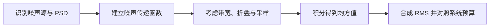

# 电路噪声：从 MOS 器件到系统设计

> [!abstract] 核心定位
> 从系统噪声预算出发，贯通器件噪声、典型模拟电路、采样系统、ADC 和仿真验证方法。

---

> 适用对象：模拟/混合信号集成电路设计，重点面向 CMOS 放大器、比较器、开关电容电路、基准源、振荡器以及高速 ADC。

---

## 目录

- **2026 新增专题**：见文末扩展篇章，含新增推导、文献与配图

1. 系统噪声预算与数学基础
   - 1.1 为什么必须从“系统噪声预算”而不是单个器件开始
   - 1.2 噪声分析的数学基础
2. 物理噪声机制与器件噪声模型
   - 2.1 基本物理噪声机制
   - 2.2 无源器件噪声
   - 2.3 MOS 管的噪声模型
   - 2.4 BJT 噪声简述
3. 基本模拟电路与 OTA 噪声
   - 3.1 基本 MOS 电路的噪声
   - 3.2 OTA 与运算放大器噪声
4. 采样电路与比较器噪声
   - 4.1 开关电容和采样电路噪声
   - 4.2 比较器噪声
5. 系统级模块、ADC 与 DAC 噪声
   - 5.1 具体模拟电路中的噪声
   - 5.2 ADC 中的噪声
   - 5.3 DAC 中的噪声
6. 噪声优化、仿真与版图
   - 6.1 噪声优化的核心方法
   - 6.2 Virtuoso/Spectre 噪声仿真方法
   - 6.3 版图对噪声的影响
7. 数值例子与常见误区
   - 7.1 三个数值例子
   - 7.2 常见误区
8. 高速 Pipeline-SAR 噪声设计流程、结论与参考文献
   - 8.1 面向高速 Pipeline-SAR ADC 的建议性噪声设计流程
   - 8.2 结论
   - 8.3 参考文献

## 1. 系统噪声预算与数学基础

*图：噪声从器件谱密度映射到系统级 RMS 预算的路径。*

### 1.1 为什么必须从“系统噪声预算”而不是单个器件开始

电路中的噪声，本质上是随机过程对信号幅度、相位或采样时刻造成的不确定性。实际设计中，应从系统允许的总噪声出发，将噪声预算逐级分配到前端采样网络、放大器、比较器、参考电压、时钟和后级电路，而不是孤立地追求某一个 MOS 管的最低噪声。

一个典型的噪声设计流程是：

1. 根据目标 SNR、SNDR 或动态范围，计算允许的总输入等效噪声；

2. 将总均方噪声分配给各模块；

3. 将模块噪声进一步分解为器件热噪声、闪烁噪声、采样噪声、参考噪声、时钟抖动等；

4. 通过手算、AC Noise、PSS/PNOISE、Transient Noise 和统计仿真交叉验证；

5. 在版图后重新评估寄生电阻、电容、衬底耦合和时钟耦合带来的噪声变化。

需要首先区分以下三类现象：

|类别|本质|典型表现|主要分析方法|
|---|---|---|---|
|随机噪声|随时间随机变化|连续噪声底、输出码随机抖动、相位噪声|Noise、PNOISE、Transient Noise|
|失配与失调|制造偏差形成的准静态误差|DC offset、增益误差、器件阈值偏差|Monte Carlo mismatch、PVT|
|确定性干扰与非线性|周期性耦合或确定性误差|谐波、时钟杂散、交织 spur、参考纹波|Transient、FFT、PSS、PAC/PXF|

失调不是热噪声，时钟串扰也不是随机噪声。三者可能同时抬高频谱，但优化方法完全不同。

---

### 1.2 噪声分析的数学基础

#### 均方值、方差与 RMS

设随机噪声为 $x_n$(t)，其均值通常近似为零：

$$
\mu_x=E[x_n(t)]\approx 0
$$

噪声功率或方差为：

$$
\sigma_x^2=E[(x_n-\mu_x)^2]
$$

噪声的 RMS 为：

$$
x_{n,\mathrm{rms}}=\sqrt{\sigma_x^2}
$$

电路噪声通常以：

- 电压噪声密度：$\mathrm{V}/\sqrt{\mathrm{Hz}}$

- 电流噪声密度：$\mathrm{A}/\sqrt{\mathrm{Hz}}$

- 功率谱密度：$\mathrm{V}^2/\mathrm{Hz}$、$\mathrm{A}^2/\mathrm{Hz}$

表示。

#### 功率谱密度 PSD

噪声在频域中的分布由功率谱密度 $S_x$(f) 描述。某一频带内的均方噪声为：

$$
\overline{x_n^2}=\int_{f_L}^{f_H}S_x(f)\,df
$$

RMS 噪声为：

$$
x_{n,\mathrm{rms}}=\sqrt{\int_{f_L}^{f_H}S_x(f)\,df}
$$

对白噪声，若 $S_x$(f)=$S_0$，则：

$$
x_{n,\mathrm{rms}}=\sqrt{S_0B}
$$

其中 B=$f_H$-$f_L$。因此白噪声 RMS 随带宽的平方根增加，而不是与带宽线性增加。

#### 单边谱与双边谱

模拟电路教材和 SPICE 工具中常用单边谱，即只积分正频率。通信理论中也可能使用双边谱。两者相差 2 倍功率或 $\sqrt{2}$ 倍幅度密度。使用公式时必须确认定义一致。

#### 噪声经过线性系统

若噪声源 PSD 为 $S_n$(f)，到输出的传递函数为 $H_n$(f)，则：

$$
S_{out}(f)=|H_n(f)|^2S_n(f)
$$

总输出噪声：

$$
v_{n,out}^2=\int_0^{\infty}|H_n(f)|^2S_n(f)\,df
$$

#### 等效噪声带宽 ENBW

对于低通系统，噪声并不是简单积分到 $-3\,\mathrm{dB}$ 带宽。定义等效噪声带宽：

$$
B_{ENBW}=\frac{1}{|H(0)|^2}\int_0^{\infty}|H(f)|^2df
$$

一阶 RC 低通有：

$$
B_{ENBW}=\frac{\pi}{2}f_{-3\mathrm{dB}}
$$

因此把 $-3\,\mathrm{dB}$ 带宽直接代入白噪声积分通常会低估噪声。

#### 非相关噪声的叠加

多个互不相关噪声源应按均方值相加：

$$
v_{n,total}=\sqrt{v_{n1}^2+v_{n2}^2+\cdots+v_{nN}^2}
$$

不能直接把 RMS 幅度相加。

若噪声存在相关性，则还要加入互相关项：

$$
S_{total}=S_1+S_2+2\operatorname{Re}\{S_{12}\}
$$

MOS 高频栅感应噪声与漏极沟道噪声就是典型相关噪声。

#### 输入等效噪声与输出噪声

若信号增益为 $A_v$(f)，输出噪声折算到输入端为：

$$
S_{n,in}(f)=\frac{S_{n,out}(f)}{|A_v(f)|^2}
$$

输入等效噪声便于比较不同增益电路，也便于系统级级联噪声预算。

#### 噪声系数与噪声指数

噪声因子定义为：

$$
F=\frac{\mathrm{SNR}_{in}}{\mathrm{SNR}_{out}}
$$

噪声指数为：

$$
NF=10\log_{10}F
$$

在 RF 接收机中，级联系统常用 Friis 公式：

$$
F_{total}=F_1+\frac{F_2-1}{G_1}+\frac{F_3-1}{G_1G_2}+\cdots
$$

其核心思想与多级 ADC 的输入等效噪声相同：前级增益会抑制后级噪声对系统输入端的贡献。

---

## 2. 物理噪声机制与器件噪声模型

### 2.1 基本物理噪声机制

#### 热噪声

载流子的随机热运动会产生热噪声。它在中等频率范围内通常近似为白噪声，噪声功率与绝对温度成正比。

电阻 R 的开路电压噪声 PSD：

$$
S_{v,R}=4kTR\quad \mathrm{V^2/Hz}
$$

短路电流噪声 PSD：

$$
S_{i,R}=\frac{4kT}{R}=4kTG\quad \mathrm{A^2/Hz}
$$

在带宽 B 内：

$$
v_{n,R}=\sqrt{4kTRB}
$$

其中 k 为玻尔兹曼常数，T 为绝对温度。

设计意义：

- 电阻越大，电压噪声越大；

- 电阻越小，电流噪声越大；

- 降低带宽能有效降低积分热噪声；

- 热噪声功率随温度升高而增大。

#### 散粒噪声

散粒噪声来源于载流子以离散电荷形式跨越势垒，其电流 PSD 为：

$$
S_i=2qI
$$

它常见于：

- PN 结电流；

- BJT 集电极和基极电流；

- 光电二极管；

- MOS 栅漏电和结漏电；

- 亚阈值或弱反型器件的某些等效噪声描述。

#### 闪烁噪声，即 1/f 噪声

闪烁噪声在低频占主导，PSD 近似为：

$$
S(f)\propto\frac{1}{f^{\alpha}},\qquad \alpha\approx 1
$$

MOS 栅输入等效闪烁噪声常用近似式：

$$
S_{v_g,1/f}(f)=\frac{K_f}{C_{ox}^2WLf^{\alpha}}
$$

不同 PDK 的实际模型可能使用不同参数形式，不能机械地把教材公式代替工艺模型。

主要物理解释包括：

- 氧化层/界面陷阱导致载流子数目涨落；

- 迁移率涨落；

- 两种机制的组合及其与偏置条件的耦合。

设计规律：

- 增大 WL 通常能降低输入等效 1/f 噪声；

- 增大沟道长度常比单纯增大宽度更有利，但会牺牲速度和增加电容；

- PMOS 的低频噪声在许多工艺中低于 NMOS，但不是普适定律，必须检查 PDK；

- Chopper、Auto-zero 和 CDS 可以降低低频噪声影响，但会引入开关纹波、噪声折叠或采样噪声。

#### 产生—复合噪声与洛伦兹谱

陷阱俘获和释放载流子会形成产生—复合噪声，其 PSD 常呈洛伦兹形：

$$
S(f)=\frac{S_0}{1+(f/f_c)^2}
$$

低于拐角频率时近似平坦，高于拐角频率后快速下降。

#### 随机电报噪声 RTS/RTN

单个或少数陷阱反复捕获和释放载流子，会使器件电流或阈值呈离散跳变。器件面积越小，单个陷阱的相对影响越明显。先进工艺的小尺寸器件、图像传感器、低频精密前端和小电容动态节点尤其容易受到 RTN 影响。

#### 雪崩噪声

反向偏置结发生碰撞电离时会出现雪崩噪声，其强度可能显著高于普通散粒噪声。正常低压 CMOS 模拟设计应避免结进入雪崩区。

#### 相位噪声和时间抖动

振荡器中的器件噪声会被转换为相位随机扰动。相位噪声常用载波某一偏移频率处的单边带噪声功率表示，单位为 $\mathrm{dBc/Hz}$。

时钟边沿不确定性用 RMS 时间抖动 $\sigma$_t 描述。对于正弦输入，采样抖动限制的 SNR 近似为：

$$
\mathrm{SNR}_{jitter}=-20\log_{10}(2\pi f_{in}\sigma_t)
$$

输入频率越高，时钟抖动要求越严，而采样率本身并不直接出现在这一近似式中。

#### 量化噪声

量化噪声不是器件物理噪声，但在 ADC 中通常和模拟噪声统一进行预算。对于理想均匀量化器且量化误差可近似为均匀分布：

$$
\sigma_q^2=\frac{\Delta^2}{12}
$$

满幅正弦输入时，理想 N 位 ADC：

$$
\mathrm{SNR}_{ideal}\approx 6.02N+1.76\ \mathrm{dB}
$$

这一公式依赖满幅正弦、均匀量化和误差近似白噪声等假设。

---

### 2.2 无源器件噪声

#### 电阻

理想电阻具有热噪声，实际集成电阻还可能存在超额 1/f 噪声。不同电阻类型的方块电阻、寄生电容、电压系数、温度系数和低频噪声差异很大。

设计注意：

- 精密低频电路不能只比较阻值和面积，还要检查 excess noise；

- 高阻节点虽然节省静态电流，但会提高电压热噪声并降低节点极点；

- 偏置网络中的大电阻噪声可能经高增益节点放大；

- 分压电阻的两个噪声源要通过闭环噪声增益折算，不能只看等效并联阻值。

#### 电容

理想电容本身不连续产生热噪声，但任何与电容连接的有损电阻、开关导通电阻、介质损耗和 ESR 都会产生噪声。

当电容通过电阻或 MOS 开关与热源充分达到平衡后，电容上的均方噪声电压为：

$$
\overline{v_n^2}=\frac{kT}{C}
$$

即：

$$
v_{n,rms}=\sqrt{\frac{kT}{C}}
$$

该结果与导通电阻大小无关，但导通电阻决定达到热平衡所需时间和带宽。

#### 电感

理想电感无噪声，实际电感的串联电阻、衬底损耗、涡流损耗会产生热噪声。RF 电路中，电感 Q 值直接影响谐振腔损耗和振荡器相位噪声。

#### MOS 开关

MOS 开关导通时可近似为时变电阻，会产生热噪声。采样结束时，其中一部分噪声被冻结到采样电容上，形成 kT/C 采样噪声。

要区分：

- 热噪声：随机；

- 电荷注入：主要是确定性误差和失配误差；

- 时钟馈通：确定性耦合；

- 开关非线性：产生谐波失真；

- 开关关断时刻抖动：形成采样时间噪声。

---

### 2.3 MOS 管的噪声模型

#### 沟道热噪声

MOSFET 在强反型饱和区的漏极电流噪声常写为：

$$
S_{i_d}=4kT\gamma g_m
$$

其中 $\gamma$ 为沟道热噪声系数。长沟道强反型饱和条件下常用 $\gamma\approx 2/3$，但短沟道、速度饱和、体效应和非准静态效应会使实际值偏离该近似。

仅考虑输入管本身时，输入等效电压噪声密度为：

$$
S_{v,in}=\frac{4kT\gamma}{g_m}
$$

幅度谱密度为：

$$
e_n=\sqrt{\frac{4kT\gamma}{g_m}}
$$

因此降低 MOS 白噪声最直接的方式是提高输入器件的 $g_m$。

##### 提高 $g_m$ 的代价

提高 $g_m$ 可通过：

- 增大偏置电流；

- 增大器件宽度；

- 选择更高 $g_m$/$I_D$ 的反型水平；

- 使用 current reuse 或 inverter-based 结构提高单位电流的总跨导。

但代价包括：

- 功耗增加；

- 输入和内部节点寄生电容增加；

- 带宽和稳定性可能变差；

- 大尺寸开关或输入管可能增加 kickback、时钟负载和驱动功耗；

- 较弱反型虽然 $g_m$/$I_D$ 高，但速度和摆幅能力受限。

#### MOS 闪烁噪声

MOS 管漏极闪烁噪声可写成：

$$
S_{i_d,1/f}=g_m^2S_{v_g,1/f}
$$

其输入等效形式与器件面积大致成反比。对于低频输入级，增大输入对管面积通常是最有效的器件级措施之一。

##### NMOS 与 PMOS

很多体硅 CMOS 工艺中，PMOS 输入对的 1/f 噪声低于 NMOS，因此精密低频放大器常选 PMOS 输入对。但在深亚微米、高 k 金属栅、FinFET 或特殊器件中，该规律可能改变，最终必须依据工艺噪声模型和仿真结果。

#### 栅电阻热噪声

栅极多晶硅和金属互连存在分布电阻，其热噪声在 RF 和高速宽带电路中不可忽略。降低方法包括：

- 多指结构；

- 双边或多点栅接触；

- 缩短单指宽度；

- 使用低阻金属跨接；

- 减小长距离高阻栅走线。

#### 栅感应噪声

高频下，沟道电荷涨落会通过栅电容在栅端感应噪声电流。栅感应噪声与漏极沟道噪声存在相关性，RF LNA、VCO 和高频输入级不能简单按两个独立噪声源相加。

#### 体区和衬底电阻噪声

体区、阱和衬底电阻会产生热噪声，并通过体效应或结电容耦合到漏极电流。深 N 阱、保护环和多点衬底接触可降低衬底阻抗和数字噪声耦合，但其目标主要是降低干扰耦合，不是消除 MOS 本征沟道噪声。

#### PN 结和栅漏电噪声

源/漏结漏电、栅隧穿电流和 ESD/保护结构漏电都会产生散粒噪声。在高温、超低功耗、长积分时间或极小信号电路中可能成为主要噪声源。

#### 工作区对噪声的影响

##### 强反型

- 速度高；

- 沟道热噪声常按 4kT$\gamma$ $g_m$ 建模；

- 单位电流的 $g_m$ 较低。

##### 中等反型

- 常在噪声、速度和功耗之间取得较好折中；

- 适合用 $g_m$/$I_D$ 方法选择工作点。

##### 弱反型

- $g_m$/$I_D$ 高，低功耗下输入等效白噪声可能较低；

- 绝对电流小、速度低、摆幅和泄漏敏感；

- 噪声具有散粒噪声式特征，必须使用连续反型模型和 PDK 模型。

##### 线性区

MOS 管可近似为受控电阻，噪声与沟道电导相关。开关、可变电阻和三极区负载的噪声分析不应直接使用饱和区公式。

#### 器件尺寸的综合影响

##### 增大宽度 W

优点：

- 在相同过驱动电压下增大 $g_m$；

- 降低输入等效热噪声；

- 通常降低 1/f 噪声；

- 降低失配。

代价：

- 增加 $C_{gs}$、$C_{gd}$、扩散电容；

- 增加前级驱动负担；

- 可能增加比较器 kickback；

- 降低某些高阻节点带宽。

##### 增大沟道长度 L

优点：

- 增大面积，通常降低 1/f 噪声和失配；

- 提高输出电阻和本征增益；

- 减弱短沟道效应。

代价：

- 降低速度；

- 增加栅电容；

- 在固定电流下可能改变反型水平和摆幅。

#### 温度影响

热噪声 PSD 中直接含有 T，但晶体管 $g_m$、迁移率、阈值和偏置电流也随温度变化，因此输入等效噪声不一定简单按 $\sqrt{T}$ 缩放。必须进行 PVT 噪声仿真。

---

### 2.4 BJT 噪声简述

尽管 CMOS 电路以 MOS 为主，Bandgap、温度传感器和 BiCMOS 前端中常包含 BJT。

BJT 主要噪声包括：

- 集电极散粒噪声：$S_{i_c}=2qI_C$；

- 基极散粒噪声：$S_{i_b}=2qI_B$；

- 基区电阻热噪声：4kT$r_b$；

- 低频 1/f 噪声。

BJT 在一定电流下可获得较高 $g_m=I_C/V_T$，因此具有较低输入电压白噪声，但存在输入电流噪声和基极电流问题。

---

## 3. 基本模拟电路与 OTA 噪声

### 3.1 基本 MOS 电路的噪声

#### 共源放大器

对于 NMOS 共源级和电阻负载 $R_D$，忽略 $r_o$ 时，增益：

$$
A_v\approx-g_mR_D
$$

输入管沟道噪声折算到输入：

$$
S_{v,in,M1}\approx\frac{4kT\gamma}{g_m}
$$

负载电阻噪声折算到输入：

$$
S_{v,in,R_D}\approx\frac{4kTR_D}{(g_mR_D)^2} =\frac{4kT}{g_m^2R_D}
$$

总输入等效白噪声近似为：

$$
S_{v,in}\approx4kT\left(\frac{\gamma}{g_m}+\frac{1}{g_m^2R_D}\right)
$$

结论：

- 增大输入管 $g_m$ 同时降低管噪声和负载折算噪声；

- 增大 $R_D$ 提高增益并降低负载输入折算噪声，但会降低带宽、压缩摆幅并增大输出节点时间常数；

- 有源负载会引入额外 MOS 沟道噪声。

#### 源极跟随器

源跟随器的电压增益接近 1，因此其自身沟道噪声几乎直接折算到输入。若负载由电流源实现，负载管噪声还会通过主输入管 $g_m$ 折算到输入。

降低源跟随器噪声的方法：

- 提高输入管 $g_m$；

- 降低负载电流源的噪声贡献；

- 减小输出带宽到必要范围；

- 对高速 ADC 输入缓冲，需同时权衡线性度、输入电容、输出驱动能力和热噪声。

#### 差分对

理想对称差分对可抑制共模干扰，但不能消除两只输入管各自不相关的热噪声。

对简单差分对，输入等效差分白噪声常呈：

$$
S_{v,id}\propto\frac{8kT\gamma}{g_m}
$$

具体系数取决于：

- 单端还是差分输出；

- 是否有有源负载；

- 跨导定义；

- 尾电流源是否贡献差模噪声；

- 共模反馈和负载连接方式。

设计规律：

- 输入对管通常是 OTA 输入噪声的第一主导项；

- 尾电流源噪声理想情况下主要表现为共模，但有限输出电阻、失配和非对称会将其转换为差模噪声；

- 有源负载管的噪声通过其 $g_m$ 与输入管 $g_m$ 比值折算到输入；

- 增大输入对 $g_m$ 并减小负载管相对 $g_m$，通常有利于输入等效噪声。

#### 电流镜

电流镜输出噪声包括：

- 参考支路器件噪声；

- 输出支路器件噪声；

- 偏置源噪声；

- 参考节点阻抗引起的噪声转换；

- 镜像比例对噪声的放大。

电流镜不仅复制平均电流，也会把参考支路的一部分噪声复制到输出端。

#### Cascode

Cascode 提高输出电阻和增益，但自身器件也产生噪声。其噪声贡献是否显著取决于该器件噪声到输出的传递函数以及输入级增益。

Cascode 的主要优势不是“没有噪声”，而是：

- 提高前级信号增益；

- 降低某些后级噪声的输入折算；

- 隔离 Miller 电容和输出扰动。

#### 源退化

源退化电阻可以提高线性度和改善输入匹配，但电阻自身产生热噪声，同时有效跨导降低。对于低噪声设计，源退化需要结合噪声系数、线性度和输入匹配统一优化。

#### 反馈电路与噪声增益

闭环电路中，噪声按“噪声增益”而不是信号增益传播。以反相放大器为例：

- 信号增益：-$R_f$/$R_{in}$；

- 运放输入电压噪声对应的闭环噪声增益：1+$R_f$/$R_{in}$。

因此在精密运放设计中，不能仅根据目标信号增益估算输出噪声。

---

### 3.2 OTA 与运算放大器噪声

#### 输入级主导原则

多级放大器总输入等效噪声可类比 Friis 公式：

$$
v_{n,in,total}^2\approx v_{n1}^2+\frac{v_{n2}^2}{A_1^2}+\frac{v_{n3}^2}{A_1^2A_2^2}+\cdots
$$

因此第一增益级最关键。高前级增益可降低后级噪声输入折算，但会增加功耗、寄生极点、稳定性和摆幅压力。

#### 两级 Miller OTA

主要噪声来源：

- 输入差分对沟道热噪声和 1/f 噪声；

- 有源负载噪声；

- 尾电流源噪声；

- 第二级共源管噪声；

- 补偿网络中电阻噪声；

- 偏置电路噪声。

通常第二级噪声会被第一级增益衰减后折算到输入，但在第一级增益有限、输出摆幅大或高频处第一级增益下降时，第二级噪声可能变得重要。

#### Folded-Cascode OTA

主要特点：

- 输入对、电流折叠管和负载电流源均产生噪声；

- 折叠支路电流较大时，折叠管噪声可能显著；

- 输入对管 $g_m$ 与折叠管/负载管 $g_m$ 的比例影响输入等效噪声；

- 适合较大输入共模范围，但噪声效率通常需要仔细优化。

#### Telescopic OTA

Telescopic 架构器件数少、内部节点少，通常能获得较高增益、速度和较好的噪声—功耗效率，但输入/输出摆幅和共模范围受限。

#### Inverter-Based OTA

NMOS 和 PMOS 同时提供跨导：

$$
g_{m,total}=g_{mn}+g_{mp}
$$

在相同电流下可获得较高总跨导，因此具有较好的热噪声效率。但需要解决：

- 共模和偏置稳定；

- PVT 下工作点变化；

- 输入/输出摆幅；

- PMOS/NMOS 噪声的共同贡献；

- 电源噪声耦合。

#### Chopper Stabilization

Chopper 将低频输入信号调制到较高频率，在放大后再解调，使放大器自身的 offset 和低频 1/f 噪声被搬移到斩波频率附近。

优点：

- 对低频 1/f 噪声和失调抑制显著；

- 适合传感器、仪表放大器和低频精密接口。

代价：

- 产生斩波纹波和奇次谐波；

- 开关注入和时钟馈通；

- 输入阻抗调制；

- 需要 ripple reduction loop 或滤波；

- 宽带白噪声不会自动消失。

#### Auto-Zero

Auto-zero 先采样放大器失调和低频噪声，再在信号相位进行抵消。

优点：

- 可显著降低失调；

- 对低频噪声有效。

代价：

- 引入采样电容的 kT/C 噪声；

- 宽带白噪声可能折叠到基带；

- 需要额外时钟相位和存储电容；

- 存在残余失调和电荷注入。

#### CDS

相关双采样通过相邻时刻相减，抑制慢变化的 offset 和低频噪声。其频域等效传递函数具有高通特性，因此能降低低频噪声，但可能增加白噪声带宽和折叠。

---

## 4. 采样电路与比较器噪声

### 4.1 开关电容和采样电路噪声

#### kT/C 采样噪声

采样开关导通足够长时，采样电容上的噪声达到：

$$
v_{n,sample}=\sqrt{\frac{kT}{C_s}}
$$

例如室温 300 K：

- $C=1\,\mathrm{pF}$：约 $64\,\mu\mathrm{V}_{rms}$；

- $C=500\,\mathrm{fF}$：约 $91\,\mu\mathrm{V}_{rms}$；

- $C=100\,\mathrm{fF}$：约 $204\,\mu\mathrm{V}_{rms}$。

在全差分结构中，差分噪声是否为单端结果的 $\sqrt{2}$ 倍，取决于两侧电容、开关和共模采样方式，必须基于完整电路计算。

#### 为什么 kT/C 与开关电阻无关

增大开关电阻会减小瞬时噪声带宽，但延长热平衡时间；减小开关电阻会提高噪声带宽，但缩短建立时间。若采样时间足够长，积分结果仍为 kT/C。

若采样时间不充分，噪声可能低于 kT/C，但同时信号也没有充分建立，不能把欠建立当作噪声优化方法。

#### 噪声折叠

采样是周期时变过程。输入和开关的宽带噪声会以采样频率及其谐波混叠到基带。因此：

- 采样前抗混叠滤波很重要；

- PNOISE 必须包含足够的 sidebands；

- 只积分 0 到 $f_s$/2 的原始连续时间噪声可能低估采样后的基带噪声。

#### 开关电容放大器

SC 放大器噪声来源包括：

- 输入采样 kT/C；

- 反馈和重置开关噪声；

- OTA 热噪声和 1/f 噪声；

- OTA 在不同相位的噪声采样；

- 参考电压噪声；

- 时钟抖动；

- 电容介质损耗和寄生电阻。

OTA 噪声会经过闭环噪声增益和采样操作折算到输出，不能简单使用连续时间 OTA 的积分噪声作为 SC 电路最终噪声。

#### Bottom-Plate Sampling

Bottom-plate sampling 主要用于降低信号相关的电荷注入和时钟馈通，从而改善线性度。它并不会消除基本 kT/C 热噪声。

---

### 4.2 比较器噪声

#### 静态比较器

静态比较器通常由前置放大器和再生锁存器组成。输入等效噪声主要包括：

- 前置放大器输入管热噪声和 1/f 噪声；

- 负载和尾电流源噪声；

- 锁存器噪声折算到输入；

- 参考节点噪声；

- 输入共模和输出负载对增益的影响。

提高前置增益可以衰减锁存器输入折算噪声，也能降低 kickback 传回输入端，但增加功耗、延迟和输入电容。

#### 动态比较器

动态比较器属于强周期时变、非线性、再生电路。其噪声不能完全用一个静态 4kT$\gamma$/$g_m$ 公式描述。

动态比较器噪声经历三个阶段：

1. 复位阶段：内部节点被预充电并建立初始噪声；

2. 前置放大/积分阶段：输入差分信号和器件噪声共同积累；

3. 再生阶段：微小差分电压被指数放大，接近亚稳态时噪声最敏感。

常用输入等效噪声提取方法：

- 多次 Transient Noise，统计在不同输入差分下的输出判决概率；

- 求得误码概率曲线并拟合等效 $\sigma$_n；

- PSS + sampled PNOISE；

- 专用周期噪声分析方法。

#### 比较器噪声、失调和亚稳态的区别

- 失调：输入为零时，器件失配导致判决偏向，属于静态随机变量；

- 热噪声：同一芯片每次判决都会随机变化；

- 亚稳态：有限时间内再生未完成，表现为延迟增大或错误判决；

- kickback：内部大摆幅节点通过寄生电容耦合回输入，主要是确定性扰动，也可能与时钟和数据相关。

#### 比较器低噪声设计

- 增大前置输入对的有效 $g_m$；

- 给予足够的前置积分时间；

- 提高前置增益，降低锁存器噪声折算；

- 增大关键内部节点电容可降低瞬时电压噪声，但会降低速度；

- 减小锁存器对输入端的直接寄生耦合；

- 优化输入管尺寸，而不是无限增大；

- 对高精度级采用更低噪声比较器，对粗量化级可放宽噪声但强调速度和大输入摆幅恢复能力。

---

## 5. 系统级模块、ADC 与 DAC 噪声

### 5.1 具体模拟电路中的噪声

#### Bandgap 基准

Bandgap 的主要噪声源：

- BJT 集电极/基极散粒噪声；

- BJT 基区电阻热噪声和低频噪声；

- PTAT/CTAT 电阻热噪声；

- 运放输入噪声和失调；

- 电流镜噪声；

- 启动电路噪声和电源耦合；

- 输出缓冲噪声。

Bandgap 输出低频噪声常受运放和 BJT 的 1/f 噪声影响，宽带噪声常受电阻和放大器热噪声影响。增大电阻可降低功耗，却会提高电压热噪声；增大电流可降低某些输入等效噪声，却会增加功耗和自热。

优化方法：

- 合理提高核心器件电流密度和输入级 $g_m$；

- 使用大面积低噪声器件；

- 限制输出带宽；

- 对超低频精密应用采用 chopper/auto-zero；

- 将启动电路在稳态充分隔离；

- 使用低噪声滤波节点，但必须验证启动和稳定性。

#### LDO

LDO 输出噪声来源：

- 基准源噪声；

- 误差放大器输入级噪声；

- 反馈分压电阻噪声；

- Pass MOS 沟道噪声和 1/f 噪声；

- 偏置电路噪声；

- 输出电容 ESR 热噪声；

- 电源纹波耦合。

低噪声不等同于高 PSRR：

- 输出噪声描述电路内部随机噪声；

- PSRR 描述输入电源扰动到输出的传递；

- 两者可能由不同节点和频率范围主导。

#### 振荡器和 VCO

振荡器中的噪声会被周期轨迹转换为相位扰动和幅度扰动，其中相位方向没有恢复力，因此相位噪声会持续积累。

主要来源：

- LC tank 损耗电阻热噪声；

- 交叉耦合对沟道噪声；

- 尾电流源噪声；

- 偏置和电源噪声；

- Varactor 和调谐节点噪声；

- Ring oscillator 延迟单元噪声。

Hajimiri–Lee 的脉冲敏感函数思想指出：同一噪声在振荡周期不同相位注入，对相位扰动的影响不同。因此 VCO 噪声优化不仅取决于总噪声，还取决于噪声注入时刻。

#### PLL

PLL 输出相位噪声由多个源通过不同闭环传递函数叠加：

- 参考时钟噪声；

- PFD/Charge Pump 噪声；

- 环路滤波器电阻热噪声；

- VCO 相位噪声；

- 分频器噪声；

- 电源和衬底耦合。

环路带宽以内，参考路径噪声通常更易传到输出；环路带宽以外，VCO 本征相位噪声更难被环路抑制。

#### TIA 和传感器前端

TIA 需要同时考虑：

- 输入电流源的散粒噪声；

- 反馈电阻热噪声；

- 运放输入电压噪声经传感器电容转换形成等效电流噪声；

- 运放输入电流噪声；

- 传感器暗电流和漏电噪声。

高频下，运放电压噪声经总输入电容形成：

$$
i_{n,eq}(f)\approx 2\pi fC_{in}e_n
$$

因此大输入电容会显著恶化高频电流噪声。

---

### 5.2 ADC 中的噪声

#### ADC 总噪声分类

ADC 输出噪声和误差通常包括：

- 量化噪声；

- 输入采样 kT/C 噪声；

- 输入缓冲器噪声；

- 比较器噪声；

- CDAC 和参考驱动噪声；

- 放大器或残差放大器噪声；

- 时钟抖动；

- 数字电源/衬底耦合；

- 交织通道噪声与失配；

- DNL/INL、谐波和 spur 等非噪声误差。

#### 从目标 SNR 反推允许噪声

若差分输入峰峰值为 $V_{pp,diff}$，满幅正弦 RMS 为：

$$
V_{sig,rms}=\frac{V_{pp,diff}}{2\sqrt{2}}
$$

允许总输入等效噪声：

$$
V_{n,rms}=\frac{V_{sig,rms}}{10^{\mathrm{SNR}/20}}
$$

例如 $V_{pp,diff}=$0.8\,$\mathrm{V}$，目标 SNR 为 74 dB：

$$
V_{sig,rms}\approx 0.283\,\mathrm{V}
$$

$$
V_{n,rms}\approx56.4\,\mu\mathrm{V}
$$

这意味着采样、比较器、缓冲器、参考和时钟等所有输入等效随机噪声的均方和必须小于约 $(56.4\,\mu\mathrm{V})^2$，而且还应给非线性、失配和仿真误差留出裕量。

#### SAR ADC

SAR ADC 的主要随机噪声：

1. 输入采样 kT/C；

2. 比较器输入等效噪声；

3. 参考电压及其缓冲器噪声；

4. CDAC 切换过程中参考节点噪声；

5. 时钟抖动；

6. 输入驱动器噪声。

##### CDAC 总电容

采样热噪声对电容的基本约束：

$$
C_{total}\gtrsim\frac{kT}{V_{n,sample}^2}
$$

但实际 CDAC 不能只按 kT/C 选取，还要满足：

- 匹配和 DNL/INL；

- 驱动建立时间；

- 开关线性；

- 参考建立；

- 比较器输入负载；

- 版图寄生和顶板寄生。

##### 比较器噪声与码宽

若比较器输入等效噪声接近 1 LSB，则判决错误概率明显增加。高分辨率 SAR 通常要求比较器 RMS 噪声显著小于 1 LSB，但精确比例应根据目标 BER、冗余、数字校准和系统噪声预算决定。

##### 参考噪声

参考噪声会随 CDAC 位切换被调制，可能呈现为随机噪声，也可能因周期性供电压降形成谐波和码相关误差。参考缓冲器必须同时满足：

- 低输出阻抗；

- 快速瞬态建立；

- 低噪声；

- 对码相关电流脉冲的稳定性。

#### Pipeline ADC 与 Pipeline-SAR

多级 ADC 的输入等效噪声可写为：

$$
V_{n,total}^2=V_{n,1}^2+\frac{V_{n,2}^2}{G_1^2}+\frac{V_{n,3}^2}{G_1^2G_2^2}+\cdots
$$

其中 $G_1$ 为第一级残差增益。

结论：

- 第一级采样网络、比较器和前端缓冲器最关键；

- 后级噪声被前级增益衰减后折算到输入；

- 级间放大器自身的输入等效噪声直接加入第一级残差路径；

- 实际增益误差不会直接成为随机噪声，但会改变后级噪声折算系数并产生失真；

- 冗余可容忍部分比较器失调和建立误差，但不能无代价地消除热噪声。

对于 5+8 Pipeline-SAR，第一级虽然只有约 5 bit 判决，但其采样噪声和级间放大器噪声最终作用于整个 ADC，因此不能只按“5 bit 精度”设计。第一级比较器噪声可结合冗余放宽，但前端采样和残差路径总噪声仍要满足整体 12 bit 左右的系统预算。

#### Flash ADC

Flash ADC 有大量并行比较器。单个比较器噪声会导致门限随机抖动，失配会导致静态门限偏移。大规模并行结构还会带来：

- 输入电容和 kickback 累加；

- 参考梯形电阻噪声；

- 比较器时钟和数字输出耦合；

- bubble error。

#### Sigma-Delta ADC

Sigma-Delta ADC 利用过采样和噪声整形把量化噪声推向带外，但模拟电路热噪声、1/f 噪声、采样噪声和参考噪声未必以同样阶数被整形。

需要区分：

- 量化噪声传递函数 NTF；

- 信号传递函数 STF；

- 各模拟噪声源到输出的独立传递函数；

- 运放有限增益和有限 GBW 引起的噪声泄漏与失真。

#### Time-Interleaved ADC

理想情况下，各通道不相关热噪声形成总体白噪声底。以下误差则主要形成 spur：

- 通道 offset mismatch；

- gain mismatch；

- time-skew mismatch；

- bandwidth mismatch；

- 通道间参考和时钟串扰。

随机采样抖动抬高宽带噪声底，确定性的周期 time skew 则形成与输入频率相关的交织杂散。

#### 时钟抖动示例

对于 $f_{in}=$1\,$\mathrm{GHz}$、$\sigm$a_$t=$100\,$\mathrm{fs}$：

$$
\mathrm{SNR}_{jitter}\approx64.0\,\mathrm{dB}
$$

因此对高输入频率 12 bit ADC，100 fs RMS 时钟抖动通常已经不足以支持理想 12 bit SNR。

---

### 5.3 DAC 中的噪声

DAC 的随机噪声主要包括：

- 参考源噪声；

- 电流源沟道热噪声和 1/f 噪声；

- 电阻阵列热噪声；

- 开关热噪声；

- 输出缓冲器噪声；

- 时钟抖动引起的波形边沿不确定性。

失配和开关时序偏差通常表现为静态非线性、毛刺和谐波，不应全部归入随机噪声。

电流舵 DAC 中，大量电流源噪声会按均方叠加。分段结构可改善动态线性，但 unary 单元数增加，也会带来更多电流源和开关噪声源。

---

## 6. 噪声优化、仿真与版图

### 6.1 噪声优化的核心方法

#### 提高信号建立位置之前的跨导

输入端或第一增益级的 $g_m$ 对总输入等效热噪声最关键。优先把功耗放在最前端通常比平均分配更有效。

#### 限制带宽

白噪声 RMS 与 $\sqrt{B}$ 成正比。无用带宽会直接恶化噪声。可通过：

- 模拟低通；

- 闭环带宽限制；

- 采样后数字滤波；

- Oversampling 与 decimation；

- 降低高阻节点寄生极点之外的噪声增益峰值。

但高速 ADC 必须保证建立精度，因此带宽不能只按噪声最小化。

#### 增大电容

增大采样电容可降低 kT/C，但会：

- 增加输入驱动负担；

- 降低采样速度；

- 增大开关尺寸和时钟功耗；

- 增加参考驱动电流；

- 增加面积。

#### 增大输入器件面积

有利于降低 1/f 噪声和失配，但会增加输入电容。对于高速比较器和输入缓冲器，过大输入管会降低速度并加重 kickback。

#### 选择合适的反型水平

用 $g_m$/$I_D$ 方法可在功耗、速度、噪声、摆幅和面积之间进行系统折中：

- 高 $g_m$/$I_D$：低功耗噪声效率高，但速度较低、器件较大；

- 低 $g_m$/$I_D$：速度高、器件较小，但单位电流跨导低；

- 高速高精度模拟常工作在中等反型到中强反型区。

#### 噪声整形和相关抵消

- Chopper：搬移低频噪声；

- Auto-zero/CDS：采样并相减低频误差；

- Noise shaping：将部分噪声推向带外；

- Correlated noise cancellation：利用相关路径相消；

- Differential：抑制共模干扰，但不消除非相关器件噪声。

#### 改善电源、地和参考

电源纹波和数字地弹跳通常不是本征噪声，但会通过有限 PSRR、衬底和参考节点转化为输出噪声或 spur。措施包括：

- 分离模拟/数字供电网络；

- 局部去耦；

- 低阻参考走线；

- 星形或受控回流路径；

- 参考和时钟屏蔽；

- 深 N 阱和 guard ring；

- 避免数字大电流回路穿过模拟区域。

---

### 6.2 Virtuoso/Spectre 噪声仿真方法

#### AC Noise

适用：

- 偏置点附近近似线性时不变的放大器；

- OTA、LDO 小信号环路、连续时间滤波器；

- 输入/输出等效噪声和器件贡献分析。

关键设置：

- 指定输出节点；

- 指定输入源用于 input-referred noise；

- 选择合理起止频率；

- 查看 integrated noise；

- 查看 noise contribution summary；

- 注意一边谱/积分定义。

普通 Transient 仿真默认不包含器件随机噪声，不能从无噪声 transient 波形的 FFT 得到真实热噪声底。

#### PSS + PNOISE

适用：

- 开关电容电路；

- Mixer；

- 采样保持；

- 动态比较器；

- 周期稳态 ADC 子模块；

- 振荡器相位噪声。

关键点：

- PSS 基频必须与电路真实周期一致；

- 采样系统需考虑噪声折叠；

- sideband 数量不足会低估噪声；

- sampled PNOISE 适合观察特定采样时刻的噪声；

- oscillator PNOISE 可用于相位噪声和 jitter。

#### Transient Noise

适用：

- 强非线性、非周期或复杂时序电路；

- 比较器误码概率；

- ADC 输出码统计；

- 噪声与数字状态相互影响；

- 需要直接观察带噪波形或 FFT。

设置注意：

- Noise Fmax 决定生成噪声的最高频率，并影响最大时间步长；

- Fmax 太低会漏掉高频噪声及其混叠；

- Fmax 过高会显著增加仿真时间；

- 应使用多个随机 seed；

- 统计结果必须有足够样本数；

- 避免把初始条件和启动瞬态混入稳态统计。

#### Monte Carlo

Monte Carlo mismatch 用于失配和工艺散布，不等同于瞬态随机噪声。完整验证通常包括：

- Process Monte Carlo；

- Mismatch Monte Carlo；

- PVT；

- Noise/PNOISE；

- 必要时 Transient Noise + mismatch 联合评估。

#### 比较器噪声仿真建议

可设置一系列小差分输入 $V_{id}$，每个输入运行多次 transient noise，统计输出为 1 的概率：

$$
P(D=1|V_{id})\approx\Phi\left(\frac{V_{id}-V_{os}}{\sigma_n}\right)
$$

拟合得到：

- $V_{os}$：等效失调；

- $\sigma$_n：输入等效 RMS 噪声。

该方法可以清晰分离判决概率中的中心偏移和随机展宽。

#### ADC 顶层噪声仿真

对高速 ADC，直接进行长时间全晶体管 transient noise 往往代价极高。建议分层：

1. 各模拟模块独立提取输入等效噪声；

2. 建立 Verilog-A 行为噪声模型；

3. 顶层行为级进行长序列 FFT 和码域统计；

4. 关键短窗口进行晶体管级 transient noise 验证；

5. 最后用少量后仿真点校正行为模型。

---

### 6.3 版图对噪声的影响

#### 栅电阻和互连电阻

版图后多指器件、长栅走线和接触数量会改变栅电阻噪声。高速输入管应采用多点栅接触和低阻金属连接。

#### 衬底耦合

数字时钟、输出缓冲和大电流开关可通过：

- 衬底电阻；

- 结电容；

- 电源/地网络；

- 互连寄生电容；

- 封装和 bondwire 互感

耦合到模拟节点。

这类干扰常形成离散 spur 或确定性噪声底抬升。保护环、深 N 阱、物理隔离、独立供电和合理回流路径是主要手段。

#### 对称与共心布局

共心和对称布局主要改善：

- 梯度失配；

- 系统性失配；

- 差分耦合不对称；

- 参考和时钟寄生不对称。

它们不会直接降低单个器件的热噪声，但可以避免共模干扰转化为差模噪声。

#### 屏蔽和敏感节点

高阻、小信号节点应：

- 缩短走线；

- 远离时钟和数字翻转线；

- 必要时用安静的 AC ground 屏蔽；

- 避免屏蔽金属增加过大寄生电容；

- 避免与大摆幅内部再生节点平行长距离布线。

#### 去耦电容

去耦电容降低供电网络阻抗和开关瞬态，但其 ESR、ESL 和布置位置决定实际效果。去耦距离过远时，高频电流仍可能通过敏感供电路径流动。

---

## 7. 数值例子与常见误区

### 7.1 三个数值例子

#### 1 kΩ 电阻在 10 MHz 带宽内的热噪声

在 300 K：

$$
v_n=\sqrt{4kTRB}
$$

代入 $R=$1\,$\mathrm{k\Omega}$、$B=$10\,$\mathrm{MHz}$：

$$
v_n\approx12.9\,\mu\mathrm{V}_{rms}
$$

#### MOS 输入管热噪声

若 $g_m=5\,\mathrm{mS}$、$\gamma=2/3$、$T=300\,\mathrm{K}$：

$$
e_n=\sqrt{\frac{4kT\gamma}{g_m}} \approx1.49\,\mathrm{nV}/\sqrt{\mathrm{Hz}}
$$

若简单按 100 MHz 矩形带宽积分：

$$
v_{n,rms}\approx14.9\,\mu\mathrm{V}
$$

实际电路还需乘以频率相关噪声传递函数并加入其他器件噪声。

#### 采样电容约束

若希望采样噪声低于 $50\,\mu\mathrm{V}_{rms}$：

$$
C\ge\frac{kT}{V_n^2}
$$

在 300 K：

$$
C\gtrsim1.66\,\mathrm{pF}
$$

如果采用全差分采样、存在两侧独立噪声或其他噪声预算，则所需总电容还要进一步增大。

---

### 7.2 常见误区

1. **“差分电路可以消除热噪声。”** 只能抑制共模干扰，两侧非相关热噪声会均方相加。

2. **“开关越大，kT/C 越小。”** 开关变大降低导通电阻、加快建立，但充分采样后的基本 kT/C 由电容决定。

3. **“普通 transient FFT 里的底噪就是器件噪声。”** 默认 transient 通常不含器件随机噪声。

4. **“比较器失调和噪声是一回事。”** 失调是固定偏置，噪声是逐次变化的随机量。

5. **“第一级只有 5 bit，所以只需满足 5 bit 噪声。”** Pipeline/Pipeline-SAR 第一级采样与残差噪声会影响整体精度。

6. **“增大所有 MOS 都能降低噪声。”** 大尺寸同时增加寄生电容、降低速度并提高驱动负担。

7. **“噪声源电压直接相加。”** 非相关噪声应按均方相加。

8. **“只看 1 Hz 处噪声密度即可。”** 系统性能取决于经过噪声传递函数后的全带宽积分。

9. **“低输出噪声等于高 PSRR。”** 两者是不同指标。

10. **“PVT 最慢角一定噪声最大。”** 噪声取决于温度、$g_m$、带宽和偏置的共同变化，需实际仿真。

---

## 8. 高速 Pipeline-SAR 噪声设计流程、结论与参考文献

### 8.1 面向高速 Pipeline-SAR ADC 的建议性噪声设计流程

#### 第一步：确定系统允许噪声

根据输入满量程和目标 SNDR/SNR 计算输入等效总噪声上限，并预留量化噪声、谐波、失配和校准残差裕量。

#### 第二步：建立均方噪声预算表

建议至少包含：

- 输入缓冲器；

- 采样网络；

- Stage-1 比较器；

- 级间放大器；

- Stage-2 折算噪声；

- 参考源/参考缓冲器；

- 时钟抖动；

- 其他辅助电路。

预算必须按平方和闭合：

$$
V_{n,total}^2=\sum_iV_{n,i}^2
$$

#### 第三步：优先优化前端

输入缓冲、采样电容、第一级比较器和级间放大器通常决定总噪声。第二级噪声可除以前级增益折算。

#### 第四步：区分热噪声、失调与非线性

- 比较器随机判决扩展：噪声；

- 判决曲线整体偏移：失调；

- 频谱 HD2/HD3：非线性；

- 固定交织频点 spur：通道失配；

- 全带噪声底随输入频率上升：可能是时钟抖动。

#### 第五步：建立模块级仿真闭环

- 输入缓冲器：AC Noise + transient linearity；

- 采样网络：PSS/PNOISE 或 transient noise；

- 比较器：判决概率统计或 sampled PNOISE；

- 级间放大器：AC Noise、settling、PVT；

- 顶层：带噪行为模型 + FFT；

- 版图后：提取寄生后重新检查主要噪声贡献和带宽。

---

### 8.2 结论

电路噪声设计的核心不是记住若干孤立公式，而是掌握以下主线：

1. **噪声源产生 PSD；**

2. **每个噪声源经过各自的噪声传递函数到达输出；**

3. **非相关噪声按均方相加；**

4. **前级增益决定后级噪声的输入折算；**

5. **带宽决定白噪声积分，器件面积决定低频噪声和失配；**

6. **采样系统必须考虑 kT/C、噪声折叠和时钟抖动；**

7. **周期时变电路不能只用静态 AC Noise；**

8. **噪声、失配、非线性和干扰必须分开建模；**

9. **最终结论必须由原理图、PVT、Monte Carlo、周期噪声和版图后仿真共同验证。**

对于高速高精度 ADC，最有效的总体策略通常是：把主要功耗和低噪声资源投入到输入端及第一级，严格控制采样电容、输入缓冲、比较器、级间放大器、参考和时钟的均方噪声，并通过级间增益降低后级噪声的输入折算。

---

### 8.3 参考文献

[1] A. van der Ziel, _Noise in Solid State Devices and Circuits_. Wiley, 1986.

[2] C. C. Enz and E. A. Vittoz, _Charge-Based MOS Transistor Modeling: The EKV Model for Low-Power and RF IC Design_. Wiley, 2006.

[3] K. Han et al., “Complete High-Frequency Thermal Noise Modeling of Short-Channel MOSFETs,” _IEEE Transactions on Electron Devices_, 2005.

[4] A. A. Abidi, “High-Frequency Noise Measurements on FETs with Small Dimensions,” _IEEE Transactions on Electron Devices_, 1986.

[5] P. Nuzzo et al., “Noise Analysis of Regenerative Comparators for Reconfigurable ADC Architectures,” _IEEE Transactions on Circuits and Systems I_, 2008.

[6] H. Kobayashi et al., “Aperture Jitter Effects in Wideband Sampling Systems,” _IEEE Instrumentation and Measurement Technology Conference_, 1999.

[7] A. Hajimiri and T. H. Lee, “A General Theory of Phase Noise in Electrical Oscillators,” _IEEE Journal of Solid-State Circuits_, 1998.

[8] A. Hajimiri, S. Limotyrakis, and T. H. Lee, “Jitter and Phase Noise in Ring Oscillators,” _IEEE Journal of Solid-State Circuits_, 1999.

[9] C. C. Enz and G. C. Temes, “Circuit Techniques for Reducing the Effects of Op-Amp Imperfections: Autozeroing, Correlated Double Sampling, and Chopper Stabilization,” _Proceedings of the IEEE_, 1996.

[10] B. Murmann, _ADC Performance Survey 1997–Present_.

[11] L. Jie et al., “An Overview of Noise-Shaping SAR ADC,” _IEEE Open Journal of the Solid-State Circuits Society_, 2021.

[12] Cadence Design Systems, _Spectre Noise, Periodic Noise and Transient Noise Analysis Documentation and Training Materials_.

## 2026 深化：时变噪声、折叠与高速 ADC 噪声预算（新增）

> [!info] 本节补充的核心问题
> 不能把 MOS 白噪声谱密度在任意“电路带宽”内直接积分来估算所有采样噪声；不同噪声源经不同传函、不同采样相位和重置状态进入输出。必须区分连续时间小信号 `noise`、周期时变 `pnoise`、瞬态 `transient noise`、抖动引起的采样误差以及确定性 spur。

### N1. 热噪声与输入等效预算的对应关系

理想电阻的一边谱热噪声 `S_v(f)=4kTR`（V²/Hz），MOS 强反型饱和区漏电流热噪声常写成 `S_id≈4kTγg_m`，但 `γ` 在短沟道、不同偏置中不是固定的 `2/3`，输入等效噪声还需考虑负载、电流源、体效应和沟道调制。对 `G_m` 放大器，若核心输出噪声积分得到 `v_{n,out,rms}`，则输入等效应由目标信号增益 `|H_sig|` 归一化：

$$v_{n,in,eq}^2=\int_0^\infty \frac{S_{v,out}(f)}{|H_{sig}(f)|^2}\,df\quad\text{（当信号增益随频率变化时需明确等效定义）}.$$

在实际设计中更稳妥的方式是按最终采样量，将每个源的 `S_i(f)` 乘其**输出传函** `|H_i(f)|²`，求输出均方噪声，再统一折算回输入端。对不相关噪声可加均方值，不可直接把 RMS 电压线性相加；对于同一器件经多条路径产生的相关噪声，应保留相关项。

*原创专项机制示意；图中比例、相位和结构仅用于说明原理，不代表实际芯片晶体管级拓扑。*

### N2. kT/C 不是所有采样相位中唯一的噪声

开关电容对热平衡采样的理想结果 `σ²=kT/C`，前提包含理想开关导通足够久、一个等效采样电容、开关电阻热噪声达到相应平衡。对差分电路，单端/差模采样电容的定义会让系数出现 `1`、`2` 等差别，必须画清实际电荷关系，不能直接套一个“差分 kT/C=2kT/C”。在连续多相流水线中，需要把：

- 前端 sampling switch `kT/C`；
- CDAC bottom-plate 切换和 reference noise；
- preamp/RA 在有限时间内注入的热噪声；
- comparator 自身的输入等效噪声与 kickback；
- 级间增益放大后的噪声和下级折回的噪声；
- 采样过程导致的 aliasing/folding

纳入同一预算。**取样后所有“后级噪声除以 G²”只是线性输入折算近似**；存在饱和、冗余拼接或码相关切换时须用相应行为模型验证。

### N3. 时钟抖动：不要与电路电压噪声混为一谈

小抖动下 `δv≈(dv/dt)δt`；对正弦输入 `A sin 2πft`，产生 `SNR_j=−20log10(2πfσ_t)`。例如假设 `f_in=10 GHz`、`σ_t=50 fs`，则计算得到约 **50.1 dB**，对应即使其他噪声理想，也远不能获得 12-bit 理想 `74 dB` SNR。该算例说明输入频率远比子 ADC 的内部运算时钟频率对真正**输入 aperture jitter**更敏感，不能把 THA 和后级只采样近似 DC 的逻辑等同。

### N4. Spectre 仿真检查清单：选择正确噪声模型

|问题|建议分析|判读条件|
|---|---|---|
|连续偏置电路输入等效噪声|AC noise|固定 DC 工作点、稳定的 LTI 小信号|
|采样、斩波、混频与周期切换|PSS + PNOISE（适用时）|PSS 真实收敛、采样边沿、侧带数和 sampled noise 设置正确|
|比较器/动态 RingAmp 非周期或亚稳态噪声|Transient Noise|多随机种子、足够样本、正确保存谱密度与时间步长|
|电源/数字耦合产生的周期 spur|Transient/FFT + PSS/PXF|这是确定性干扰，不能简单归为 `noise floor`|
|器件失配引入 offset|Monte Carlo mismatch|这是片间准静态偏差，不是热噪声|

对采样电路的 PNOISE 结果，应明确报告 `sampled` 观测时间、噪声 sidebands 截断收敛曲线和哪些边沿产生噪声；否则只报一个积分 RMS 没有可复现性。若 FFT 的低频 spur 随仿真采样时间变化，应先排查数字周期/时钟相位/非相干泄漏，而不是一律归因 1/f noise。

### N5. 面向两级 Pipeline-SAR 的最小噪声设计流程

① 由目标 SNDR 扣除谐波预算后给出允许的**输入等效随机噪声 RMS**；② 对输入采样、首级 CDAC、RA、二级 CDAC、比较器、参考源及 THA/aperture 分配均方噪声份额；③ 用晶体管 op-point 导出 `g_m, g_ds` 等而不是对所有 MOS 使用同一个 `γ`；④ 建立每个相位的 transfer function 和噪声折叠；⑤ PNOISE/Transient Noise 与顶层 FFT 三层结果闭环；⑥ PVT、MC、后仿重算预算。尤其要分开**RA 线性建立误差**（确定性动态失真）与 RA 热噪声（随机噪声），两者优化旋钮不同。

### N6. 推荐核验的经典文献

- [N1] C. C. Enz and G. C. Temes, “Circuit Techniques for Reducing the Effects of Op-Amp Imperfections: Autozeroing, Correlated Double Sampling, and Chopper Stabilization,” *Proceedings of the IEEE*, 1996. [DOI:10.1109/5.542410](https://doi.org/10.1109/5.542410)。
- [N2] A. Hajimiri and T. H. Lee, “A General Theory of Phase Noise in Electrical Oscillators,” *IEEE JSSC*, 1998. [DOI:10.1109/4.658619](https://doi.org/10.1109/4.658619)；[作者存档 PDF](https://chic.caltech.edu/wp-content/uploads/2013/05/general.pdf)。
- [N3] S. Pavan, R. Schreier, and G. C. Temes, *Understanding Delta-Sigma Data Converters*, 2nd ed., Wiley-IEEE Press, 2017. [DOI:10.1002/9781119258308](https://doi.org/10.1002/9781119258308)。
- [N4] B. Razavi, *Design of Analog CMOS Integrated Circuits*, 2nd ed., McGraw-Hill, 2017. [出版社书目](https://www.mheducation.com/highered/product/Design-of-Analog-CMOS-Integrated-Circuits-Razavi.html)。
- [N5] IEEE Std 1241-2023, *IEEE Standard for Terminology and Test Methods for Analog-to-Digital Converters*. [官方入口](https://standards.ieee.org/ieee/1241/6797/)。
- [N6] A. N. Karanicolas, H.-S. Lee, and K. L. Bacrania, “A 15-b 1-Msample/s Digitally Self-Calibrated Pipeline ADC,” *IEEE JSSC*, 1993. [DOI:10.1109/4.261994](https://doi.org/10.1109/4.261994)（校准与随机噪声预算概念需区别）。

**读图路线**：N1 中 autozero/CDS 噪声折叠图、N2 中相位敏感函数/ISF；本次插图皆为原创机制图，可在本地 Obsidian 离线查看。

### 定量分析图（理论/指定参数示意）

> 上图为数学模型/显式参数下计算的示意曲线，不是论文测量，也不是 TSMC 28 nm PDK 提取结果。实际结论需结合文中定义、完整寄生与时序验证。

---