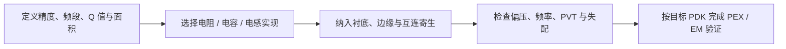

# TSMC 28 nm CMOS 片上无源器件：电阻、电容与电感

> [!abstract] 核心定位
> 比较 TSMC 28 nm CMOS 中电阻、电容和电感的实现、寄生、匹配与高速 ADC 选型。

---

在 TSMC 28 nm 这一类先进 CMOS 工艺中，片上无源器件并不是独立焊接的理想 R、L、C，而是利用**扩散区、多晶硅、金属互连、栅氧、PN 结以及层间介质**构造出来的。因此，它们都会同时带有寄生电阻、寄生电容、衬底耦合、非线性和工艺偏差。

需要首先强调：

> **具体可用器件名称、层次、阻值范围、容密度、Q 值和耐压必须以对应工艺版本的 PDK、DRM 和 Model Guide 为准。**

同样是“TSMC 28 nm”，HPM、HPC、HPC+、RF、1.8 V option、不同 BEOL 金属堆栈提供的器件可能并不完全相同。

---

## 目录

- **2026 新增专题**：见文末扩展篇章，含新增推导、文献与配图

1. 片上电阻
   - 1.1 片上电阻
2. 片上电容
   - 2.1 片上电容
3. 片上电感与磁性/传输线器件
   - 3.1 片上电感
4. 器件比较与高速 ADC 选型
   - 4.1 三类器件的综合比较
   - 4.2 面向高速 ADC 的具体选型建议
   - 4.3 不要只比较 R、L、C 的标称值
5. 版图设计与核心结论
   - 5.1 版图设计中最需要注意的问题
   - 5.2 核心结论

## 1. 片上电阻



*图：片上无源器件从规格到版图验证的选型流程；器件参数以目标 PDK 为准。*

### 1.1 片上电阻

#### 电阻的基本表达式

规则矩形电阻近似为：

$$R=R_{\mathrm{sh}}\frac{L}{W}+R_{\mathrm{contact}}+R_{\mathrm{terminal}}$$

其中：

- $R_{\mathrm{sh}}$：方块电阻，单位 $\Omega/\square$
- $L/W$：方块数
- $R_{\mathrm{contact}}$：接触孔与通孔电阻
- $R_{\mathrm{terminal}}$：引出金属等附加电阻

实际设计中，不能只按照 $R_{\mathrm{sh}}L/W$ 手算，应该直接使用 PDK 电阻 PCell 和对应的 Spectre/SPICE 模型。

---

#### 多晶硅电阻 Poly Resistor

##### 实现方式

利用一段经过特定掺杂的多晶硅形成电阻，常见类型包括：

- 普通掺杂 Poly 电阻
- 高阻 Poly，High-R Poly
- N 型 Poly 电阻
- P 型 Poly 电阻
- 硅化 Poly 与非硅化 Poly

在先进 HKMG 工艺中，晶体管栅极结构不一定等同于传统多晶硅栅，但工艺仍可能专门提供用于无源电阻的 Poly 模块。

##### 特点

优点：

- 阻值和几何尺寸关系明确
- 匹配性能通常较好
- 相比扩散电阻，结电容和电压系数通常较小
- 适合做精密电阻比
- High-R Poly 可以在较小面积内得到较大阻值

缺点：

- 绝对阻值工艺偏差仍可能较大
- 存在温度系数 TCR
- 有寄生电容
- 高频下表现为分布式 RC 网络
- 大阻值电阻会占用较长版图

##### 典型应用

- Bandgap 中的 PTAT/CTAT 电阻
- 运放偏置和共模反馈
- RC 时间常数
- 有源 RC 滤波器
- DAC/ADC 中的电阻阵列
- 反馈网络
- 电流检测和退化电阻

##### 适用建议

对于精密模拟电路：

- 优先使用 PDK 提供的精密 Poly 或 High-R Poly
- 尽量依赖电阻比而不是绝对电阻值
- 电阻阵列采用相同方向、相同宽度和相同端点结构
- 高精度时采用 common-centroid 和 dummy 电阻

---

#### 扩散电阻 Diffusion Resistor

##### 实现方式

利用源漏扩散区形成：

- N+ diffusion resistor
- P+ diffusion resistor

通常扩散区两端布置接触孔，电流沿扩散条流动。

##### 特点

优点：

- 工艺天然存在，通常不需要额外特殊层
- 阻值适中
- 适合局部、小阻值用途

缺点：

- 与衬底或阱形成 PN 结
- 结电容较大
- 阻值随端电压变化，电压系数较明显
- 温度系数和工艺偏差通常不如精密 Poly
- 存在漏电
- 高频性能受结电容限制

##### 典型应用

- 非关键偏置电阻
- ESD 或 I/O 网络
- 低精度电阻
- 局部镇流电阻
- 某些启动电路

##### 不适合

- 高线性采样网络
- 高精度电阻 DAC
- 高精度增益设定
- 高频高阻节点

---

#### 阱电阻 Well Resistor

##### 实现方式

利用 N-well、Deep N-well 或其他阱结构形成电阻，例如：

- N-well resistor
- Deep-N-well resistor

##### 特点

优点：

- 方块电阻通常较高
- 可以用相对较小面积实现较大阻值
- 可用于低功耗偏置和启动网络

缺点：

- 对衬底和其他阱存在较大的结电容
- 电压系数通常较明显
- 隔离结构复杂
- 高频性能较差
- 阻值的 PVT 漂移可能较大

##### 典型应用

- 高阻值启动电路
- 弱偏置支路
- ESD 与 I/O 电路
- 低频 RC 网络

不建议将 Well 电阻用于高速 ADC 的精密信号通路。

---

#### 金属电阻 Metal Resistor

##### 实现方式

直接使用一段金属走线作为电阻：

$$R=\rho \frac{L}{Wt}$$

或者仍然按方块电阻表示：

$$R=R_{\mathrm{sh,metal}}\frac{L}{W}$$

不同金属层厚度不同：

- 底层金属通常较薄，方块电阻相对较高
- 顶层厚金属通常较厚，方块电阻低
- AP/RDL 等超厚金属阻值更低

##### 特点

优点：

- 线性度高
- 电压系数小
- 不存在 PN 结
- 可承受较大电流
- 高频性能通常较好
- 适合小阻值

缺点：

- 方块电阻低，做大阻值需要很长走线
- 占用布线资源
- 容易与衬底和周围金属产生寄生电容
- 电迁移限制需要重点检查
- 小阻值时 via/contact 电阻占比很大

##### 典型应用

- 片上终端匹配
- 小阻值串联阻尼
- 电源网络电流检测
- RF 退化电阻
- 传输线阻尼
- 高频信号串联电阻
- ESD 电流路径

##### 设计要点

小阻值金属电阻需要特别注意：

$$
R_{\mathrm{total}} = R_{\mathrm{metal}} + R_{\mathrm{via}} + R_{\mathrm{contact}}
$$

例如设计一个几欧姆的电阻时，通孔阵列本身的电阻可能已经不可忽略。应使用多排 via，并进行后仿真或 EM 分析。

---

#### MOS 管等效电阻

MOS 管在线性区可以近似成可调电阻：

$$
R_{\mathrm{on}}\approx \frac{1} {\mu C_{\mathrm{ox}}\frac WL(V_{GS}-V_{TH})}
$$

##### 类型

- NMOS 开关导通电阻
- PMOS 开关导通电阻
- Transmission gate
- Triode MOS resistor
- MOS pseudo-resistor

##### 特点

优点：

- 阻值可通过栅压调节
- 面积小
- 可以实现极大的等效电阻
- 适合可调滤波器和超低频电路

缺点：

- 严格来说不是线性无源电阻
- 非线性明显
- 强烈依赖输入共模和信号幅度
- PVT 变化大
- 存在沟道噪声和开关噪声
- pseudo-resistor 的绝对值可能跨越多个数量级变化

##### 典型应用

- 开关电容电路中的采样开关
- Gm-C 或可调 RC 滤波器
- 生物电信号前端的超大反馈电阻
- 直流恢复网络
- 泄放路径

---

## 2. 片上电容

### 2.1 片上电容

在先进 CMOS 模拟设计中，常见电容可以分为：

1. MIM 电容
2. MOM 电容
3. MOS 电容
4. PN 结电容
5. 金属对衬底寄生电容
6. 标准单元 Decap

---

#### MIM 电容

MIM 即：

$$\text{Metal-Insulator-Metal}$$

##### 实现方式

在两层专用金属极板之间放置较薄、较稳定的绝缘介质：

$$C=\varepsilon\frac{A}{d}$$

通常：

- 上极板为专用 MIM top plate
- 下极板为某一层金属
- 位于较高的 BEOL 层
- 某些工艺需要额外 mask 或特殊工艺 option

##### 特点

优点：

- 电容密度通常较高
- 电压线性度好
- 温度稳定性好
- 匹配性能好
- Q 值高
- 底板寄生相对容易控制
- 模型通常较成熟

缺点：

- 可能需要额外工艺选项和成本
- 可使用的层次受限制
- 最小尺寸及 enclosure 规则可能较严格
- routing 灵活性不如 MOM
- 大电容仍然非常占面积

##### 典型应用

- SAR ADC CDAC
- Pipeline ADC MDAC
- 采样保持电容
- 开关电容积分器
- 精密电容比
- 补偿电容
- RC 滤波器
- 高线性模拟信号通路

---

#### MOM 电容

MOM 即：

$$\text{Metal-Oxide-Metal}$$

这里的“oxide”主要是普通金属层之间的层间介质。MOM 通常利用金属边缘之间的边缘电场形成电容。

##### 平面型 MOM

同一层金属形成交指结构：

```text
AAAAAAA
 BBBBBBB
AAAAAAA
 BBBBBBB
```

电容主要来自相邻金属指之间的侧壁耦合。

##### 垂直型 MOM

利用上下多层金属的重叠和边缘场：

```text
M5: A A A A
M4: B B B B
M3: A A A A
M2: B B B B
```

实际 PCell 通常同时利用：

- 同层横向边缘场
- 上下层垂直场
- 多层金属并联

##### 特点

优点：

- 通常不需要额外 MIM mask
- 利用已有 BEOL 金属层
- 布局形式灵活
- 很适合先进工艺
- 可以做很小的单位电容
- 多层 MOM 可以提高单位面积电容量
- 对小尺寸电容阵列特别有吸引力

缺点：

- 电容密度通常低于专用 MIM，但高度依赖金属堆栈
- 对金属线宽、间距、CMP、dummy fill 比较敏感
- 边缘场占主导，模型和周围环境影响明显
- 周围金属、屏蔽和走线会改变电容
- 寄生耦合分析更复杂

##### 典型应用

- 高速 SAR ADC CDAC
- Pipeline-SAR ADC 子级 CDAC
- 小型采样电容
- 数字控制的电容阵列
- VCO 调谐电容阵列
- 补偿和中和电容
- 高频耦合电容

##### 对先进 ADC 的意义

在 28 nm 中，MOM 很常用，主要原因是：

- 可以做到很小的单位电容
- 不一定增加特殊 mask
- 容易与数字校准配合
- 版图层次可以灵活配置
- 可降低 CDAC 总电容和开关功耗

但单位电容缩小后，以下问题会逐渐主导：

- 随机失配
- 开关 drain/source 寄生
- 比较器输入寄生
- 顶板走线电容
- dummy fill 引起的环境差异
- 提取误差
- 参考电压建立误差

---

#### MIM 和 MOM 的主要区别

| 指标 | MIM | MOM |
|---|---|---|
| 电场形式 | 以垂直平行板电场为主 | 以边缘场、侧壁场和多层耦合为主 |
| 是否需特殊层 | 通常需要专用 MIM 层 | 一般利用普通金属层 |
| 电容密度 | 通常较高 | 通常较低到中等 |
| 线性度 | 通常很好 | 通常也很好 |
| 小单位电容 | 受最小尺寸规则限制 | 很适合做小电容 |
| 布局灵活性 | 受专用层限制 | 较高 |
| 环境敏感性 | 相对较低 | 较高 |
| 周围金属影响 | 较小 | 较明显 |
| 典型用途 | 精密 SC、MDAC、大型 CDAC | 高速低功耗 CDAC、小电容阵列 |

---

#### MOS 电容 MOSCAP

##### 实现方式

将 MOS 管的：

- Source
- Drain
- Body

连接在一起作为一个端口，Gate 作为另一个端口。

也可以使用专用 MOS capacitor PCell。

##### 工作区域

MOS 电容可能处于：

- Accumulation，积累
- Depletion，耗尽
- Inversion，反型

因此其电容随端电压变化：

$$C=C(V)$$

##### 特点

优点：

- 电容密度高
- 面积小
- 不需要额外 MIM 结构
- 适合大规模电源去耦
- 可以作为压控电容

缺点：

- 电压非线性明显
- 栅漏电需要考虑
- 薄氧器件耐压低
- 受偏置状态影响
- 不适合高精度大信号线性采样
- 存在沟道和衬底相关寄生

##### 典型应用

- 电源 Decap
- VCO varactor
- PLL 调谐
- 非关键旁路电容
- 数字电源去耦
- 小信号 AC 耦合

---

#### PN 结电容 Junction Capacitor

PN 结反偏时具有耗尽层电容：

$$
C_j(V)= \frac{C_{j0}} {\left(1+\frac{V_R}{\phi_0}\right)^m}
$$

##### 实现方式

- N+ / P-sub
- P+ / N-well
- N-well / P-sub
- Deep-N-well / P-sub

##### 特点

优点：

- 工艺天然存在
- 可作为变容二极管
- 电容随电压变化明显，适合调谐

缺点：

- 非线性很大
- 漏电流明显
- 对温度敏感
- Q 值和衬底损耗需要关注
- 不适合精密电容比

##### 典型应用

- LC-VCO varactor
- ESD 结构
- RF 调谐
- 结电容补偿
- 某些高压接口

---

#### 标准单元 Decap

数字库中通常提供 DCAP/DECAP cell。

##### 实现方式

多数利用 MOS 栅电容，并满足标准单元：

- 高度
- 电源轨
- implant
- well tap
- placement 规则

##### 主要用途

- 数字电源去耦
- 减少电源瞬态跌落
- 降低局部 IR drop 和 supply bounce
- 填充数字布局空白区域

不适合直接作为精密模拟电容，因为其：

- 电容值和偏置相关
- 耦合数字噪声
- 单元周围环境不可控
- 模型通常针对电源去耦而不是精密模拟应用

---

## 3. 片上电感与磁性/传输线器件

### 3.1 片上电感

片上电感是三类无源器件中最“不理想”的一类，因为硅衬底有损，金属电阻较大，而且电感面积很大。

---

#### 平面螺旋电感

这是最常见的片上电感。

##### 结构形式

- 方形 spiral
- 八边形 spiral
- 圆形 spiral
- 差分对称 spiral
- 中心抽头 spiral

一般使用：

- 最高层或接近最高层的厚金属
- 较大的金属宽度
- 足够的金属间距
- 底层金属作为 underpass
- 密集 via 阵列连接上下层

##### 为什么用顶层厚金属

电感串联电阻近似为：

$$R_s=\rho\frac{l}{wt}$$

提高金属厚度 $t$ 和宽度 $w$ 可以减小串联电阻，从而提高 Q 值。

---

#### 电感的等效模型

简化模型包括：

- 理想电感 $L_s$
- 串联电阻 $R_s$
- 匝间电容 $C_p$
- 金属到衬底电容 $C_{\mathrm{sub}}$
- 衬底电阻 $R_{\mathrm{sub}}$

品质因数：

$$Q=\frac{\operatorname{Im}(Z)}{\operatorname{Re}(Z)}$$

在低到中等频率下，可以近似写为：

$$Q\approx\frac{\omega L}{R_s}$$

但实际 Q 不会随频率无限上升，因为高频时：

- 衬底损耗增加
- 趋肤效应增加
- 邻近效应增加
- 寄生电容开始旁路电感
- 涡流损耗增加

最终在自谐振频率 SRF 附近：

$$\operatorname{Im}(Z)=0$$

超过 SRF 后，器件表现得更像电容，而不是电感。

---

#### 单层与堆叠电感

##### 单层 Spiral

主要绕线位于同一顶层金属。

优点：

- 结构简单
- 金属间寄生相对容易控制
- 自谐振频率通常较高
- 模型比较成熟

缺点：

- 单位面积电感量有限
- 面积较大

##### Stacked Inductor

利用多层金属形成串联或并联的堆叠绕组。

优点：

- 相同占地面积下可以提高电感量
- 可以利用多层金属降低某些路径电阻
- 适合变压器或强耦合结构

缺点：

- 层间电容增大
- 自谐振频率降低
- 设计和模型复杂
- via 电阻和电流拥挤明显
- Q 值不一定比单层更高

因此，“叠更多金属层”不一定更好，需要综合比较：

$$L,\quad Q,\quad f_{\mathrm{SRF}},\quad R_s,\quad A$$

---

#### 差分电感

##### 结构

两个对称端口，通常中心对称，也可能具有 center tap。

##### 特点

- 差模磁场叠加
- 共模耦合可能部分抵消
- 对差分 VCO、LNA、PA 很适合
- 版图对称性好
- 可减小某些共模寄生影响

##### 应用

- LC-VCO
- 差分 LNA
- 差分 PA
- 高频 input buffer
- T-coil
- 高频时钟网络

---

#### 片上变压器

变压器本质上是两个互感电感：

$$M=k\sqrt{L_1L_2}$$

其中 $k$ 是耦合系数。

##### 实现结构

- Interleaved transformer
- Stacked transformer
- Concentric transformer
- Center-tapped transformer
- Balun

##### 应用

- 单端转差分
- 阻抗变换
- 宽带匹配
- VCO tank
- 功率合成
- mmWave PA
- RF 输入接口

##### 主要指标

- $L_1,L_2$
- $Q_1,Q_2$
- 耦合系数 $k$
- 插入损耗
- 幅度不平衡
- 相位不平衡
- 自谐振频率

---

#### Patterned Ground Shield

可在电感下方放置图案化接地屏蔽层 PGS。

##### 目的

- 减少电场进入有损硅衬底
- 降低电感与衬底之间的耦合
- 提高器件间隔离
- 减小衬底噪声注入

##### 为什么不能使用完整实心金属板

完整金属板会产生大面积涡流，涡流形成反向磁场，导致：

- 电感值降低
- Q 值下降
- 高频损耗增加

所以 PGS 通常被切割成条带或网格，以阻断大的闭合涡流路径。

---

#### 传输线等效电感

在高频或毫米波电路中，可以使用：

- CPW
- Microstrip
- Slow-wave transmission line
- 短路或开路 stub
- 高阻抗短传输线

在电长度较小时，一段传输线可以表现为感性阻抗。

##### 优点

- 高频模型更准确
- 可同时实现阻抗变换和电感功能
- mmWave 下可能比集中式 spiral 更合适

##### 缺点

- 面积大
- 必须进行 EM 仿真
- 对周围金属和衬底结构非常敏感

---

#### Bondwire 和封装电感

虽然不属于晶圆内部的集成电感，但实际芯片设计经常利用：

- 键合线电感
- 封装走线电感
- RDL 电感
- PCB 走线电感

##### 优点

- Q 值可能高于片上 spiral
- 不占核心硅面积
- 适合 RF matching 和电源网络

##### 缺点

- 工艺和封装偏差较大
- 模型依赖封装厂
- 与 pad、ESD、PCB 强耦合
- 不易精确控制

---

#### 有源电感

利用晶体管和电容构造 gyrator，可以模拟电感。

但它不是严格意义上的无源电感。

##### 优点

- 面积远小于 spiral
- 电感值可调
- 适合低频或中频集成滤波

##### 缺点

- 消耗静态功耗
- 噪声较大
- 线性度有限
- 动态范围有限
- PVT 敏感
- Q 值由有源器件决定

---

## 4. 器件比较与高速 ADC 选型

### 4.1 三类器件的综合比较

| 器件 | 常见实现 | 主要优势 | 主要缺点 |
|---|---|---|---|
| 电阻 | Poly | 匹配较好，适合精密电阻比 | 温漂、绝对偏差、面积 |
| 电阻 | High-R Poly | 大阻值面积小 | 噪声、工艺偏差、压系数 |
| 电阻 | Diffusion | 工艺简单 | 结电容大、非线性 |
| 电阻 | Well | 阻值高 | 衬底寄生大、速度慢 |
| 电阻 | Metal | 线性好、耐电流、适合小阻值 | 做大阻值面积巨大 |
| 电阻 | MOS 等效 | 可调、面积小 | 非线性和 PVT 敏感 |
| 电容 | MIM | 高线性、高密度、匹配好 | 可能需特殊层，规则严格 |
| 电容 | MOM | 灵活、适合小单位电容 | 环境和寄生敏感 |
| 电容 | MOSCAP | 密度高、适合 Decap | 强非线性、耐压低 |
| 电容 | Junction | 适合变容调谐 | 非线性和漏电大 |
| 电感 | Spiral | 真正无源、适合 RF | 面积大、Q 有限 |
| 电感 | Stacked | 同面积电感量较大 | 层间电容大、SRF 低 |
| 电感 | Transformer | 可实现互感和阻抗变换 | 面积和模型复杂 |
| 电感 | Transmission line | 高频模型准确 | 面积大，必须 EM 仿真 |

---

### 4.2 面向高速 ADC 的具体选型建议

#### CDAC

优先级通常为：

$$\boxed{\text{MOM 或 MIM}}$$

##### 小单位电容、高速低功耗

一般优先考虑 MOM：

- 适合 1～数 fF 的单位电容
- 方便多层实现
- 可以降低总 CDAC 电容
- 与数字校准配合较好

但需要重点验证：

- Monte Carlo mismatch
- PEX 后权重误差
- 金属 fill 影响
- 顶板总线寄生
- 开关寄生
- 电容 PCell 的 recommended dimension

##### 高线性、高精度、单位电容不太小

若工艺提供合适 MIM，可优先考虑 MIM：

- 密度和线性较好
- 环境敏感性通常较低
- 适合 MDAC 和精密采样电容

---

#### 采样电容

推荐：

$$\boxed{\text{MIM/MOM}}$$

不推荐用 MOSCAP 直接承担高线性采样电容，因为：

$$C=C(V)$$

会将输入电压转换为信号相关电容，从而产生谐波失真。

对于高速 ADC，最终 SFDR 往往还同时受以下因素限制：

- 采样开关 $R_{\mathrm{on}}$ 非线性
- 输入 buffer 输出阻抗
- 底板采样时序
- 栅压自举误差
- 时钟馈通
- 版图不对称

---

#### 偏置和共模电路电阻

推荐：

$$\boxed{\text{Poly 或 High-R Poly}}$$

适合：

- 电流镜退化
- CMFB
- 运放偏置
- Bandgap
- 共模生成
- 启动电路

若只要求非常大的泄放电阻，可以考虑 MOS pseudo-resistor，但不要把它当作精密线性电阻。

---

#### 输入端终端电阻

若需要 50 Ω、100 Ω 等高速终端：

- 可以使用低阻 Poly PCell
- 也可以使用专用 metal resistor
- 必须同时考虑 pad、ESD、走线和封装寄生
- 最好采用 Kelvin 或四端提取思路
- 需要检查电流密度和自热

---

#### 电感

高速 ADC 核心 CDAC、比较器、级间放大器通常不会大量使用电感，因为面积过大。

电感更可能用于：

- RF input buffer
- shunt peaking
- series peaking
- T-coil
- 宽带输入匹配
- 高频时钟 buffer
- LC-VCO/PLL
- ESD 电容补偿

若输入 buffer 带宽达到十几 GHz，电感峰化可能有效；但必须进行：

$$\boxed{\text{PEX + EM + 封装联合仿真}}$$

仅使用 schematic 中的理想电感模型是不够的。

---

### 4.3 不要只比较 R、L、C 的标称值

#### 电阻

$$
R,\quad R_{\mathrm{sh}},\quad \sigma_R/R,\quad TCR,\quad VCR,\quad C_{\mathrm{par}},\quad I_{\max},\quad \text{noise}
$$

其中：

- TCR：温度系数
- VCR：电压系数
- $\sigma_R/R$：随机失配

---

#### 电容

$$
C,\quad C/A,\quad \sigma_C/C,\quad TC,\quad VC,\quad Q,\quad f_{\mathrm{SRF}},\quad C_{\mathrm{bottom}}
$$

---

#### 电感

$$
L,\quad Q(f),\quad R_s(f),\quad f_{\mathrm{SRF}},\quad k,\quad A,\quad S_{11},S_{21}
$$

---

## 5. 版图设计与核心结论

### 5.1 版图设计中最需要注意的问题

#### 电阻

- 使用 PDK PCell，不要手动画等效电阻结构
- 尽量保持相同宽度，通过长度调整比例
- 精密匹配使用 common-centroid
- 两端接触孔数量相同
- dummy 电阻保持环境一致
- 远离高温和大功率器件
- 大电阻考虑分布式寄生电容
- 检查自热和电迁移

---

#### 电容

- 单位电容相同尺寸、相同方向
- 周围 dummy 单元完整
- 顶板和底板引线结构对称
- 避免在电容上方或下方穿过不对称信号线
- 注意金属 fill 对边缘电场的影响
- 差分电容阵列采用镜像对称和共心结构
- 不能只看 PCell 标称值，必须看 PEX 后有效电容
- 重点区分总电容与有效差分电容
- 顶板节点尽量减小寄生

对于 MOM，周围金属环境本身就是电容结构的一部分，因此布局环境一致性格外重要。

---

#### 电感

- 使用顶层厚金属
- underpass 尽量短
- 上下层连接使用密集 via 阵列
- 远离数字时钟、电源开关和其他电感
- 保持足够 keep-out 区域
- 检查 dummy fill 对 Q 和电感量的影响
- 检查与衬底、guard ring、PGS 的耦合
- 差分结构严格保持对称
- 使用端口定义正确的 EM 仿真
- 观察完整 S 参数，而不只是某个频点的 L 值

---

### 5.2 核心结论

1. **精密电阻优先用 Poly/High-R Poly，低阻高频和大电流场景使用金属电阻。**
2. **高速 ADC 的精密电容优先使用 MIM 或 MOM，不宜直接使用强非线性的 MOSCAP。**
3. **MIM 更像传统平行板电容；MOM 更依赖边缘场和金属环境，在先进工艺中非常常用。**
4. **MOSCAP 主要用于电源去耦和调谐，而不是大信号高线性采样。**
5. **片上电感通常使用顶层厚金属 spiral，但面积大、Q 有限且必须考虑硅衬底损耗。**
6. **电感及变压器不能只做常规 RC 提取，应使用 foundry model 或 EM 仿真。**
7. **先进工艺中，寄生参数有时会与目标无源器件本身处于同一数量级，尤其是数 fF CDAC 和几欧姆金属电阻。**
8. **最终判断依据应是对应 TSMC 28 nm PDK 中的器件模型、统计模型、DRC 推荐结构和硅验证数据，而不是通用经验值。**

## 2026 深化：从 PCell 名义值到 EM/PEX 后的真实等效网络（新增）

> [!important] 工艺证据边界
> 这里所有示意均为**通用先进 bulk CMOS / BEOL 方法**，不是 TSMC 28 nm 工艺提供的具体器件清单。具体 MIM/MOM 层叠、最高金属 TM 厚度、工艺电阻类型、密度、Q 值、允许电压、电流密度与 EM 保证必须查看已授权 PDK、DRM、器件模型及对应 metal stack。不得把公开论文的某个工艺典型值当作所用 28 nm PDK 的保证值。

### R1. 从理想 R/C/L 转成带损耗的高频模型

片上电阻不仅有 `R_sh·L/W`，还包含接触电阻、温度系数、寄生到衬底电容和分布式 RC；高频时一段长 Poly 不再是理想集总电阻。MOM 的边缘场电容依赖相邻金属、fill 和布线环境，MIM 更接近平板近似但仍有底板/边缘寄生；MOSCAP 的强非线性源于器件工作状态以及 C-V 曲线。螺旋电感可以采用简化 `L_s、R_s、C_ox、R_sub/C_sub` 模型，但提取 L/Q/自谐振频率时应从完整二端口 `Z/Y/S` 和 port 参考平面出发。[R1][R2][R3]


*原创专项机制示意；图中比例、相位和结构仅用于说明原理，不代表实际芯片晶体管级拓扑。*


### R2. 采样 CDAC 重点：匹配、寄生和寄生的**可校准性**

一套 5-bit first stage 的 CDAC，关键不是仅把单位电容选择得足够大：单位电容面积、差分阵列对称、top-plate 寄生、reference-line resistance 和切换顺序均影响线性度/建立。若顶板寄生为 `C_p`，反馈系数可能近似 `β=C_f/(C_f+C_s+C_p+...)`，而非简单 `1/G`。这使较小 `C_unit` 虽降低面积/开关负载，却可能加大寄生占比与 mismatch。CDAC 的 Monte Carlo 应包括两个层次：随机单元偏差和系统性走线/边缘梯度；背景位权校准可以消除部分静态误差，但**不能恢复每次因参考未建立、码相关重分配或时钟馈通导致的动态误差**。

推荐四次交叉对比：schematic ideal-C → PCell model → PEX extracted → 带供电/参考/clock routing 的完整链路。对电容阵列特征码（mid-scale、大进位码、极大输入斜率）逐次测 `top-plate` 与 `Vref` 的建立轨迹，并导出 INL/HD2/HD3，而非只比较总有效 C。

### R3. 长高频走线何时必须按传输线而非 lumped RC 建模

衡量电气长度：`βl=2π f l/v_p`；当路径延迟占信号周期比例不可忽略（工程预警常可从 `l≈λ/10` 级别开始，阈值并非固定标准）时，应考虑分布 RLGC、阻抗不连续与反射。对 on-chip 微带/共面走线，损耗包括导体趋肤/近邻效应、介质/硅衬底耦合；return current 的路径与信号本身同样重要。

使用 `S11/S21` 判断输入匹配和传输损耗，需**明确 50 Ω 为端口参考阻抗，不等于每一段链路都应采用 50 Ω 物理特征阻抗**。对负载为 THA 采样网络的长线，应把实际切换电容与时变输入阻抗加入 EM/SP 联合仿真。差分偶/奇模、de-embedding 与金属填充对 port 的影响在验证记录中不可省略。


### R4. 电感的 Q、SRF 与等效 L 不是独立可随意指定的指标

常以 `Q(ω)=Im{Z_in(ω)}/Re{Z_in(ω)}` 定义某个一端口阻抗对应的品质因子（在电感性工作区），但**靠近自谐振**时 `Im{Z}` 可变号，等效 L/Q 的解释要格外谨慎。所谓“物理螺旋匝数一定越多 L 越大且 Q 越高”不成立：增加匝数通常也增加串联电阻、寄生和底板耦合。图案地屏蔽（PGS）可缓解衬底损耗，同时也可能引入涡流/屏蔽层寄生，必须以 EM 仿真验证设计细节。经典文献依次可读 Long & Copeland 1997、Yue & Wong 1998、Niknejad & Meyer 1998。[R1–R3]

### R5. 从版图到仿真的三层流程

|级别|方法|能看到什么|看不到什么|
|---|---|---|---|
|电路图 + PDK compact models|Spectre/S-parameter|器件 PCell 模型固有寄生和非线性|自定义长线、周边布局、复杂互耦|
|RC/耦合提取 (Calibre PEX/DSPF)|带寄生节点的 SPICE|一般互连 RC、寄生 C、时序和静态建立|高频磁场电流分布/分布电感完整精度|
|3D/2.5D EM (EMX/HFSS/ADS Momentum 等)|S 参数/宽带等效网表|趋肤、相邻导体互感、返回路径、衬底损耗|晶体管非线性自身仍须混合仿真|

不能简单认为 “Calibre View 一定比 DSPF 精确”；二者可能来自同一提取数据，差异来自网表结构、寄生简化、端口、模型绑定和仿真选项。若要得到高频长线性能，应将 EM/SNP 子网络嵌入 Spectre，与真实电路、buffer output impedance 和 sampling kickback 联合。


### R6. 经典参考文献与教材

- [R1] J. R. Long and M. A. Copeland, “The Modeling, Characterization, and Design of Monolithic Inductors for Silicon RF IC's,” *IEEE JSSC*, 1997. [DOI:10.1109/4.557634](https://doi.org/10.1109/4.557634)。
- [R2] C. P. Yue and S. S. Wong, “On-Chip Spiral Inductors With Patterned Ground Shields for Si-Based RF ICs,” *IEEE JSSC*, 1998. [DOI:10.1109/4.668989](https://doi.org/10.1109/4.668989)。
- [R3] A. M. Niknejad and R. G. Meyer, “Analysis, Design, and Optimization of Spiral Inductors and Transformers for Si RF ICs,” *IEEE JSSC*, 1998. [DOI:10.1109/4.720393](https://doi.org/10.1109/4.720393)。
- [R4] M. J. M. Pelgrom, A. C. J. Duinmaijer, and A. P. G. Welbers, “Matching Properties of MOS Transistors,” *IEEE JSSC*, 1989. [DOI:10.1109/JSSC.1989.572629](https://doi.org/10.1109/JSSC.1989.572629)。
- [R5] J. L. McCreary, *Successive Approximation Analog-to-Digital Conversion Techniques in MOS Integrated Circuits*, UC Berkeley, 1975. [高校机构存档](https://www2.eecs.berkeley.edu/Pubs/TechRpts/1975/7366.html)。
- [R6] A. M. Niknejad, Berkeley ASITIC 与 spiral inductor 研究线索（由 R3 论文综述延伸；具体工具版本、许可证需单独确认）。

**论文原图建议**：R1 的等效电感模型及 Q；R2 的 PGS 结构；R3 的电磁/等效电路。此处所插图为本专题重绘示意，不包含任何保密版图或 PDK 截图。

### 定量分析图（理论/指定参数示意）


> 上图为数学模型/显式参数下计算的示意曲线，不是论文测量，也不是 TSMC 28 nm PDK 提取结果。实际结论需结合文中定义、完整寄生与时序验证。

---