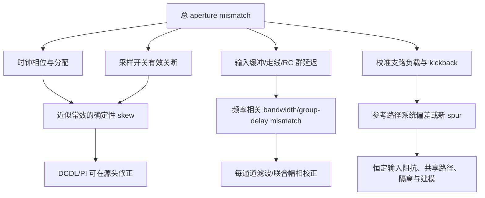
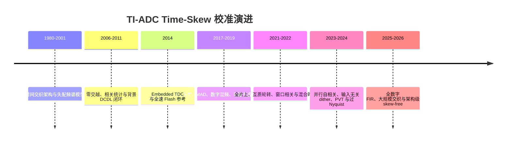
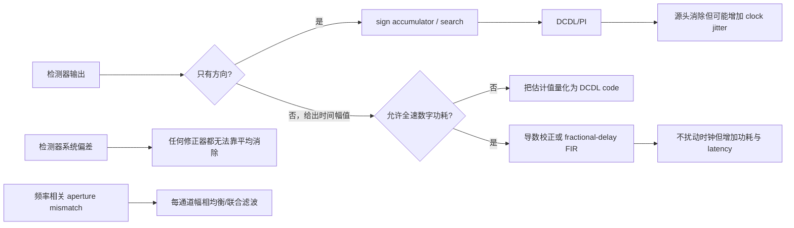
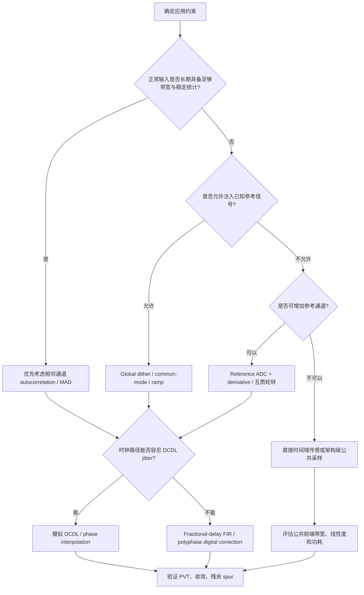

# TI-ADC Time-Skew 校准：原理、方法与演进

> [!abstract] 核心定位
> 从误差机理、检测方法、修正方式、代表性芯片和方法选型五个维度，系统梳理 TI-ADC time-skew 校准的技术演进，并明确区分论文实测、仿真结果与跨文献归纳。

> [!info] 文献来源
> 本文基于 Zotero 分类 `主题分类 > Calibration > time skew` 的 70 条记录、71 个 PDF 附件和 14 条精读笔记整理。完整条目及 DOI 见[[#附录 B：Zotero time skew 分类全部 70 条记录|附录 B]]。

> [!important] 一句话判断
> Time-skew 校准的真正难点不是“把一个时间差估得足够精确”，而是在正常输入、参考通道或注入信号中构造一个对 skew **有符号、近似单调、且不被增益/带宽/前端扰动淹没**的可观测量；修正精度最终还受 DCDL/FIR 分辨率、检测器系统偏差和随机 jitter 的共同限制。

> [!tip] 阅读路径
> - 先读[[#2. Time skew 的来源及系统影响|第 2 节]]，建立“周期性确定性 skew、随机 jitter、频率相关 aperture mismatch”三者的边界；
> - 再读[[#3. 校准系统的统一框架|第 3 节]]和[[#5. 典型误差检测方法|第 5 节]]，理解可观测量、更新律与失效条件；
> - 做电路/算法选型时直接看[[#7. 方法横向比较|第 7 节]]、[[#9. 方法选型指南|第 9 节]]和[[#10. 设计与验证检查表|第 10 节]]；
> - 查具体论文数据时看[[#8. 代表性实现及论文报告结果|第 8 节]]与[[#附录 B：Zotero time skew 分类全部 70 条记录|附录 B]]。

## 摘要

时间交织模数转换器（time-interleaved ADC，TI-ADC）通过让多个较低速率的子 ADC 依次采样，将整体采样率提高到单通道能力之外，是数 GS/s 至百 GS/s 高速 ADC 的核心架构之一。其代价是引入通道间偏置、增益、带宽和采样时刻失配，其中 time skew 对输入频率高度敏感，在接近 Nyquist 或更高输入频率时通常成为限制 SFDR、SNDR 和有效输入带宽的主要因素。

本文基于本地 Zotero 分类 `主题分类/Calibration/time skew` 中的 70 条文献记录、71 个 PDF 附件和 14 条精读笔记，对 time-skew 校准的理论基础、发展历程、误差检测、误差修正、代表性芯片结果以及方法选型进行系统整理。整个技术演进可概括为：从失配频谱建模和前景测试信号校准，发展到依赖输入统计量的相关/方差型背景校准；随后出现全速或低速参考 ADC、导数辅助检测、直接时间域传感和全数字插值；近年来进一步转向输入无关的全局 dither、所有通道并行收敛、过 Nyquist 校准、全数字 fractional-delay FIR，以及通过公共采样前端或 T/H-based MDAC 从架构上减少甚至消除通道间采样时差。

现有方案并不存在绝对最优解。自相关类方案具有最小模拟开销，但依赖输入统计；参考通道类方案收敛快，却可能调制输入阻抗；参考信号类方案输入无关，但需要谨慎处理注入路径失配和前端扰动；数字重采样避免在时钟路径中加入可变延迟，却带来全速计算功耗和延迟。实际设计需要围绕校准精度、收敛速度、输入独立性、前端副作用、模拟/数字开销和 PVT 鲁棒性进行协同权衡。

全文可压缩为五条结论：

1. $N$ 路 TI-ADC 只有 $N-1$ 个独立相对 skew；真正决定各根交织 spur 的是通道 skew 序列的空间傅里叶模式，而不只是一个 RMS 数字。
2. 检测方法的本质区别是 timing 信息来自哪里：正常输入统计、参考通道、已知参考信号，或直接时间域传感。
3. 检测器与修正器必须分开评价；方向型 detector 适合闭环 DCDL，幅值型 estimator 才能自然驱动数字导数/FIR。
4. 延长平均只能降低随机估计误差，不能消除参考路径、dither 路径、bandwidth mismatch 或 actuator 非线性造成的系统偏置。
5. 近年的主线不是单纯追求更低 skew 数字，而是让所有通道并行、保持恒定输入阻抗、覆盖过 Nyquist、共享真实输入路径，并把频率相关 aperture mismatch 纳入联合校正。


## 目录

- **2026 新增专题**：见文末扩展篇章，含新增推导、文献与配图


- [[#1. 文献范围、方法与证据边界|1. 文献范围、方法与证据边界]]
- [[#2. Time skew 的来源及系统影响|2. Time skew 的来源及系统影响]]
- [[#3. 校准系统的统一框架|3. 校准系统的统一框架]]
- [[#4. 发展历程|4. 发展历程]]
- [[#5. 典型误差检测方法|5. 典型误差检测方法]]
- [[#6. 误差修正方法|6. 误差修正方法]]
- [[#7. 方法横向比较|7. 方法横向比较]]
- [[#8. 代表性实现及论文报告结果|8. 代表性实现及论文报告结果]]
- [[#9. 方法选型指南|9. 方法选型指南]]
- [[#10. 设计与验证检查表|10. 设计与验证检查表]]
- [[#11. 研究趋势与尚未解决的问题|11. 研究趋势与尚未解决的问题]]
- [[#12. 结论|12. 结论]]
- [[#附录 A：分类中的重复版本和外围条目|附录 A：分类中的重复版本和外围条目]]
- [[#附录 B：Zotero time skew 分类全部 70 条记录|附录 B：Zotero time skew 分类全部 70 条记录]]
- [[#附录 C：核心参考文献快捷入口|附录 C：核心参考文献快捷入口]]

## 1. 文献范围、方法与证据边界

### 1.1 数据来源

本文只使用本轮实际读取到的本地 Zotero 分类内容，不把通用网络搜索结果混入分类统计。

| 项目 | 数量或范围 |
|---|---:|
| Zotero 路径 | `主题分类 > Calibration > time skew` |
| 分类键 | `N7W6UKWE` |
| 顶层文献记录 | 70 |
| 期刊论文 | 36 |
| 会议论文 | 33 |
| 学位论文 | 1 |
| PDF 附件 | 71 |
| Zotero 精读笔记 | 14 |
| 文献年份 | 2001—2026 |
| 条目最多的年份 | 2024、2025，各 11 条 |

分类中至少包含六组明显的“会议版本—期刊扩展版本”：

1. Chen/Pileggi 2014 ISSCC 与 JSSC；
2. Song 等 2016 A-SSCC 与 2017 JSSC；
3. Song 等 2018 CICC 与 2019 TCSI；
4. Jiang 等 2018 A-SSCC 与 2021 TCSI；
5. Gu 等 2023 ESSCIRC 与 2025 JSSC；
6. Tao 等 2024 ISSCC 与 2026 JSSC。

因此，70 条记录不等于 70 种相互独立的算法。分类还包含若干外围工作，例如用架构避免 sampling skew 的单通道 ADC、关注 routing skew 的高速 DAC、输入缓冲器/时钟电路，以及对 time skew 只有局部讨论的高速 ADC。正文优先综合直接研究 TI-ADC time-skew 检测、校正或规避的工作；全部条目仍保留在附录中。

### 1.2 证据标记

为避免把论文报告值和工程归纳混在一起，正文采用以下边界：

- **实测结果**：摘要、正文或 Zotero 精读笔记明确指出芯片测量所得；
- **仿真结果**：行为级、电路级或 post-layout simulation；
- **论文观点**：作者对优点、限制或适用条件的分析；
- **跨文献归纳**：本文对多篇文献共同趋势的综合，不等同于单篇论文结论。

这是一份基于用户现有 Zotero 专题库的叙述性技术综述，而不是经过多数据库检索、双人筛选和正式 PRISMA 流程的系统综述。它适合用于课题学习、架构选型和建立研究地图，但不应直接宣称覆盖了全球全部相关文献。

## 2. Time skew 的来源及系统影响

### 2.1 时间交织模型：只有相对 skew 可校准

设总采样率为 $f_s$，理想采样周期为 $T_s=1/f_s$，由 $N$ 个子 ADC 交织。第 $m$ 个子 ADC 的理想采样时刻为

$$
t_{m,k}^{\mathrm{ideal}}=(kN+m)T_s,\qquad m=0,\ldots,N-1 .
$$

若该通道存在等效采样时刻误差 $\Delta t_m$，实际输出的一阶模型为

$$
\begin{aligned}
y_m[k]
&=x\!\left((kN+m)T_s+\Delta t_m\right)\\
&\approx x(t_{m,k}^{\mathrm{ideal}})
+\Delta t_m x'(t_{m,k}^{\mathrm{ideal}}).
\end{aligned}
$$

这个展开给出 time-skew 校准的基本物理图像：误差是“通道相关的时间系数”与“输入瞬时斜率”的乘积。对正弦输入 $x(t)=A\sin(2\pi f_{\mathrm{in}}t)$，误差幅度尺度为

$$
|e_t|\sim 2\pi f_{\mathrm{in}}A|\Delta t_m|.
$$

因此，同一个 100 fs 的时差在 100 MHz 输入时可能不可见，在 5 GHz 输入时却会直接限制高分辨率 ADC 的 SFDR。

校准能够识别的是通道间的**相对采样位置**，而不是整个 ADC 相对外部世界的绝对时刻。若所有通道同时增加同一个延迟 $t_0$，输出只是整体平移，并不会产生交织 spur。工程上通常采用以下任一“规范条件”消除这一自由度：

$$
\sum_{m=0}^{N-1}\Delta t_m=0,
$$

或把某一路定义为参考，令 $\Delta t_0=0$。因此，$N$ 路系统只有 $N-1$ 个独立相对 skew。比较不同论文的“skew 数值”时必须确认作者报告的是单通道偏差、两路相对时差、相邻采样间隔误差，还是各通道相对均值的 RMS；这些定义相差最多可到两倍或带有 $\sqrt{N}$ 量级的换算。

### 2.2 从周期 skew 序列推导交织杂散

把合并后的全速序列写成

$$
y[n]\approx x(nT_s)+\delta[n]x'(nT_s),
\qquad
\delta[n+N]=\delta[n],
$$

其中 $\delta[n]=\Delta t_{n\bmod N}$ 是以 $N$ 为周期的确定性序列。对它作 $N$ 点离散傅里叶展开：

$$
\delta[n]=\sum_{q=0}^{N-1}c_qe^{j2\pi qn/N},
\qquad
c_q=\frac{1}{N}\sum_{m=0}^{N-1}
\Delta t_me^{-j2\pi qm/N}.
$$

这一步非常关键：time-skew spur 的大小不是只由“最大通道偏差”决定，而是由 skew 空间分布在各个交织模式上的傅里叶系数 $c_q$ 决定。对单音输入，一阶误差项把输入搬移到

$$
f_{\mathrm{spur}}
=q\frac{f_s}{N}\pm f_{\mathrm{in}},
\qquad q=1,\ldots,N-1 .
$$

若忽略折叠方向和实信号的共轭项，第 $q$ 个 skew 模式的 spur/信号幅度近似为

$$
\rho_q\approx 2\pi f_{\mathrm{in}}|c_q|,
$$

因而

$$
\mathrm{Spur}_q\,[\mathrm{dBc}]
\approx20\log_{10}\!\left(2\pi f_{\mathrm{in}}|c_q|\right).
$$

$c_0$ 是所有通道的公共延迟，只造成整体相位变化；$q\ge1$ 才形成交织 spur。这个表示也解释了为什么“每路 skew RMS 相同”的两颗芯片可能具有不同的最坏 SFDR：如果误差集中在某一个离散空间模式上，其单根 spur 会比误差分散在多个模式时更高。

> [!warning] 公式的使用边界
> 上式是一阶、小 skew、单一恒定时间偏差模型。不同文献对两路系统的 $\Delta t$ 定义不同：有的用两路相对时差，有的用每路相对理想网格的偏差，有的用相邻间隔 $T_s\pm\Delta t$。因此不要脱离论文定义直接比较公式前的系数 1、2 或 $1/2$。

### 2.3 从目标 SFDR 反推残余 skew

若目标是让某个最坏 skew 模式低于 $S$ dBc，一阶估算为

$$
|c_q|_{\max}
\lesssim
\frac{10^{-S/20}}{2\pi f_{\mathrm{in,max}}}.
$$

例如，仅作数量级说明，若希望在 $f_{\mathrm{in,max}}=5.7\ \mathrm{GHz}$ 时把一阶 time-skew spur 压到 −74 dBc 以下，则最坏模式系数需约小于

$$
|c_q|_{\max}\lesssim
\frac{10^{-74/20}}{2\pi\cdot5.7\times10^9}
\approx5.6\ \mathrm{fs}.
$$

这不是“每路 DCDL 必须有 5.6 fs 步长”的直接结论：模式系数和通道误差的映射取决于 $N$ 与误差空间分布，且实际 SFDR 还可能由量化、谐波、带宽失配、参考路径 feedthrough 和随机 jitter 限制。但它能快速说明为什么 10 GS/s、12-bit 级系统会把校准推到几十飞秒甚至个位数飞秒的系统误差预算。

### 2.4 电路级来源

Time skew 不是只由时钟树长度差造成的；应把“控制采样结束时刻的全部路径”都纳入 aperture mismatch。

#### 2.4.1 多相时钟产生与分配失配

相位发生器、分频器、占空比校正、时钟缓冲器、走线寄生和不同负载会使各路采样时钟偏离理想相位。时间误差与相位误差的换算为

$$
\Delta t=\frac{\Delta\phi}{360^\circ f_{\mathrm{clk}}}.
$$

以 10 GHz 时钟为例，1° 相位误差约为 278 fs。时钟路径还可能把电源噪声转换成数据相关或随机的边沿位移，因此 DCDL 能调掉平均相位，却不能自动消除新增的随机 jitter。

#### 2.4.2 采样开关阈值与边沿斜率失配

采样开关的有效关断时刻不等于数字时钟的逻辑阈值交越时刻。MOS 阈值、bootstrap 波形、栅极驱动斜率、body effect、信号相关导通电阻和 drain feedthrough 都会改变 aperture。若时钟边沿在阈值附近的斜率为 $S_{\mathrm{clk}}$，阈值失配 $\Delta V_{\mathrm{th}}$ 的一阶等效时间误差为

$$
\Delta t_{\mathrm{eq}}\approx
\frac{\Delta V_{\mathrm{th}}}{S_{\mathrm{clk}}}.
$$

这说明只在时钟输入端测相位并不足以证明实际采样时刻已经匹配。

#### 2.4.3 输入分配、缓冲和采样网络失配

输入缓冲器、封装/走线、ESD、开关导通电阻和采样电容的差异会产生通道相关传递函数。可写成

$$
H_m(f)=H_0(f)\,[1+\epsilon_m(f)]e^{-j2\pi f\Delta t_m(f)}.
$$

当工作频带远低于前端极点，$\epsilon_m(f)$ 很小且 $\Delta t_m(f)$ 近似常数，调采样边沿是合理的；当输入接近前端带宽时，$\epsilon_m(f)$ 和群延迟差均随频率变化，单个 DCDL 码只能在某一频率附近抵消线性相位项。此时应把问题称为 bandwidth/aperture mismatch，并考虑每通道均衡或 fractional-delay/filter correction，而不是继续把所有误差都归结为标量 time skew。

#### 2.4.4 校准支路本身造成的等效 skew

参考 ADC、dither 开关、window detector、replica sampler 和 dummy load 都会改变输入负载或产生 kickback。如果这种变化与通道号或校准周期同步，它会形成新的离散 spur。更棘手的是：检测器可能在内部参考路径上准确收敛，但真实输入路径仍保留未被观测的延迟。因而“检测精度高”不等于“系统残差小”，必须把参考路径与信号路径的传递函数差异单列为系统误差。



### 2.5 确定性 skew、随机 jitter 与带宽失配的区别

| 误差 | 典型数学描述 | 频谱表现 | 能否靠增加校准样本消除 | 常见对策 |
|---|---|---|---|---|
| 通道间确定性 skew | 固定周期序列 $\delta[n+N]=\delta[n]$ | $qf_s/N\pm f_{\mathrm{in}}$ 离散 spur | 可降低估计噪声，但最终受修正器/系统偏差限制 | 相关、参考、dither 检测 + DCDL/FIR |
| 随机采样 jitter | 零均值随机过程 $\eta[n]$ | 宽带噪声裙或相噪侧带 | 不能由静态 skew 校准消除 | 低噪时钟、低 jitter DCDL、PLL/clock design |
| 频率相关 aperture mismatch | $H_m(f)$ 的幅相差 | 多频率相关镜像/失真，未必符合单一 skew 比例 | 不能靠更长平均变成常数延迟 | 多频点估计、每通道均衡、架构共用前端 |

随机 jitter 的正弦输入上限常用

$$
\mathrm{SNR}_{\mathrm{jitter}}\approx
-20\log_{10}\left(2\pi f_{\mathrm{in}}\sigma_t\right).
$$

与确定性 skew 不同，随机 jitter 主要增加噪声；随机化通道顺序或参考采样时刻虽然能把周期 spur 摊平，却没有消除误差能量，因此可能改善 SFDR 而不改善 SNDR。

## 3. 校准系统的统一框架

### 3.1 检测和修正是两个独立设计维度

time-skew 校准通常包含：误差观测、误差估计/方向判决、控制器更新和模拟或数字修正。文献中“相关校准”“参考 ADC 校准”“数字混频校准”多数是在描述检测机制；DCDL、phase interpolator、fractional-delay FIR 则是在描述修正机制。两者可以交叉组合。

```mermaid
flowchart LR
    A[模拟输入 x(t)] --> B[多通道采样与量化]
    B --> C[通道输出 D_i]
    C --> D[误差观测器]
    R[输入统计量 / 参考通道 / 参考信号] --> D
    D --> E[估计 Δt_i 或其符号]
    E --> F[环路滤波 / 累加 / 搜索]
    F --> G{修正域}
    G -->|模拟域| H[DCDL / PI / 可调采样边沿]
    G -->|数字域| I[导数补偿 / 插值 / FIR]
    H --> B
    I --> J[校准后输出]
    C --> I
```

### 3.2 用一个小信号闭环统一描述各类方案

在已接近锁定点的小 skew 范围内，多数检测器都可抽象为

$$
z_i[\ell]
=K_i\Delta t_{i,\mathrm{res}}[\ell]
+b_i+\nu_i[\ell],
$$

其中：

- $z_i$ 是相关差、方差差、参考通道电压差、PN 相关量或时间码差；
- $K_i$ 是检测器对 skew 的局部增益，其符号必须已知；
- $b_i$ 是参考路径 mismatch、offset、带宽差或 dither 残留造成的系统偏置；
- $\nu_i$ 是有限样本、量化和热噪声形成的随机估计误差；
- $\Delta t_{i,\mathrm{res}}$ 是施加当前 DCDL/FIR 控制后的残余 skew。

以符号累加器为例，更新律可写成

$$
u_i[\ell+1]
=\operatorname{sat}\!\left(
u_i[\ell]-\mu\operatorname{sgn}(K_i)\operatorname{sgn}(z_i[\ell])
\right),
$$

而 DCDL 近似产生

$$
t_{i,\mathrm{corr}}[\ell]
=t_{\mathrm{LSB}}u_i[\ell].
$$

若检测器给出误差幅度而不只是符号，也可以用 LMS、归一化 LMS、binary/coarse-fine search 或 Kalman/随机梯度更新。算法名称不同，但闭环都必须同时满足：

1. $K_i\neq0$：目标输入下有可观测性；
2. $\operatorname{sgn}(K_i)$ 已知或可自适应判断：更新方向正确；
3. 步长与平均窗口使环路稳定；
4. 修正范围覆盖初始 skew；
5. 检测器偏置 $b_i/K_i$ 小于允许的残余 skew。

### 3.3 前景、背景、盲校准与输入无关并非同义词

#### 3.3.1 前景校准

在正常转换开始前或暂停业务时，施加已知正弦、斜坡或边沿，直接估计每路误差。其优点是原理简单、可达到高精度，对输入统计没有未知性；缺点是必须中断正常转换，而且无法持续跟踪温度、电源和老化漂移。仪器上电校准或误差变化很慢的系统仍可能采用一次性 foreground trimming。

#### 3.3.2 背景校准

在正常输入存在时持续估计 time skew。背景校准能跟踪 PVT，但必须解决未知输入、校准信号对主链路的干扰，以及有限样本导致的估计噪声。当前分类的绝大多数核心工作都属于 background calibration。

“背景”只说明正常转换未中断，并不自动意味着“盲”或“输入无关”：

- **blind/input-statistics based**：不注入已知信号，也不需要训练序列，但依赖正常输入的相关、零交越或斜率统计；
- **reference-assisted background**：正常转换持续，同时由参考 ADC 或额外 sampler 提供观测；
- **dither-based background**：在正常输入上叠加已知随机参考，之后数字相关分离；
- **input-independent**：检测器在 DC、低频或未知输入统计下仍能产生有效误差信号；它通常需要参考信号/边沿，并不等于“零模拟开销”。

### 3.4 评价指标

评价一个 time-skew 校准方案时，至少应同时考察：

- **残余 skew 或 skew spur**：不要只报告 SNDR 改善；
- **收敛样本数和实际时间**：二者都受参考通道采样率影响；
- **适用输入范围**：DC、窄带、随机信号、Nyquist 和过 Nyquist 是否都能工作；
- **系统性误差**：注入路径、参考通道、量化和有限延迟步长造成的残差；
- **随机误差**：热噪声、量化噪声和时钟 jitter，可通过平均降低但会减慢收敛；
- **模拟开销**：参考 ADC、额外 sampler、HPF、TDC、dummy load、DCDL；
- **数字开销**：乘法器、相关累加、FIR、存储和全速数据通路；
- **前端副作用**：输入阻抗调制、kickback、dither feedthrough、额外电容；
- **PVT 与老化跟踪**：校准在温度/电源变化下是否持续有效；
- **功耗核算边界**：数字算法是否片上，功耗是否计入 ADC FoM。

### 3.5 收敛速度、精度下限和跟踪带宽

有限样本统计的标准差通常近似按

$$
\sigma_{\hat z}(M)\propto\frac{1}{\sqrt{M}}
$$

下降。把随机误差再减半，往往需要约四倍有效样本；但系统偏置 $b_i$ 不会随平均时间消失。残余 skew 可用下式作一阶预算：

$$
\sigma_{t,\mathrm{res}}^2
\approx
\sigma_{t,\mathrm{est}}^2
+\sigma_{t,\mathrm{quant}}^2
+\sigma_{t,\mathrm{track}}^2
+\sigma_{t,\mathrm{path}}^2.
$$

其中 $\sigma_{t,\mathrm{path}}\approx|b_i/K_i|$ 表示参考/信号路径差造成的等效时间偏差。对步长为 $t_{\mathrm{LSB}}$ 的单调 DCDL，若锁定码在一个量化区间内近似均匀，量化残差 RMS 的粗略估计为

$$
\sigma_{t,\mathrm{quant}}\approx\frac{t_{\mathrm{LSB}}}{\sqrt{12}},
$$

而静态最坏值通常按 $t_{\mathrm{LSB}}/2$ 检查。若控制码持续在相邻码间翻转，还需把由码切换引入的调制 spur 和附加 jitter 单独计入。

平均窗口越长，$\sigma_{t,\mathrm{est}}$ 越低，但校准环跟踪 PVT 漂移的带宽越窄。高速采样率不等于快速校准：参考通道可能只在 $f_s/21$ 工作，window detector 可能只选中几千分之一的样本，算法一次更新又可能需要多个 trial code。应同时报告：

$$
T_{\mathrm{conv}}
=\frac{N_{\mathrm{total\ clocks}}}{f_s}
=\frac{N_{\mathrm{effective\ samples}}}
{p_{\mathrm{valid}}f_{\mathrm{obs}}},
$$

其中 $p_{\mathrm{valid}}$ 是有效事件概率，$f_{\mathrm{obs}}$ 是观察路径的实际采样率。

### 3.6 一个可移植的符号型背景环

下面的伪代码不对应某一篇论文，而是对自相关、参考通道和 dither 相关方案共同结构的跨文献归纳：

```text
初始化每路控制码 u[i]，指定一条参考约束（例如 sum(u)=0）
重复：
    采集 M 个“有效”观测样本
    对每个待校准通道 i：
        z[i] = detector(samples, reference, i)
        direction = sign(K[i]) * sign(z[i])
        accumulator[i] += direction
        若 |accumulator[i]| >= threshold：
            u[i] = saturate(u[i] - step * sign(accumulator[i]))
            accumulator[i] = 0
    投影到相对-skew 约束，或固定参考通道不动
    若所有 |z[i]| 进入迟滞窗口：降低步长或进入慢速跟踪模式
```

实际实现中最容易遗漏的是第一行与倒数第二行：若所有通道都独立追逐一个会随公共延迟变化的参考量，环路可能出现整体漂移或多个环互相“追赶”。固定一条参考、约束控制码均值，或显式用图拉普拉斯/相邻间隔方程求解，都可以消除这个自由度。

### 3.7 可观测性比优化器复杂度更重要

| 检测器所需信息 | 失去可观测性的典型情况 | 可行补救 |
|---|---|---|
| 相邻自相关的导数符号 | DC、某些周期单音、目标 Nyquist zone 中导数换符号 | 改变间隔、window/dither、按 Nyquist zone 翻转更新符号 |
| 输入斜率符号 | 平坦输入、导数估计被量化噪声淹没 | 参考 ramp、模拟 HPF、早/晚采样 |
| 参考与主通道的电压差 | 两路径增益/offset 未校准，kickback 改变输入 | 冗余窗口、先校 offset/gain、VTR/恒定负载 |
| 已知 dither 的相关量 | dither 与输入路径不一致或去除误差过大 | 全局注入、交叉耦合抵消、多波形联合估计 |
| 纯时间边沿判决 | TDC/VTC 非线性、边沿未经过真实采样路径 | 码表/PVT 跟踪、复用主采样器作传感器 |

因此，FAPSO、非线性步长或更高阶滤波器能改善已存在的代价面搜索，却无法从 $K_i=0$ 的输入中创造 timing 信息。

## 4. 发展历程



校准技术的“进步”不只是校准后 SNDR 逐年变高，还体现在研究问题本身发生了迁移：

| 阶段 | 首要问题 | 典型回答 | 新暴露的瓶颈 |
|---|---|---|---|
| 误差建模期 | spur 在哪里、为何随输入频率增长 | 周期失配模型、频谱解析式 | 仅靠匹配无法覆盖 PVT |
| 背景闭环形成期 | 如何在不中断转换时找 skew 方向 | 零交越、相关峰值、DCDL | 输入统计限制、收敛慢 |
| 参考复用期 | 如何获得更明确的共同时间基准 | full-rate flash、embedded TDC、reference ADC | 输入负载、kickback、参考自身误差 |
| 低复杂度/快收敛期 | 如何减少样本、乘法器和串行层次 | window variance、MAD、mixing、VTR | 仍需说明失效输入与数字核算 |
| 路径一致性期 | 检测到的是否是真实输入路径 skew | constant impedance、TI-reference、global dither | dither 动态范围与路径频率差 |
| massive/宽带期 | 32/64 路、过 Nyquist 和宽带前端如何扩展 | 相邻并行相关、FIR、共同 sampler、联合 aperture 校准 | 全片上数字功耗与频率相关模型 |

### 4.1 1980—2001：从架构提出到失配显式建模

时间交织转换器阵列的概念可追溯到 Black 和 Hodges 1980 年的工作。早期系统主要依靠公共前端 T/H、严格时钟设计和布局匹配降低通道时差。随着交织路数和输入频率提高，仅凭版图匹配无法保证所需的亚皮秒精度。

Kurosawa 等 2001 年的工作（Zotero：`8I67QJME`）系统推导了 offset、gain 和 timing mismatch 同时存在时的频谱关系，指出 gain 与 timing mismatch 会相互作用，而 offset 项相对独立，并讨论 bandwidth mismatch。这一阶段的贡献主要是建立误差模型和 spur 位置，不是形成完整的片上背景校准环路。

### 4.2 2006—2011：输入统计型背景校准形成

Wang 和 Wu 2006 年（`YWHX9R2U`）提出在相邻通道之间随机交换采样先后顺序，并统计输入零交越次数，从而判断两路时差，最后调整数字控制延迟单元。这一方法已经具备典型背景闭环的结构：正常输入作为激励、统计检测 skew、DCDL 修正采样边沿。

El-Chammas 和 Murmann 2011 年（`WLQ5L35N`）将相关性检测用于 12 GS/s、5-bit、八路 TI-flash ADC。一个低分辨率辅助采样路径估计通道相对时刻，数字算法在片外执行，片上 DCDL 调节采样相位。实测校准使高频输入下的 skew 相关失真降低约 12 dB，Nyquist 附近 SNDR 达 25.1 dB。该工作确立了“数字统计检测 + 模拟时钟修正”的经典范式。

### 4.3 2014：参考通道和直接时间检测成为另一条主线

2014 年出现两类重要工作。

Chen 和 Pileggi（`CWNPVDJE`、`EWJJZPLG`）在 20 GS/s、6-bit TI-ADC 中加入 embedded time-to-digital calibration。其本质不是放置一个独立的高分辨率 TDC 宏单元，而是让 sub-ADC 对经过可编程延迟移动的两电平校准边沿进行判决，把采样时刻映射成数字码表，再选择合适的时钟延迟单元组合。实测 time-skew spur 约降低 20 dB，Nyquist SNDR 为 30.7 dB。

Lee、Chandrakasan 和 Lee（`DBW2HPGW`）则在 1 GS/s、10-bit TI-SAR 中放置全速 4-bit flash。该 flash 一方面提供 coarse code、缩短 SAR 转换周期，另一方面由于自身不交织，可作为共同时间参考。算法通过 flash coarse result 与 SAR 最终结果的不一致程度构造统计代价，并用片上可调时钟修正。校准后实测 Nyquist SNDR 51.4 dB、SFDR 59.1 dB，功耗 18.9 mW。

这一阶段标志着校准电路开始与 ADC 架构复用，而不是简单增加独立的检测通道。

### 4.4 2017—2019：检测算法快速分化

这一阶段的研究重点从“能否背景校准”转向“如何降低样本数、输入限制和硬件开销”。

#### 4.4.1 窗口方差与 MAD

Song 等 2017 年（`EK9FLZWS`）使用单比较器 window detector，只选择接近零交越的小窗口样本，再比较条件方差。由于窗口内输入幅度本身较集中，skew 引起的方差变化不再被大范围输入波动淹没，所需样本数相对早期宽窗口方差方法降低约四个数量级。2018/2019 年的后续工作（`6ESBPNZX`、`AAEGE5SI`）用 mean absolute deviation 代替平方和乘法，进一步降低数字复杂度。

#### 4.4.2 全数字导数与插值校正

Chen 等 2017 年（`INDXF7EE`）提出全数字 timing mismatch 估计和导数型数字校正，并推导四路 TI-ADC 校正后 SNDR 的闭式表达式。这一路线不调模拟采样时钟，而是估计 $\Delta t_m$，再从数字输出中减去近似的 $\Delta t_m x'(t)$。优点是可用于现有 ADC 数据的后处理；主要限制是导数滤波、乘法和高速数字数据通路的开销。

#### 4.4.3 数字混频和 Δ-sampling

Lin 等 2018 年（`MVQABTTH`）在 16 路 10-bit、2.6 GS/s TI-SAR 中配置共享的 Δ-sampling 辅助 SAR，量化相邻时刻的信号差，再用数字混频相关量估计误差并前馈修正。实测 Nyquist SNDR 为 50.6 dB，最佳情况下交织 spur 从 −33.6 dB 降到 −63.2 dB。这种方法能够给出数字修正所需的幅度信息，而不只判断 skew 正负。

#### 4.4.4 虚拟时间参考

Kang 等 2018 年（`TA6A2GPU`）提出 virtual-timing-reference。算法上仍比较主通道与参考 ADC，但物理上把参考 ADC 的采样边沿推迟到主通道采样完成之后，再用匹配的输入延迟重建原参考时刻，从而减少参考采样 kickback 对主输入的污染。270 MS/s、12-bit 原型实测 Nyquist SNDR 59.7 dB，Zotero 精读笔记记录的残余 skew 约 50 fs。

#### 4.4.5 模拟导数路径与随机参考采样

Zhou、Xu 和 Chiu 2019 年（`DDJUA8XB`）用一个慢速 reference ADC 估计主阵列误差，再用模拟 CR-HPF/1-bit comparator 路径提供输入斜率符号，以区分 gain error 和 timing error。参考 ADC 的采样频率采用随机 hopping，把周期性输入阻抗扰动形成的离散 spur 摊开。1 GS/s、12-bit 原型校准后峰值 SNDR 65.3 dB，DC 至 500 MHz 的 SFDR 高于 70 dB。

### 4.5 2021—2022：全片上校准、互质轮转与大规模交织

Chang、Choi 和 Ryu 2021 年（`32XPFC4I`）提出 relative-prime TI sub-ranging SAR。5 路 coarse ADC 与 18 路 fine ADC 采用互质通道数，使每个 fine ADC 都能均匀遇到指定 coarse ADC，后者兼作共同 timing reference。这样既复用已有 coarse conversion，又减少固定低速参考 ADC 的周期性输入负载。实测 skew tone 从约 −40 dB 降到 −63 dB，对应残余 skew 从约 1.6 ps 降到 113 fs。

Ni 等 2022 年（`YQ7B8KRU`）进一步使用与主八路 ADC 互质的三路 TI reference ADC，让参考采样动作保持全速、近似恒定输入阻抗。与降采样单通道参考 ADC 相比，时变输入阻抗引起的 spur 被抑制 20 dB 以上，2 GS/s、13-bit 原型在近 Nyquist 输入下达到 60.36 dB SNDR。

与此同时，出现了数字 windowing 加速自相关（`E8TESPTL`）、relative-prime rotation 自相关（`J2WS5WXM`），以及用单个高速 VTC 作为共享采样缓冲器、从架构上消除多路采样开关 time skew 的 VTC/TDC-assisted ADC（`BX4NTY3T`）。

### 4.6 2023—2024：鲁棒、输入无关和过 Nyquist

Gu 等 2023 年会议版、2025 年期刊版（`R7LL9IS6`、`CEMRICHS`）提出相邻通道一阶段自相关方法。通过平均所有相邻通道相关量重建理想 $R(T_s)$，每个通道都只依赖 $R'(T_s)$ 判断误差，不再依赖跨越多个通道周期的 $R'(NT_s/2)$。因此，理论输入带宽限制由约 $f_s/N$ 放宽到 Nyquist，而且所有通道可同时更新。1 GS/s、11-bit 四路 TI-SAR 实测 Nyquist SNDR 59.3 dB、SFDR 78.8 dB，全部 skew tones 低于 −80 dB；但数字计算在片外实现，不能把该结果直接理解为完整片上校准引擎的功耗。

Wang 和 Chang 2023 年（`JNJ7P7U5`）通过 common-mode reference injection 和 replica switch 实现输入无关检测，并将校准路径与主量化器隔离；近 4 GHz 输入下，在少于 12k 样本内把 skew tones 压到 −52 dB 以下。

2024 年最显著的演进是 global dither injection（GDI）。Tao 等（`VMVYNXD8`）和 Cao 等（`AMZFXGAJ`）把伪随机 ramp/pulse dither 注入公共输入缓冲器，使 dither 与真实信号尽可能共享各通道路径。相比 local dither injection，GDI 可以观测更多真实输入路径的延迟差，也避免各本地注入支路失配形成的校准盲区。Cao 等的 12 GS/s、12-bit、四路 TI-pipeline ADC 实测近 Nyquist SNDR 54.1 dB、SFDR 66.0 dB。

同年还出现：

- dithered digital mixing，把数字混频的适用输入范围扩展到 Nyquist（`FHN7TXYE`）；
- even/odd absolute-error autocorrelation，实现第一和第二 Nyquist 区的 time-skew 校准（`IXJ8QHCQ`）；
- 单额外通道同时获得 $\Delta V$ 和输入导数符号的低成本 derivative-based calibration（`HNUISZ9K`）；
- FAPSO 同时搜索多通道 skew，再用二阶 FIR differentiator 数字校正（`D94YNYTN`）；
- constant-input-impedance reference-assisted architecture（`I7BEUCDA`）。

### 4.7 2025—2026：全数字重采样、联合校准与架构级消除

2025 年的研究继续沿三条方向推进。

第一，改进估计器收敛，例如 windowed autocorrelation（`2G5ZRLS5`）和 fast nonlinear step iteration（`P9BFQ6Z2`）。第二，引入内部 ramp 和 replica switch，在正常转换不中断的前提下获得输入无关的方向判决（`FT36C3VY`）。第三，把校正进一步迁移到数字域，例如 30 GS/s、32 路 CI-SAR TI-ADC 使用 fractional-delay FIR 完成全数字背景校正（`RUY2II3Z`）。

到 2026 年，time-skew 校准开始与前端架构、输入缓冲和多种误差联合校准深度融合：

- 112 GS/s、64 路 hybrid ADC 使用注入锁定环振、多级采样网络和背景 time-skew 校准（`23DJQ9TP`）；
- T/H-based TI MDAC 让交织发生在已保持的信号上，从结构上避免通道间 time skew，并把校准资源集中到 bit weight 和 offset（`NJ6MULSI`）；
- global-dither time-skew 与 bit-distribution comparator-offset calibration 被组合到同一片 4.8 GS/s TI-SAR 中（`M36TQMAA`）；
- Nyquist-zone-extending aperture calibration 尝试在第一、第二 Nyquist 区联合判断 aperture error 的方向和幅度（`85E57YAP`）。该条目在库中标记为 2026-10，晚于本文生成日期 2026-09-01，且摘要报告的是 post-layout simulation，应与已流片实测工作分开解释。

## 5. 典型误差检测方法

2024 年综述（`W9KQRT3H`）按误差观测来源把背景校准分为三大类：自相关/输入统计型、参考通道型、参考信号型。为了覆盖分类中的全部路线，本文另外把直接时间域传感和数字优化器视为横跨三类的实现变体。

### 5.1 自相关及输入统计型

#### 5.1.1 两路自相关的基本关系

对于两路 TI-ADC，若相邻采样间隔分别为 $T_s+\Delta t$ 和 $T_s-\Delta t$，宽平稳输入的相邻相关量为

$$
R_{12}=E\{x_1[k]x_2[k]\}=R(T_s+\Delta t),
$$

$$
R_{21}=E\{x_2[k]x_1[k+1]\}=R(T_s-\Delta t).
$$

因此

$$
\Delta R=R_{12}-R_{21}
\approx 2R'(T_s)\Delta t.
$$

只要能够保证 $R'(T_s)$ 的符号，$\Delta R$ 就能判断 skew 应向前还是向后调。控制器不一定要准确求出 $\Delta t$ 的绝对值，只需持续按正确方向更新 DCDL，直到统计量在零附近波动。

#### 5.1.2 多通道并行相关

传统多路方法常按二叉树逐级对齐通道，需要依赖更长采样间隔处的相关导数 $R'(NT_s/2)$，输入带宽限制随交织路数增加而变严。较新的相邻通道算法计算

$$
R_i=E\{x_i[k]x_{i+1}[k]\},
$$

再利用所有相邻相关量的平均值近似理想 $R(T_s)$：

$$
\bar R=\frac{1}{N}\sum_{i=1}^{N}R_i\approx R(T_s).
$$

各通道通过累加相邻间隔并与相应倍数的 $\bar R$ 比较，可以同时获得 skew 方向。其优势是并行收敛和 Nyquist 带宽，代价是仍然依赖输入统计；某些特殊周期输入可能让相关导数或误差统计失去可观测性。

#### 5.1.3 低复杂度统计量

为了减少乘法器，文献常用以下替代量：

- mean absolute difference：$E|x_i-x_j|$；
- 条件方差或 mean absolute deviation；
- 只保留输出符号/MSB 的 1-bit 相关；
- 零交越计数；
- 在数字窗口或模拟 window detector 选中的样本上计算统计量。

这些替代量通常只保留 skew 方向信息，而不是高精度的绝对时间值。低位宽和窗口化降低硬件活动率，但阈值 offset、样本选择概率和输入幅度会影响收敛。

#### 5.1.4 数字混频和 chopping

数字混频通过给通道序列乘以周期或伪随机符号，把通道相关误差搬移到 DC 或可分离频点，再用相关累加提取 skew。其优势是可在数字域统一处理多个通道；若没有额外 dither 或导数信息，输入带宽和极限环仍可能限制收敛。2024 年的 dithered digital mixing 用 PRBS 改善 Nyquist 输入下的可观测性，并避免固定步长在最优点附近形成不可收敛的 limit cycle。

#### 5.1.5 主要优缺点

优点：

- 基本不增加敏感模拟前端电路；
- 校准对正常采样路径的直接干扰最小；
- 在先进 CMOS 中数字逻辑易缩放；
- 可以与模拟 DCDL 或数字 FIR 任意组合。

限制：

- 依赖宽平稳、足够幅度和带宽等输入条件；
- 收敛速度随输入统计显著变化；
- 有限样本估计噪声与 DCDL 步长共同决定残余 skew；
- 对 massive interleaving，传统逐级算法带宽限制和误差累积严重；
- 统计检测本身不能自动区分 time skew 与频率相关 bandwidth mismatch。

### 5.2 参考通道型

参考通道以不同采样率或不同相位与主通道周期性对齐。若主、参考通道采样同一局部波形，则电压差近似为

$$
\Delta V\approx \frac{\mathrm dV_{\mathrm{in}}}{\mathrm dt}\Delta t.
$$

因此

$$
\operatorname{sgn}(\Delta t)
=\operatorname{sgn}\!\left(\Delta V\cdot\frac{\mathrm dV_{\mathrm{in}}}{\mathrm dt}\right).
$$

这类方案的关键不只是“有没有参考 ADC”，还包括怎样得到输入导数，以及参考通道如何接入输入而不制造新的周期误差。

#### 5.2.1 全速参考 ADC

全速 flash 或低位参考 ADC 每个总采样周期都工作，不存在交织 time skew，可作为共同时间基准。它可以兼作 sub-ranging/coarse conversion，从而摊薄额外功耗。主要问题是全速量化器自身功耗和输入电容会限制高分辨率或超高速扩展。

#### 5.2.2 低速参考 ADC

低速 reference ADC 依次访问各主通道，功耗较低，但它的采样电容以固定周期接入输入，造成时变输入阻抗和参考 spur。常见缓解方法包括：

- 随机化参考采样时刻，把 spur 摊平；
- 连接 dummy load，保持恒定输入电容；
- 使用与主通道数互质的参考采样周期；
- 使用多路 TI reference ADC，使任一时刻都有参考负载；
- 让 coarse ADC 或冗余通道兼作参考，避免独立高速参考路径。

#### 5.2.3 导数辅助参考通道

输入导数可以由数字 FIR、模拟 HPF、额外早/晚采样器，或在采样瞬间提前触发比较器获得符号。数字 FIR 灵活但带来高速运算和带宽近似问题；模拟 HPF 支持较宽输入带宽，却增加模拟通道和匹配要求。2024 年低成本 derivative-based 方法尝试只用一个额外通道同时获得 $\Delta V$ 与导数符号，并复用主通道的 MSB，降低参考 ADC 分辨率和功耗。

#### 5.2.4 虚拟参考和互质参考

virtual timing reference 通过延迟参考采样和输入波形，使算法参考时刻与物理采样时刻分离，减少 kickback。relative-prime reference 则通过主、参考交织路数互质，让每个主通道都均匀遇到参考通道，同时避免固定配对和残余 skew 累积。

#### 5.2.5 主要优缺点

优点是 skew 极性清楚、收敛通常只需数百至数万有效样本，并且可以不依赖长期输入自相关。限制是额外模拟通道、电容、路由和参考通道自身误差；若输入阻抗调制未处理，校准电路可能产生比原始 skew 更难控制的新 spur。

### 5.3 参考信号和 dither 注入型

参考信号型方法让各通道采样已知时间波形。只要参考信号边沿与目标采样时刻具有确定关系，通道采样值差异就可以直接映射为 time skew。

#### 5.3.1 独立参考路径和直接边沿检测

独立的 clock/ramp path、embedded TDC 或专用 sampler 能快速得到时间信息，收敛可接近 foreground calibration。但参考路径与真实输入路径不完全一致，其开关、路由和带宽失配会形成不能靠继续平均消除的系统误差。

#### 5.3.2 Local dither injection

在每个通道本地注入伪随机 ramp/pulse，再把 ADC 输出与已知 PN 序列相关，可在正常输入上分离 dither 分量。其输入独立性好，但各通道注入路径本身存在增益和延迟失配；更重要的是，本地 dither 未经过公共输入缓冲和完整真实输入路径，因此某些 input-path skew 对它不可见。

#### 5.3.3 Global dither injection

GDI 把 dither 注入公共输入缓冲器或更靠近 ADC 全局输入的位置，使其与真实信号共同经过更多前端路径。这样既减少本地注入支路失配，又提高对输入缓冲、分配网络和采样开关延迟差的可观测性。为避免 dither 反向耦合到外部输入或与真实信号互调，通常需要隔离、交叉耦合补偿或尺寸较小的辅助 buffer。

GDI 的关键价值不是“完全消除所有路径误差”，而是显著缩小校准信号和真实输入的路径差异。由于二者频谱、幅度和前端非线性响应仍不完全相同，残余系统误差仍需通过电路设计和建模控制。

#### 5.3.4 Common-mode 注入和 replica switch

将参考变化注入共模，可以减少对差分信号本身的扰动；replica switch 则让校准支路复制主 sampler 的时间特性，同时与主 CDAC/量化器隔离。这类方法适合中等分辨率高速 SAR，但 replica 与真实采样开关的 mismatch 仍决定最终精度。

#### 5.3.5 内部 ramp

内部 ramp 提供单调、已知导数的校准波形。各子 ADC 的 replica switch 采样 ramp，比较器直接判断其相对参考开关的电压差符号。它不要求正常输入具有足够带宽，检测电路也可能比 FIR 或高分辨率参考 ADC 更简单。当前分类中的 2025 ramp-based 工作主要给出仿真验证，尚不能与完整片上实测校准直接等价比较。

#### 5.3.6 主要优缺点

最大的优势是输入独立：即使正常输入为 DC、低频、小幅度或不满足宽平稳条件，校准仍可持续跟踪。主要代价是前端增加参考信号和相关开关，可能引入 dither feedthrough、互调、额外输入电容和噪声；如果注入点或路径选择不当，算法可能精确校准“参考路径”，却没有校准真实输入路径。

### 5.4 直接时间域传感和混合域前端

某些工作不依赖输出自相关，也不使用传统参考 ADC，而是在前端把时间差直接转换成幅度或数字码：

- embedded TDC 通过扫描已知边沿和比较器判决建立采样时刻码表；
- current-integrating sampler 利用相邻采样间的积分交互，把时间差映射到输出幅度统计；
- time-domain ADC 直接比较时间编码结果；
- VTC/TDC-assisted ADC 使用单个高速 VTC 作为公共采样缓冲器，从架构上减少多路电压采样开关的时差。

这类方法通常收敛快、输入限制较少，但会把设计难点转移到 VTC/TDC 线性度、积分器记忆、时间量化分辨率和 PVT 校准。

### 5.5 优化器和搜索策略

误差观测器给出代价函数后，可以采用符号累加、LMS、binary search、coarse/fine search、随机梯度、非线性步长或粒子群优化更新 skew。优化器主要影响收敛速度、极限环和多通道耦合，但不能弥补不可观测性：若误差统计在某类输入下与 skew 无关，再复杂的优化器也无法恢复正确时间误差。

FAPSO 等群体优化算法能同时搜索多通道参数并减少串行收敛，但 FPGA/ASIC 中的比较、状态存储和多候选更新开销必须与简单 sign-LMS 公平比较。

### 5.6 九个典型方案的工作机理拆解

以下“方案卡片”优先使用本地 Zotero 精读笔记中的电路、样本数和失效条件。数字均保持论文原有核算边界；“为什么有效”和“适合什么场景”属于本文跨文献归纳。

#### 5.6.1 2011：低速校准比较器 + 相关峰值搜索

**工作**：El-Chammas 与 Murmann，12 GS/s、5-bit、八路 TI-flash（Zotero: WLQ5L35N）。

**结构**：八个 1.5 GS/s 主 sub-ADC 共享一个仅约 480 MHz 工作的 1-bit CAL comparator。对第 $i$ 路主 ADC，构造

$$
C_i(\tau_i)=E\!\left\{D_i\,\operatorname{sgn}(D_{\mathrm{CAL}})\right\}.
$$

当主通道与辅助比较器看到的局部输入最对齐时，相关量接近峰值；数字梯度搜索/LMS 调整该通道的 7-bit DCDL。这里检测器不是直接输出“多少皮秒”，而是把采样相位转换成一个可搜索的相关代价面。

**硬件与环路**：

- DCDL 范围约 32 ps，步长约 0.25 ps；
- 每次校准循环使用 500k 样本时约 20 个循环、约 160 ms 收敛；
- 缩短到 50k 样本可把时间降到约 16 ms，但相关估计波动超过 3 dB；
- 数字算法和收敛控制在片外执行，不能把 81 mW ADC 功耗解释为完整校准系统功耗。

**实测结果**：8 GHz 输入时，收敛过程中 SNDR 约从 12 dB 提高到 24 dB；skew spurs 下降约 10—30 dB；Nyquist 附近 SNDR 为 25.1 dB。本地笔记记录的残余 skew 约 0.4 ps，随机 jitter 约 0.6 ps-rms。

**边界**：相关面由输入统计决定；某些输入相关结构会使峰值不明显或产生错误梯度。它奠定了“低速辅助观察 + 数字统计 + 每路模拟 DCDL”的经典框架，但不是输入无关校准。

#### 5.6.2 2014：全速 coarse flash 复用为 timing reference

**工作**：Lee、Chandrakasan 与 Lee，1 GS/s、10-bit、八路 TI-SAR（Zotero: DBW2HPGW）。

**结构**：在交织 SAR 前加入一个不交织、全速运行的 4-bit flash。它同时承担两项功能：

1. 给 SAR 提供 coarse subrange，缩短每路转换时序；
2. 作为共同时间参考，用 coarse flash 结果和 SAR 最终码之间的残差统计判断主通道 timing。

设计刻意保留约 1-bit redundancy，使 coarse/fine 边界附近的码差不被立即饱和；否则 timing 改变可能只在量化边界外发生，代价函数会出现死区。算法对不同 DCDL 码收集 coarse/fine difference histogram，并搜索其方差最小点。

**硬件与环路**：

- 每个方差点使用 128k 样本和 128-bin histogram；
- DCDL 约为 2 ps coarse + 0.8 ps fine，范围约 $\pm10$ ps；
- 仿真估计 DCDL 新增 jitter 小于 0.2 ps-rms；
- 估计器片外实现；全速 flash 使输入电容约增加 45%。

**实测结果**：479 MHz 输入下，校准前 SNDR/SFDR 约为 42.5/46.6 dB，初始 skew 约 2.7 ps-rms；校准后 SNDR 51.4 dB、SFDR 59.1 dB（正文另有约 60.0 dB 的频谱读数），残余约 0.55 ps-rms，ADC 功耗 18.9 mW。

**边界**：要求输入在观察窗口内有足够活动，且统计在扫描期间稳定；输入频率若与单通道采样率形成特定整数关系，coarse/fine 差的方差可能失去 timing 敏感性。全速 flash 的功耗与输入电容决定其扩展上限。

#### 5.6.3 2017：window detector 把宽方差问题变成条件方差

**工作**：Song 等，800 MS/s、10-bit、四路 TI-SAR（Zotero: EK9FLZWS）。

**结构**：一个全速比较器只标记接近零交越、满足 $|V_{\mathrm{in}}|<W$ 的样本。对这些有效事件，若相对窗口中心存在采样时差 $\tau$，局部输入近似

$$
v(t+\tau)\approx v(t)+\tau\dot v(t),
$$

条件方差近似为

$$
\sigma_v^2(\tau)
\approx\sigma_v^2(0)+\tau^2\sigma_{\dot v}^2.
$$

因此方差在 $\tau=0$ 附近取最小值。与对全幅输入直接求方差相比，window detector 先压缩正常信号本身的统计波动，timing 引起的二阶变化更容易被看见。

**为什么窗口不能任意缩小**：小窗口会增强 timing 灵敏度，却降低有效事件概率并使 comparator offset、噪声和量化死区占主导。论文分析的方差估计波动近似随 $W^3$ 增长，实测/仿真选取约 1 LSB 的窗口；相对 64 LSB 的宽窗口，所需总样本从约 $10^9$ 降到 $10^5$，量级上快约 $10^4$ 倍。背景环还根据有效标志比例 $N_f/N_{\mathrm{ADC}}$ 调整窗口宽度。

**实测结果**：每个通道、每个方差点约用 $10^5$ 个总样本，约 0.5 ms，但真正落入窗口的样本只有约 200 个。389 MHz 输入下，SNDR/SFDR 约从 35/38 dB 提高到 48/56 dB，skew tones 低于 −61 dBFS；ADC 功耗 4.9 mW，window detector 约占 7%。数字部分为估算而非片上实测。

**边界**：DC、脉冲以及单音与单通道采样率形成特定关系时可能缺少有效事件；少量噪声反而能打破量化死区，但过大噪声会提高误判。窗口 offset 必须进入最终残差预算。

#### 5.6.4 2018：virtual timing reference 隔离参考采样扰动

**工作**：Kang 等，270 MS/s、12-bit、两路 TI-SAR（Zotero: TA6A2GPU）。

**结构**：主通道和低速参考 SAR 的码差给出电压误差符号；相邻两个主样本的差给出输入斜率符号。两者异或即可得到 skew 更新方向：

$$
\operatorname{sgn}(\Delta t)
=\operatorname{sgn}(\Delta V)\,
\operatorname{sgn}\!\left(\frac{\mathrm dV}{\mathrm dt}\right).
$$

普通参考 ADC 若与主 sampler 同时接入输入，会把 kickback 直接注入最敏感的采样瞬间。VTR 把参考时钟延后约 4 ps，使其在主采样完成后动作，同时在参考输入端引入匹配的约 4 ps 信号延迟，于是算法仍“看到”原参考时刻，而物理扰动晚于主采样到达。

**硬件与环路**：参考 SAR 约 6 bit、采样率 $f_s/21$、采样电容约 50 fF；32 次 up/down 判决后更新 9-bit DCDL，主 DCDL 范围约 $\pm5$ ps。匹配延迟的 Monte Carlo 标准差约 150 fs，温度系数约 10.4 fs/°C，说明 VTR 自身的延迟匹配是系统残差而非可平均噪声。

**实测结果**：120.1 MHz 输入时 skew tone 改善 19.9 dB；由频谱反推的 skew 约从 520 fs 降到 50 fs。Nyquist SNDR 59.7 dB、SFDR 高于 75 dB，总功耗 4.5 mW，其中 reference ADC 约 0.13 mW，面积开销约 9.7%。

**边界**：原型只有两路；算法仍需要正常输入提供可靠斜率，50 fs 是由频谱推断而非直接时间测量。延迟副本只要随 PVT 漂移，就会转化为不可平均的残差。

#### 5.6.5 2018：Δ-sampling + 数字混频消除未知输入斜率

**工作**：Lin 等，2.6 GS/s、10-bit、16 路 TI-SAR（Zotero: MVQABTTH）。

**结构**：共享的 7-bit Δ-sampling SAR 在相隔已知 $\Delta T=10$ ps 的两个时刻采样局部输入，产生

$$
d_{\Delta}\approx K\Delta T,
$$

而主通道 timing error 产生

$$
d_s\approx Kt_s.
$$

其中未知局部斜率 $K$ 由两式共同携带，因此用数字混频/相关提取两项后，可通过比值

$$
\hat t_s\approx\Delta T\frac{d_s}{d_{\Delta}}
$$

抵消输入斜率。这使检测器能够给出数字前馈修正所需的幅度，而不仅是方向；校正采用局部一阶插值，不在模拟时钟中放置 VDL。

**硬件与环路**：每个校准阶段 16,384 样本，利用二叉层次在四个 cycle 内覆盖 16 路。模拟 ADC core 为 18.4 mW；论文估算数字校准约 130k gates、20.8 mW、0.1 mm²，因此含校准总功耗约 39.2 mW。辅助 Δ-sampling 路径约增加 41% 模拟功耗和 40% 输入负载。

**实测结果**：Nyquist SNDR 50.6 dB、SFDR 57.8 dB；最佳 skew spur 由 −33.6 dB 降至 −63.2 dB。

**边界**：局部线性近似要求 $\Delta T+|t_s|$ 足够小；论文给出的 1.3 GHz 输入、0.5 LSB 误差条件约为总间隔小于 22 ps。数字算法仍由软件执行，未报告完整实时收敛时间。

#### 5.6.6 2021：互质 coarse/fine 轮转形成全片上共同参考

**工作**：Chang、Choi 与 Ryu，2.2 GS/s、10-bit、18 路 TI-SAR（Zotero: 32XPFC4I）。

**结构**：5 路 2.5-bit coarse ADC 与 18 路 fine ADC 满足 $\gcd(5,18)=1$。在 90 个全速样本内会遍历 $5\times18=90$ 种 coarse/fine 配对，因此每个 fine ADC 都能周期性遇到同一个 C-ADC1 timing reference，而无需新增固定采样率的独立参考 ADC。

冗余位判断 coarse 与 fine 采样结果的差符号；两个 10-bit 主输出相减提供输入斜率符号；XOR 后进入 sign-sign LMS。7-bit up/down counter 饱和时更新 10-bit RDAC/VCDL。片内只广播 3 条 coarse MSB 与一个 flag，避免把完整 coarse code 分发到 18 路形成约 270 条长线。

**修正器**：VDL 步长约 40 fs、范围约 6 ps，仿真新增 jitter 约 80 fs。

**实测结果**：最坏 skew tone 约从 −40 dBc 降到 −63 dBc；由频谱推断相对 skew 从约 1.6 ps 降到 113 fs。近 Nyquist SNDR 为 44.9 dB、SFDR 52.6 dB（后者受 HD2 限制），功耗 18.2 mW。数字环路为片上实现；精读笔记按更新条件估计约需 $3\times10^6$ 总样本收敛。

**边界**：依赖正常输入斜率；coarse/fine offset、gain、settling 和 redundancy window 都会污染方向判决。固定 C-ADC1 只建立相对时间基准，不能消除其公共绝对 jitter。

#### 5.6.7 2022：全速互质 TI-reference ADC 与工作区间约束

**工作**：Ni 等，2 GS/s、13-bit、八路 pipeline-SAR 主阵列 + 三路 1-bit TI reference（Zotero: YQ7B8KRU）。

**结构**：三路参考 ADC 也以总速率轮转，因此任一时刻都有近似恒定的参考输入负载；3 与 8 互质使每个 reference/main 组合被均匀访问。以主通道 1 为相对参考，检测量比较

$$
R_i=E\{d_r^F d_{\mathrm{out},i}\},
\qquad
\Delta R_i=R_i-R_1.
$$

1-bit reference 自身的通道 skew 会改变相关曲线斜率，但只要所有采样间隔处于自相关的同一单调区，多个 reference 通道的公共零点仍与主通道相对 skew 对齐。该工作的重要贡献不只是“多放几个参考比较器”，而是同时保持恒定输入阻抗并明确给出相关检测的可工作延迟区间。

**设计窗口**：名义辅助延迟约 50 ps、主 DCDL 步长约 20 fs。延迟必须同时避开低频相关平台和高频相关函数换符号区；全文示例中 120 MHz 输入会因 offset/平台而失败，240 MHz 可工作；8 GHz 输入可工作，10 GHz 会发散。当前端约 2.3 GHz 带宽带来约 65.3 ps 等效群延迟时，50 ps 辅助延迟也会越出正确区间，而 4 GHz 前端可恢复。

**实测结果**：900 MHz 输入下 SNDR/SFDR 约由 35.88/40.59 dB 提高到 60.36/71.86 dB，全部主要 skew tones 低于 −70 dB。与单路 $f_s/3$ 参考相比，全速 TI-reference 使参考相关 spur 改善超过 20 dB。

**核算边界与限制**：ADC core 约 248.5 mW，论文估算数字共约 4.1 mW，但 timing-calibration 数字部分仅约 0.05 mW；完整环路通过片外计算和 SPI 手动调码，不是实时片上闭环。这个案例清楚表明：参考辅助法虽然输入统计限制较弱，仍存在由相关单调区、前端群延迟和辅助延迟共同决定的工作窗口。

#### 5.6.8 2024：global dither 让参考信号共享真实输入路径

**工作**：Cao 等，12 GS/s、12-bit、四路 TI-pipeline（Zotero: AMZFXGAJ）。

**问题起点**：若在每个通道本地注入 dither，参考信号不经过完整公共输入缓冲，而且各注入支路的增益和延迟不匹配。精读笔记给出的局部注入残差形式可概括为

$$
\Delta t_{\mathrm{LDI,res}}
\approx \Delta t_D-t_d\Delta G_D,
$$

并且真实输入路径的 $\Delta t_{\mathrm{IN}}$ 可能完全不可见。继续增加平均样本只能减小随机噪声，不能消除这类路径偏置。

**结构**：GDI 在公共输入 buffer 前后更靠近全局入口的位置注入随机 ramp/pulse，使 dither 与真实输入共同经过更多缓冲、分配和采样路径。ramp 的相关量估计 timing，pulse 辅助估计 gain，pulse cycle 同时用于 offset；交叉耦合补偿电容用于抵消 dither 对主输入的反向耦合。

**电路量级**：ramp/pulse 约 10/5 mV；level-shift 电容约 2 pF，ramp/pulse 注入电容约 90/6 fF，输入有效幅度约衰减到 0.9 倍。DCDL 步长约 7 fs。电容失配 $\pm4\%$ 的仿真仍保持 SNR 高于 70 dB；补偿 trim 约 0.5% 步长时，最坏 dither-removal error 小于 2 LSB。

**收敛与实测**：约 200 次迭代，每次使用 12.8M 个 dither 样本，说明输入无关与高精度并不自动意味着快速。5.71 GHz 输入下 timing calibration 使 SFDR 约从 45.7 dB 提高到 66.0 dB，主要 skew tones 低于 −70 dB，SNDR 54.1 dB。ADC 功耗 179.8 mW，未计入片外数字；输入 buffer 另约 24 mW。

**边界**：dither 与信号的幅度和频谱并不相同，即使共享大部分路径，也不能保证看到完全相同的群延迟。论文附录中约 8 fs 的 input-signal residual skew 是仿真而非硅上直接测量。还必须接受约 10% 输入动态范围损失、多轮前景 trim 和很长收敛时间。

#### 5.6.9 2025：相邻自相关平均实现所有通道并行收敛

**工作**：Gu 等，1 GS/s、11-bit、四路 TI-SAR（Zotero: CEMRICHS）。

**结构**：计算每一对相邻通道在一个总采样周期间隔处的相关量

$$
R_i=E\{x_i[k]x_{i+1}[k]\},
$$

并用环形相邻相关的平均

$$
\bar R=\frac{1}{N}\sum_{i=0}^{N-1}R_i
\approx R(T_s)
$$

重建理想相邻相关。每个通道只需把自己的局部累计间隔对应统计量拉向 $\bar R$，因此所有通道可以同时更新，并且不再依赖传统二叉层次中的 $R'(NT_s/2)$。乘法相关还可用 MAD 替代。

**可观测性**：对第一 Nyquist 区的 Nyquist-limited 输入，作者利用 $R'(T_s)<0$ 确定更新符号；进入偶数 Nyquist zone 时需要反转符号。DC、$f_s/N$ 的特殊谐波或使相关导数为零的输入仍是奇点。

**收敛与实测**：确定性正弦仿真约 $10^4$ 样本可收敛；行为模型中 100 MHz baseband 随机输入约 $10^6$ 样本（约 10 ms），窄带输入约 $10^5$ 样本（约 1 ms）。DCDL 步长约 50 fs。Nyquist 输入下 SNDR/SFDR 由约 49.5/50.5 dB 提高到 59.3/78.8 dB，skew tones 低于 −80 dB；ADC core 3.7 mW。相关数字在片外执行，综合估算约 0.5 mW、0.002 mm²。

**边界**：该芯片只有四路，尚不能直接证明 32/64 路中的路由、状态与环路耦合开销；结果也不等于“任意输入均可校准”。它的核心进步是把多通道可扩展性从串行/树形对齐推进到局部相邻量与全局约束的并行求解。

> [!summary] 九个方案背后的共同演进
> 2011—2017 年主要在降低“从正常输入中看到 skew”所需的统计代价；2014—2022 年通过复用 coarse ADC、互质轮转和虚拟参考解决参考路径的功耗与扰动；2018 以后开始追求 skew 幅值估计和数字修正；2024 年 GDI 把焦点推进到“参考信号是否真正经过真实输入路径”；2025 年相邻并行相关则把重点推进到 massive interleaving 下的可扩展性。方法更替不是简单性能排名，而是可观测性、前端侵入性和数字实现成本之间的重新分配。

## 6. 误差修正方法

### 6.1 模拟域：DCDL 和 phase interpolator

模拟修正直接移动各通道采样边沿，使实际采样时刻重新落到均匀网格上。它是目前最常见的方案，因为误差在源头被消除，后端不需要对每个全速样本做乘加。

设计关注点包括：

- **范围**：覆盖工艺、布局和时钟树的最坏 skew；
- **分辨率**：延迟最小步长决定量化型残余 skew；
- **单调性和 DNL**：非单调延迟码会破坏闭环；
- **附加 jitter**：current-starved delay 或多级可变负载会增加随机时钟噪声；
- **PVT**：延迟增益随电压和温度变化，可能需要 coarse/fine 两级或背景码更新；
- **占空比和边沿耦合**：只调一个边沿可能影响 track time 或后级 SAR 时序；
- **环路极限环**：当误差小于一个 LSB，控制码会在相邻值间跳动，需要迟滞、随机化或减小步长。

LC delay line 可降低 jitter，但面积和可调范围不适合所有 ADC。高速数字相位插值器易集成，却可能引入相位非线性和电源噪声敏感性。

用简单线性模型表示，模拟修正后的残差为

$$
\Delta t_{i,\mathrm{res}}
=\Delta t_{i,0}-K_{\mathrm{DCDL}}u_i-\Delta t_{i,\mathrm{act,bias}}.
$$

其中 $K_{\mathrm{DCDL}}$ 可能随码值、PVT 和边沿方向变化，$\Delta t_{i,\mathrm{act,bias}}$ 包括占空比耦合、负载变化和校准码注入。一个可用的 DCDL 规格分解是：

| 规格 | 应回答的问题 | 常见遗漏 |
|---|---|---|
| 总范围 | 最坏初始相位、PVT 漂移和布局误差是否均可覆盖 | 只验证 TT、只测中心码 |
| 细步长 | 在最高输入频率下，半 LSB 残差对应多少 dBc | 把 nominal step 当成全码保证值 |
| 单调性/DNL | sign loop 每次更新是否一定朝正确时间方向移动 | 延迟码 bubble 导致局部错误极值 |
| 码切换 glitch | 更新瞬间会不会形成周期 spur | 只在校准关闭后量频谱 |
| 附加 jitter | 可变负载/电流源噪声是否降低 SNDR | 只报告平均延迟、不报相噪 |
| 边沿与占空比 | 调整 sampling edge 是否压缩 track/convert 时间 | DCDL 插在错误的时钟树节点 |

工程上常用 coarse/fine 两级：coarse 覆盖数皮秒至数十皮秒，fine 负责几十飞秒；锁定后可降低更新率或冻结 coarse 级，减少码切换和 jitter。若 fine code 在两个码间来回跳动，可用迟滞、概率更新或噪声整形，但需检查其误差能量被搬移到哪里。

### 6.2 数字域：一阶导数修正

根据

$$
y_m[k]\approx x(t_k)+\Delta t_m x'(t_k),
$$

可构造

$$
\hat x(t_k)=y_m[k]-\widehat{\Delta t_m}\,\widehat{x'(t_k)}.
$$

一阶导数可用相邻样本差或 FIR differentiator 近似。该方法结构清楚，适合小 skew；当输入接近 Nyquist、skew 较大或前端存在显著 bandwidth mismatch 时，一阶近似误差增加。

从频域看，理想时间平移的逆校正需要乘以 $e^{-j\omega\Delta t_m}$，而一阶导数法只保留

$$
e^{-j\omega\Delta t_m}
\approx1-j\omega\Delta t_m.
$$

被忽略的二阶项尺度约为 $(\omega\Delta t_m)^2/2$。因此，同一个估计误差在低频足够精确，在 Nyquist/过 Nyquist 可能产生新的 residual spur。数字导数还必须从已经包含其他通道失配的合并数据中估计；若相邻样本来自不同增益/带宽通道，应先校 offset/gain，或在每通道低速域构造匹配的 differentiator。

若估计器只给出方向而不给出物理量 $\widehat{\Delta t_m}$，则无法直接设置乘法系数；需要通过已知 DCDL step、扫频辨识或额外幅值参考把控制码标定成时间。

### 6.3 Fractional-delay FIR 和 polyphase FIR

fractional-delay FIR 把各通道数字序列重新采样到统一时间网格。与简单导数修正相比，它可以在更宽频带逼近期望时移。polyphase 结构将高采样率 FIR 分解到各低速通道，改善时序实现。

主要代价为：

- 系数存储和校准；
- 每个输出样本的乘加功耗；
- 边界延迟和系统 latency；
- 有限阶滤波器的幅相误差；
- skew 与 bandwidth mismatch 同时存在时，目标滤波器不再只是纯延迟。

在 30 GS/s、数十路交织系统中，全数字 FIR 的可实现性越来越高，但论文必须明确数字电路是否片上、使用何种工艺/电压，以及功耗是否计入系统 FoM。

理想第 $m$ 路校正滤波器可写为

$$
H_m(e^{j\omega})\approx
e^{-j\omega\widehat{\Delta t_m}/T_s}.
$$

实际 FIR 同时受到阶数、系数量化和通带设计区间限制。若目标只覆盖第一 Nyquist 区，可以针对该带宽优化 Chebyshev/minimax 误差；若需支持多个 Nyquist zone，离散时间混叠后“原模拟频率”不再唯一，估计器还必须告诉滤波器当前 zone 或使用保留模拟频率信息的前端模型。Polyphase 实现降低单个运算单元的时钟，却不会减少总乘加次数的数量级。

### 6.4 随机化不是严格校正

随机化通道选择或参考采样时刻可以打破周期误差，使离散 spur 扩散到噪声底。它通常提高 SFDR，却未必提高 SNDR，因为总误差能量仍然存在；同时需要冗余通道或复杂调度。它更适合作为校准的补充，而不是替代高精度 skew 消除。

### 6.5 架构级规避

另一条路线是让多个后级通道处理已经由公共高速前端保持或编码的信号：

- full-rate master sampling；
- 单个 THA 后接交织量化器；
- 单个 VTC 后接交织 SAR/TDC；
- T/H-based TI MDAC，把交织放在保持后的 residue 路径；
- 将 interleaved SAR 放在 pipeline 后级，使第一采样级不交织。

这些结构可以显著降低通道间 time skew，但公共前端必须独自满足总采样率下的噪声、线性度和带宽要求。所谓 “timing-skew-free” 通常是把最敏感的采样时刻统一，而不是整个 ADC 中不存在任何相位、带宽或时钟失配。

### 6.6 检测器与修正器的合理配对



| 检测结果 | 最自然的修正器 | 原因 | 不自然的组合 |
|---|---|---|---|
| 只给 skew 正负 | DCDL/PI + sign loop | 无需把统计量标定成秒 | 直接设置 FIR 系数会缺少幅值标定 |
| 给出物理时间或比例幅值 | DCDL code 或 FIR | 可明确映射修正量 | 只用固定步长会浪费幅值信息 |
| 给出每频点复数误差 | 每通道均衡/FIR | 问题已经超出纯延迟 | 单个 DCDL 只能消线性相位 |
| 只降低周期性 | 随机化 + 后续校准 | 可先改善 SFDR | 把随机化宣称为误差能量消除 |

## 7. 方法横向比较

### 7.1 检测、修正与代价的第一层比较

| 方法 | 观测来源 | 常见修正 | 输入独立性 | 收敛速度 | 模拟开销 | 数字开销 | 主要风险 |
|---|---|---|---|---|---|---|---|
| 零交越/符号统计 | 正常输入零交越 | DCDL | 低—中 | 中—慢 | 低 | 低 | 低频或少零交越输入失效 |
| 自相关/MAD | 相邻通道统计 | DCDL 或 FIR | 中 | 中；并行法较快 | 很低 | 中 | 特殊输入、有限样本和带宽限制 |
| 窗口方差 | 零交越附近条件样本 | DCDL | 中 | 快于宽窗方差 | 单 comparator/WD | 低—中 | 窗口 offset、有效样本概率 |
| 数字混频/chopping | 通道序列调制后的相关量 | DCDL 或数字前馈 | 中 | 中 | 低或需辅助 ADC | 中—高 | Nyquist 可观测性、极限环 |
| 全速参考 ADC | 无 skew 的全速参考采样 | DCDL | 高 | 快 | 高 | 低—中 | 功耗、输入电容、参考 ADC 误差 |
| 低速/互质参考 ADC | 周期或互质参考采样 | DCDL | 高 | 快 | 中 | 低—中 | 输入阻抗调制和 reference spur |
| 导数辅助参考 | $\Delta V$ 与 $dV/dt$ | DCDL | 中—高 | 很快 | 中 | 低或高，视导数实现 | 导数路径带宽与匹配 |
| Reference dither | 已知 PN/ramp/pulse | DCDL | 高 | 中 | 中 | 中 | dither feedthrough、路径系统误差 |
| Embedded TDC/直接时间域 | 已知边沿或时间编码 | DCDL/码表 | 高 | 快 | 中—高 | 低—中 | TDC/VTC 线性度和 PVT |
| Fractional-delay FIR | 数字估计的 $\Delta t$ | 全数字重采样 | 取决于估计器 | 可快 | 很低 | 很高 | 功耗、延迟、有限阶误差 |
| 公共采样前端 | 架构上统一采样时刻 | 无或少量校准 | 高 | 不适用 | 高速公共模拟块 | 低 | 公共前端功耗、线性度和带宽 |

### 7.2 真正决定残差下限的因素

| 方法族 | 随机估计误差如何下降 | 不能靠平均消除的系统误差 | 修正器下限 | 最应补充报告的数据 |
|---|---|---|---|---|
| 自相关/MAD | 增加有效样本、改善输入活动 | 输入统计模型错误、gain/BW 污染、特殊频率奇点 | DCDL step/jitter 或 FIR 误差 | $R'(\tau)$ 符号区间、不同输入下收敛 |
| Window/conditional statistics | 增加窗口命中数、优化 $W$ | window offset、选择偏差、量化死区 | DCDL step/jitter | 有效样本比例而非只报总样本 |
| Reference ADC | 提高参考速率/分辨率、更多平均 | 参考 offset/gain/skew、输入阻抗调制 | DCDL 或 FIR | 参考电容、kickback、reference spur |
| Derivative-assisted | 提高斜率判决 SNR | 导数路径相位/带宽差 | 多为 DCDL | 导数有效频带、零斜率误判率 |
| Local/global dither | 增加 PN 长度和累加次数 | 注入路径 mismatch、dither-removal error、互调 | DCDL step | 注入点、幅度、动态范围损失、收敛时间 |
| Embedded TDC/VTC | 重复边沿判决、平均 TDC 噪声 | TDC INL、边沿路径与信号路径差、PVT | 时间码/DCDL 分辨率 | TDC transfer curve 与真实 sampler 对齐证据 |
| 数字 FIR | 改善 skew 估计、提高系数位宽 | 有限阶逼近、频带模型错误 | 乘加/量化/latency | tap 数、系数位宽、片上功耗与目标带宽 |
| 架构级统一采样 | 不适用或只跟踪残差 | 公共前端失真、后级 group-delay mismatch | 公共采样 jitter | 公共前端 ERBW、线性度、负载可扩展性 |

> [!note] 比较原则
> “校准后 SFDR 最高”不必然意味着检测器更精确。不同芯片的分辨率、输入频率、初始 skew、DCDL 步长、谐波上限和数字核算范围均不同。更公平的比较应同时给出最高输入频率、校准前后特定 skew tone、残余时间误差定义、有效样本数、是否片上闭环以及校准电路引入的新 spur/noise。

## 8. 代表性实现及论文报告结果

以下数值来自各论文摘要、全文或本地 Zotero 精读笔记。不同论文的输入频率、数字校准是否片上、功耗计入范围和 FoM 定义并不完全一致，不能只按单一数字直接排名。

| 年份 | 工作 | 方法 | ADC | 论文报告的代表性结果 | 证据 |
|---:|---|---|---|---|---|
| 2011 | El-Chammas/Murmann `WLQ5L35N` | 相关检测 + DCDL | 12 GS/s, 5-bit, 8× TI-flash | 高频 skew impairment 降低约 12 dB；Nyquist SNDR 25.1 dB；81 mW | 芯片实测，数字校准片外 |
| 2014 | Chen/Pileggi `EWJJZPLG` | Embedded TDC/码表 + 延迟选择 | 20 GS/s, 6-bit | skew spur 降低约 20 dB；Nyquist SNDR 30.7 dB；69.5 mW | 芯片实测 |
| 2014 | Lee 等 `DBW2HPGW` | 全速 flash reference + 方差代价 + DCDL | 1 GS/s, 10-bit TI-SAR | Nyquist SNDR 51.4 dB、SFDR 59.1 dB；18.9 mW | 芯片实测；估计器片外 |
| 2017 | Song 等 `EK9FLZWS` | Window detector + 条件方差 | 800 MS/s, 10-bit TI-SAR | Nyquist SNDR 48 dB；4.9 mW；29.8 fJ/step | 芯片实测 |
| 2018 | Lin 等 `MVQABTTH` | Δ-sampling + digital mixing + 前馈校正 | 2.6 GS/s, 10-bit, 16× TI-SAR | Nyquist SNDR 50.6 dB；最佳 skew spur −33.6→−63.2 dB；18.4 mW | 芯片实测 |
| 2018 | Kang 等 `TA6A2GPU` | Virtual timing reference + DCDL | 270 MS/s, 12-bit, 2× TI-SAR | Nyquist SNDR 59.7 dB；残余 skew 约 50 fs；4.5 mW | 芯片实测 |
| 2019 | Zhou 等 `DDJUA8XB` | Reference ADC + analog HPF 导数 + 随机采样 | 1 GS/s, 12-bit, 4× pipelined-SAR | 峰值 SNDR 65.3 dB；DC—500 MHz SFDR >70 dB；31.5 mW | 芯片实测 |
| 2021 | Chang 等 `32XPFC4I` | 互质 coarse/fine 参考 + DCDL | 2.2 GS/s, 10-bit, 18× TI-SAR | skew tone −40→−63 dB；残余 skew 1.6 ps→113 fs；18.2 mW | 芯片实测 |
| 2022 | Ni 等 `YQ7B8KRU` | 互质 TI-reference ADC + 相关检测 | 2 GS/s, 13-bit, 8× TI pipeline-SAR | 参考阻抗 spur 抑制 >20 dB；近 Nyquist SNDR 60.36 dB；252.6 mW | 芯片实测 |
| 2022 | Whitcombe 等 `BX4NTY3T` | 公共 VTC + assist TDC，架构消除 skew | 3.8 GS/s, 7-bit | Nyquist SNDR 38 dB；13 GHz ERBW；6.0 mW | 芯片实测 |
| 2023 | Wang/Chang `JNJ7P7U5` | Common-mode reference + replica switch | 4.5 GS/s, 7-bit, 4× TI-SAR | 近 4 GHz 输入下 <12k 样本把 skew tones 压至 −52 dB 以下 | 芯片实测 |
| 2024 | Park 等 `IXJ8QHCQ` | Even/odd absolute-error autocorrelation | 10 GS/s, 12-bit | 5 GHz/9 GHz 输入 SNDR 50.2/46.2 dB；386 mW | 芯片实测，覆盖第二 Nyquist 区 |
| 2024 | Cao 等 `AMZFXGAJ` | Global dither injection + DCDL | 12 GS/s, 12-bit, 4× TI pipeline | 近 Nyquist SNDR 54.1 dB、SFDR 66.0 dB；179.8 mW | 芯片实测；数字校准片外且功耗未计入 FoM |
| 2024 | Wang 等 `D94YNYTN` | FAPSO 估计 + 二阶 FIR differentiator | 商用 3.6 GS/s, 12-bit, 4× ADC | SNDR/SFDR 分别改善 16.5/29.6 dB；FPGA 合成功耗 7.3 mW | 商用 ADC + FPGA 验证 |
| 2025 | Gu 等 `CEMRICHS` | 相邻通道并行 autocorrelation/MAD + DCDL | 1 GS/s, 11-bit, 4× TI-SAR | Nyquist SNDR 59.3 dB、SFDR 78.8 dB；skew tones <−80 dB；ADC 3.7 mW | 芯片实测；数字计算片外 |
| 2025 | Kim 等 `RUY2II3Z` | Fractional-delay FIR 全数字背景校正 | 30 GS/s, 7-bit, 32× CI-SAR | 14.9 GHz 输入 SNDR 31.43 dB；28 GS/s 下 −30—80 °C 工作 | 芯片实测 |
| 2026 | Luo 等 `23DJQ9TP` | IL-ring clock + background skew calibration | 112 GS/s, 7-bit, 64× hybrid ADC | 44.1 GHz 输入 SNDR 27.1 dB、SFDR 43.1 dB；968.7 mW | 芯片实测 |
| 2026 | Cao 等 `NJ6MULSI` | T/H-based TI MDAC，架构级 skew-free | 4 GS/s, 12-bit pipelined TI-SAR | Nyquist SNDR 58.3 dB、SFDR 77.9 dB；79.8 mW | 芯片实测 |
| 2026* | Xu 等 `85E57YAP` | Nyquist-zone-extending aperture calibration | 4 GS/s, 12-bit, 2× SHA-less pipeline | Nyquist SNDR 60.4 dB、SFDR 80.6 dB | post-layout simulation；库中日期晚于本文生成日 |

## 9. 方法选型指南



### 9.1 1—5 GS/s、中高分辨率 TI-SAR

若输入通常是宽带通信波形或足够高频的随机信号，相邻通道 autocorrelation/MAD 是较自然的起点：无需额外模拟参考路径，可用低速累加器实现，检测结果控制每路 DCDL。应优先采用所有通道同时更新的方案，避免二叉级联在大 $N$ 下的带宽限制和误差累积。

若系统必须对 DC、低频或不可预测输入持续跟踪，则 global dither 或 reference-channel derivative 更可靠。对于 10—12 bit，必须特别分析注入路径 mismatch、dither 与输入互调、参考通道 kickback 和 residual skew 的系统误差，不能只依靠增加平均样本数。

### 9.2 10 GS/s 以上、中等分辨率

在 6—8 bit、10—100 GS/s 系统中，允许 skew 常进入百飞秒甚至几十飞秒量级。单通道速度、交织路数、时钟功耗和输入带宽往往比数字估计精度更先成为瓶颈。可优先考虑：

- embedded TDC 或直接时间域检测；
- coarse/fine 两级 phase adjustment；
- 分层或公共前端 sampler，减少最前级交织路数；
- VTC/TDC-assisted 或 pipeline-SAR hybrid，提高单通道速率；
- 在数字工艺和功耗预算允许时使用 fractional-delay FIR。

### 9.3 高 SFDR 测量系统

若核心指标是 SFDR，而不是单纯 SNDR，需要避免校准电路形成确定性 spur。重点检查参考 ADC 的固定采样周期、输入阻抗调制、dither 周期、延迟码极限环和数字舍入周期。随机化能够改善 SFDR，但会抬高噪声底；更理想的方案是保持恒定输入阻抗，并让校准信号与输入共享路径而不周期性改变模拟负载。

### 9.4 过 Nyquist 输入

传统相关算法常依赖第一 Nyquist 区内 $R'(T_s)$ 的符号。进入第二 Nyquist 区后，相关导数、采样混叠和 skew 方向之间的关系可能翻转。可选方向包括：

- even/odd channel absolute-error correlation；
- 已知 dither/ramp 的输入无关检测；
- fractional-delay 数字重采样；
- 同时估计误差方向和幅度的 aperture calibration；
- 显式把目标 Nyquist zone 纳入估计器模型。

### 9.5 从系统指标落到校准规格的六步流程

#### 第一步：定义最高模拟输入频率，而不是只写采样率

Time-skew 误差直接与 $f_{\mathrm{in}}$ 相乘。一个 2 GS/s ADC 若只服务 200 MHz baseband，与需要第二 Nyquist 区输入的 2 GS/s ADC，残余时间规格完全不同。先明确 $f_{\mathrm{in,max}}$、目标 SFDR/SNDR、输入幅度与目标 Nyquist zone。

#### 第二步：把 spur 目标换算成空间 skew 模式上限

用

$$
|c_q|_{\max}
\lesssim\frac{10^{-S/20}}{2\pi f_{\mathrm{in,max}}}
$$

作第一轮估算。例如，1 GHz 输入、目标 skew spur 低于 −70 dBc，对应最坏模式系数约 50 fs；5.7 GHz 输入、−74 dBc 则约 5.6 fs。前者不应直接被误读为“每路允许 50 fs RMS”，而应在行为模型中把实际 $\{\Delta t_m\}$ 做 $N$ 点 DFT，验证所有 $q\ge1$ 模式。

#### 第三步：分配残余预算

可先用 RSS 分配互相近似独立的量：

$$
\sigma_{t,\mathrm{target}}^2
\ge
\sigma_{t,\mathrm{det}}^2
+\sigma_{t,\mathrm{path}}^2
+\sigma_{t,\mathrm{act}}^2
+\sigma_{t,\mathrm{track}}^2.
$$

其中检测随机误差可通过更多样本下降，path bias 通常不能；actuator 项包括 DCDL 量化、DNL 和新增 jitter；tracking 项由温漂速度与环路带宽决定。随机 clock jitter 还应通过 SNR 预算单独检查，而不是全部塞入“residual skew”。

#### 第四步：从输入条件选择观测器

- 输入长期宽带、允许慢速跟踪：相邻 autocorrelation/MAD；
- 输入偶尔低频但具有足够零交越：window/conditional statistics；
- 输入不可预测且允许辅助 sampler：reference/derivative；
- 必须对 DC/低频持续有效：global dither、ramp、embedded time sensing；
- 输入进入多个 Nyquist zone：显式 zone-aware correlation、已知参考或幅值型 aperture estimator。

在 schematic 之前先画出“信息从哪里来”：如果 detector 同时需要 $\Delta V$ 与输入斜率符号，就分别证明这两个符号在 offset、gain、noise 和 PVT 下仍可靠。

#### 第五步：让修正器规格闭合

若量化残差预算为 $t_{\mathrm{q,max}}$，静态最坏条件下通常要求

$$
t_{\mathrm{LSB}}\lesssim2t_{\mathrm{q,max}}.
$$

DCDL 范围应覆盖 Monte Carlo + PVT + 路由提取的最坏初始 skew，并保留边界裕量；数字 FIR 则需把目标频带内的复数误差和系数量化误差换算成 residual spur。对于只给方向的检测器，还要设计控制码到时间的闭环，不要假定 detector 数字值天然以秒为单位。

#### 第六步：用“输入 × 误差 × PVT × 环路状态”矩阵验证

最低限度的行为/电路验证矩阵包括：

| 维度 | 建议角点 |
|---|---|
| 输入 | DC、低频单音、$f_s/N$ 附近、Nyquist、目标过 Nyquist zone、双音、带限噪声、调制波形 |
| 失配 | 仅 skew；skew + offset/gain；skew + bandwidth；参考路径 mismatch；DCDL DNL |
| PVT | 全 corner、温度扫、电源扰动、时钟相噪/占空比 |
| 环路 | 最大正/负初始码、接近锁定、码饱和、步长切换、校准冻结/重启 |
| 输出 | 每根交织 tone、SNDR/SFDR、收敛轨迹、误判率、有效样本、残余码分布、功耗 |

只有在这个矩阵中都保持正确更新方向，才能把“某个单音仿真收敛”提升为可落地的校准方案。

## 10. 设计与验证检查表

### 10.1 建模阶段

- 明确区分 deterministic channel skew、random clock jitter 和 bandwidth mismatch；
- 同时仿真 offset、gain、skew 和 bandwidth mismatch，避免在理想化单误差条件下高估算法；
- 由目标 SFDR/SNDR 和最大输入频率反推允许的 residual skew；
- 检查封装、板级走线和时钟源 jitter 是否会掩盖片上校准效果；
- 对输入缓冲和采样网络提取通道群延迟，而不只比较时钟零交越。

### 10.2 误差检测器

- 证明或仿真误差统计量在目标输入带宽内的符号和单调性；
- 对 DC、低频、单音、双音、带限随机信号和调制波形分别测试；
- 给出有效样本数，而不只给总时钟周期数；
- 分析 offset、量化噪声、热噪声、谐波和输入幅度对误判概率的影响；
- 对多通道算法验证公共参考选择和误差累积；
- 若使用 dither，检查注入路径与真实输入路径的传递函数差异。

### 10.3 修正器

- 扫描 DCDL 全码，验证范围、单调性、DNL 和 PVT；
- 测量或仿真 DCDL 引入的附加 jitter；
- 验证校准环在最小步长附近是否出现 limit cycle；
- 对 FIR 校正给出阶数、系数位宽、群延迟和运算功耗；
- 若同时存在 bandwidth mismatch，验证纯延迟校正是否足够。

### 10.4 系统级硅后验证

- 同时报告 calibration on/off 的频谱；
- 报告多个输入频率和幅度，而不只选择最有利单音；
- 报告所有主要 skew tones，而不只给 SNDR；
- 给出 convergence trace、有效样本数和实际时间；
- 在电压、温度、不同芯片和老化条件下重复测试；
- 明确数字校准是片上、片外 MATLAB 还是 FPGA；
- 功耗和 FoM 中单独列出 estimator、delay control、reference path 和 FIR 的贡献。

### 10.5 建议采用的最小可复现实验记录

为了让后续自己或他人能够复现结果，每次仿真/测量至少保存以下内容：

| 字段 | 记录内容 |
|---|---|
| ADC 配置 | $N$、$f_s$、分辨率、输入带宽、通道顺序 |
| 输入 | 波形、频率、幅度、相干采样关系、记录长度、窗口函数 |
| 初始误差 | 每路 $\Delta t_m$、offset、gain、BW/group delay；说明 skew 定义与参考约束 |
| Detector | 精确公式、样本选择规则、累加位宽、平均长度、阈值、导数/参考来源 |
| Controller | step、迟滞、饱和、coarse/fine 切换、更新率、停止条件 |
| Corrector | DCDL transfer curve 或 FIR taps/系数位宽、附加 jitter/latency |
| 收敛 | 总时钟数、有效样本数、真实时间、每路 control-code trace |
| 结果 | 校准前后频谱、所有 $qf_s/N\pm f_{\mathrm{in}}$ tones、SNDR、SFDR、残余 skew |
| 核算边界 | 模拟、数字、参考路径、I/O、时钟是否计入功耗与面积 |

> [!important] 建议的校准顺序
> 对依赖电压差或符号统计的 detector，通常先处理大 offset，再校 gain/coarse range，随后做 coarse skew，最后联合迭代 fine skew 与 bandwidth；否则 offset/gain 可能被 timing 环误当成 skew。这个顺序不是普遍定律：若某论文证明其 detector 对 offset/gain 正交，应以该推导为准，而不是机械套用。

## 11. 研究趋势与尚未解决的问题

### 11.1 从固定 time skew 转向频率相关 aperture mismatch

在宽带和过 Nyquist ADC 中，通道差异不再是常数时间平移。输入缓冲器、采样网络和封装产生的频率相关群延迟与幅度误差需要联合校正。未来算法应从标量 $\Delta t_m$ 扩展为每通道的小型校正滤波器或参数化前端模型。

### 11.2 校准可观测性与前端扰动的矛盾

参考信号越接近真实输入路径，可观测的误差越完整；但注入点越靠近前端，越容易影响输入阻抗、线性度和噪声。Global dither 是重要进展，但仍需更系统地量化信号—dither 互调、带宽差和 buffer 非线性造成的残差。

### 11.3 Massive interleaving 的可扩展性

交织路数达到 16、32、64 后，逐通道参考和串行更新的时间、路由和状态存储迅速增加。相邻通道并行估计、图结构约束、低秩误差模型和局部—全局两级校准可能比简单复制 $N$ 个环路更有效。

### 11.4 片外算法与片上可实现性的差距

不少论文的 ADC 芯片实测是真实的，但相关、FAPSO 或 FIR 在 MATLAB/FPGA/片外执行。对于高速 ADC，数字校准的 I/O、存储和全速数据重排可能比算法乘加本身更昂贵。未来比较应统一计入片上数字功耗、面积和 latency。

### 11.5 多误差联合校准

time skew 常与 offset、gain、bandwidth mismatch、comparator offset、CDAC bit weight、inter-stage gain 和 input-buffer distortion 同时存在。分别闭环可能相互干扰，例如 gain error 会污染基于电压差的 skew detector，参考通道 offset 会改变方向判决。联合估计或按可观测性设计校准顺序，是高分辨率系统的重要方向。

### 11.6 架构和校准共同设计

提高单通道速度、减少交织路数、采用公共采样前端或把交织移到已保持的 residue 节点，可以从根源上降低校准压力。未来最有效的方案可能不是更复杂的 skew 算法，而是让架构只留下低维、容易观测的 residual skew，再用轻量背景环跟踪 PVT。

## 12. 结论

TI-ADC time-skew 校准的发展并不是单一路线的替代，而是误差观测、修正域和前端架构三方面持续协同演进。

早期工作建立了交织失配的频谱模型，并用零交越或相关统计构建背景 DCDL 闭环。2014 年以后，参考 ADC、embedded TDC 和架构复用显著加快了检测。2017—2019 年形成方差/MAD、数字混频、导数校正、虚拟参考和模拟 HPF 等多种分支。2021—2022 年研究集中到全片上、互质轮转和大规模交织扩展。2023 年以后，输入无关、所有通道同时收敛、global dither、过 Nyquist 和 PVT 鲁棒成为主线；到 2025—2026 年，全数字 fractional-delay FIR、联合多误差校准和架构级 skew-free 进一步模糊了“校准算法”和“ADC 架构”之间的边界。

若只看平均意义上的通用选择：

- 输入统计可靠且追求低模拟开销：优先相邻通道 autocorrelation/MAD；
- 输入不可预测且需要持续跟踪：优先 global dither 或 derivative/reference-channel；
- 时钟 jitter 极敏感或需要复杂频率响应校正：考虑 fractional-delay FIR；
- massive interleaving 或极高输入频率：优先减少前端交织路数、采用公共 sampler/VTC/T&H，并把背景校准作为 residual error tracking。

最终评价一个方案时，不能只问“校准后 SNDR 提高了多少”，还应问：它在什么输入条件下可观测、需要多少有效样本、是否制造新的前端 spur、残余 skew 由什么决定、数字是否真正片上，以及 time skew 与 bandwidth mismatch 是否已经超出标量延迟模型的适用范围。

## 附录 A：分类中的重复版本和外围条目

### A.1 明显的会议—期刊扩展

| 主题 | 会议版本 | 期刊版本 |
|---|---|---|
| Embedded TDC 20 GS/s ADC | `CWNPVDJE` | `EWJJZPLG` |
| Windowed variance TI-SAR | `E7VVDPW9` | `EK9FLZWS` |
| MAD timing-skew calibration | `6ESBPNZX` | `AAEGE5SI` |
| Current-integrating sampler | `JHATSCUR` | `F34RHB5V` |
| One-stage autocorrelation | `R7LL9IS6` | `CEMRICHS` |
| Global-dither TI-SAR | `VMVYNXD8` | `M36TQMAA` |

### A.2 与主题有关但并非独立 time-skew 校准算法

- `LTSXHT25`：单通道 nonbinary 2-bit/cycle SAR，通过单输入采样路径避免多 CDAC sampling skew；
- `S3ITTYSP`：利用 intentional timing skew 做 flash comparator offset calibration；
- `R85ATZRA`：高速 DAC 的 routing-induced timing skew，而非 TI-ADC 通道校准；
- `DJTBCC9P`：高速单通道 flash-assisted SAR，为减少未来 TI 路数和 skew 校准压力；
- `9A7PXUE2`：将 TI-SAR 放到 pipeline 后级以规避前端 time skew；
- `E2U993VC`：高速 TI-ADC 输入缓冲和采样前端学位论文；
- `NUX99K3T`、`HLNMD5NA`：强调 bandwidth mismatch、输入缓冲和高阶前端误差，说明仅一阶 time-skew calibration 不再充分。

## 附录 B：Zotero time skew 分类全部 70 条记录

> 注：下表按年份排序。Zotero 键用于在本地库中定位；DOI 链接来自条目元数据。分类归属不代表每篇论文都以 time-skew 校准为唯一主题。

| # | 年份 | 标题 | Zotero 键 | DOI |
|---:|---:|---|---|---|
| 1 | 2001 | Explicit analysis of channel mismatch effects in time-interleaved ADC systems | 8I67QJME | [10.1109/81.915383](https://doi.org/10.1109/81.915383) |
| 2 | 2006 | A background timing-skew calibration technique for time-interleaved analog-to-digital converters | YWHX9R2U | [10.1109/TCSII.2005.861887](https://doi.org/10.1109/TCSII.2005.861887) |
| 3 | 2011 | A 12-GS/s 81-mW 5-bit time-interleaved flash ADC with background timing skew calibration | WLQ5L35N | [10.1109/JSSC.2011.2108125](https://doi.org/10.1109/JSSC.2011.2108125) |
| 4 | 2014 | 22.2 a 69.5mW 20GS/s 6b time-interleaved ADC with embedded time-to-digital calibration in 32nm CMOS SOI | CWNPVDJE | [10.1109/ISSCC.2014.6757478](https://doi.org/10.1109/ISSCC.2014.6757478) |
| 5 | 2014 | A 1 GS/s 10b 18.9 mW time-interleaved SAR ADC with background timing skew calibration | DBW2HPGW | [10.1109/JSSC.2014.2362851](https://doi.org/10.1109/JSSC.2014.2362851) |
| 6 | 2014 | A 69.5 mW 20 GS/s 6b time-interleaved ADC with embedded time-to-digital calibration in 32 nm CMOS SOI | EWJJZPLG | [10.1109/JSSC.2014.2364043](https://doi.org/10.1109/JSSC.2014.2364043) |
| 7 | 2015 | A decision-error-tolerant 45 nm CMOS 7b 1 GS/s nonbinary 2b/cycle SAR ADC | LTSXHT25 | [10.1109/JSSC.2014.2364833](https://doi.org/10.1109/JSSC.2014.2364833) |
| 8 | 2016 | A 10-b 800MS/s time-interleaved SAR ADC with fast timing-skew calibration | E7VVDPW9 | [10.1109/ASSCC.2016.7844138](https://doi.org/10.1109/ASSCC.2016.7844138) |
| 9 | 2017 | A 0.014mm2 10-bit 2GS/s time-interleaved SAR ADC with low-complexity background timing skew calibration | 2JJHT573 | [10.23919/VLSIC.2017.8008507](https://doi.org/10.23919/VLSIC.2017.8008507) |
| 10 | 2017 | A 10-b 800-MS/s time-interleaved SAR ADC with fast variance-based timing-skew calibration | EK9FLZWS | [10.1109/JSSC.2017.2713523](https://doi.org/10.1109/JSSC.2017.2713523) |
| 11 | 2017 | A 400-MS/s 10-b 8 interleaved SAR ADC in 0.13 um CMOS | JVGR4CA3 | [10.1587/elex.14.20170067](https://doi.org/10.1587/elex.14.20170067) |
| 12 | 2017 | All-digital calibration of timing mismatch error in time-interleaved analog-to-digital converters | INDXF7EE | [10.1109/TVLSI.2017.2703141](https://doi.org/10.1109/TVLSI.2017.2703141) |
| 13 | 2018 | A 10-b 600-MS/s 2-way time-interleaved SAR ADC with mean absolute deviation based background timing-skew calibration | 6ESBPNZX | [10.1109/CICC.2018.8357058](https://doi.org/10.1109/CICC.2018.8357058) |
| 14 | 2018 | A 10-bit 2.6-GS/s time-interleaved SAR ADC with a digital-mixing timing-skew calibration technique | MVQABTTH | [10.1109/JSSC.2018.2793535](https://doi.org/10.1109/JSSC.2018.2793535) |
| 15 | 2018 | A 13Bit 5GS/S ADC with time-interleaved chopping calibration in 16NM FinFET | E9PDCUMU | [10.1109/VLSIC.2018.8502306](https://doi.org/10.1109/VLSIC.2018.8502306) |
| 16 | 2018 | A 16-mW 1-GS/s with 49.6-dB SNDR TI-SAR ADC for software-defined radio in 65-nm CMOS | YNXEGYLU | [10.1109/TVLSI.2017.2771811](https://doi.org/10.1109/TVLSI.2017.2771811) |
| 17 | 2018 | A 38-mW 7-bit 5-GS/s time-interleaved SAR ADC with background skew calibration | V9Q48WLW | [10.1109/ASSCC.2018.8579318](https://doi.org/10.1109/ASSCC.2018.8579318) |
| 18 | 2018 | A 7b 2 GS/s time-interleaved SAR ADC with time skew calibration based on current integrating sampler | JHATSCUR | [10.1109/ASSCC.2018.8579344](https://doi.org/10.1109/ASSCC.2018.8579344) |
| 19 | 2018 | A time-interleaved 12-b 270-MS/s SAR ADC with virtual-timing-reference timing-skew calibration scheme | TA6A2GPU | [10.1109/JSSC.2018.2843360](https://doi.org/10.1109/JSSC.2018.2843360) |
| 20 | 2019 | A 10-b 600-MS/s 2-way time-interleaved SAR ADC with mean absolute deviation-based background timing-skew calibration | AAEGE5SI | [10.1109/TCSI.2019.2907581](https://doi.org/10.1109/TCSI.2019.2907581) |
| 21 | 2019 | A 12-b 1-GS/s 31.5-mW time-interleaved SAR ADC with analog HPF-assisted skew calibration and randomly sampling reference ADC | DDJUA8XB | [10.1109/JSSC.2019.2915583](https://doi.org/10.1109/JSSC.2019.2915583) |
| 22 | 2019 | A 14-bit 500-MS/s time-interleaved ADC with autocorrelation-based time skew calibration | LABJBQ4K | [10.1109/TCSII.2018.2849691](https://doi.org/10.1109/TCSII.2018.2849691) |
| 23 | 2019 | A 2.6 GS/s 8-bit time-interleaved SAR ADC in 55 nm CMOS technology | K3LVH5VV | [10.3390/electronics8030305](https://doi.org/10.3390/electronics8030305) |
| 24 | 2019 | A 29mW 5GS/s time-interleaved SAR ADC achieving 48.5dB SNDR with fully-digital timing-skew calibration based on digital-mixing | HVDNKWLG | [10.23919/VLSIC.2019.8778077](https://doi.org/10.23919/VLSIC.2019.8778077) |
| 25 | 2019 | A 3GSps 12-bit four-channel time-interleaved pipelined ADC in 40 nm CMOS process | D8IV97UV | [10.3390/electronics8121551](https://doi.org/10.3390/electronics8121551) |
| 26 | 2019 | An 8-bit 2.8 GS/s flash ADC with time-based offset calibration and interpolation in 65 nm CMOS | S3ITTYSP | [10.1109/ESSCIRC.2019.8902814](https://doi.org/10.1109/ESSCIRC.2019.8902814) |
| 27 | 2020 | A 0.07-mm² 162-mW DAC achieving >65 dBc SFDR and <-70 dBc IM3 at 10 GS/s with output impedance compensation and concentric parallelogram routing | R85ATZRA | [10.1109/JSSC.2020.2993672](https://doi.org/10.1109/JSSC.2020.2993672) |
| 28 | 2021 | A 20GS/s 8b time-interleaved time-domain ADC with input-independent background timing skew calibration | JJ4MSTXB | [10.23919/VLSICircuits52068.2021.9492436](https://doi.org/10.23919/VLSICircuits52068.2021.9492436) |
| 29 | 2021 | A 28-nm 10-b 2.2-GS/s 18.2-mW relative-prime time-interleaved sub-ranging SAR ADC with on-chip background skew calibration | 32XPFC4I | [10.1109/JSSC.2021.3073976](https://doi.org/10.1109/JSSC.2021.3073976) |
| 30 | 2021 | A 7-bit 2 GS/s time-interleaved SAR ADC with timing skew calibration based on current integrating sampler | F34RHB5V | [10.1109/TCSI.2020.3039252](https://doi.org/10.1109/TCSI.2020.3039252) |
| 31 | 2021 | A real-time output 50-GS/s 8-bit TI-ADC with dedicated calibration techniques and deterministic latency | PN7L5Z7H | [10.1109/ESSCIRC53450.2021.9567780](https://doi.org/10.1109/ESSCIRC53450.2021.9567780) |
| 32 | 2021 | A single-channel 1.75GS/s, 6-bit flash-assisted SAR ADC with self-adaptive timer and on-chip offset calibration | DJTBCC9P | [10.1109/A-SSCC53895.2021.9634816](https://doi.org/10.1109/A-SSCC53895.2021.9634816) |
| 33 | 2022 | A 12-bit 10GS/s 16-channel time-interleaved ADC with a digital processing timing-skew background calibration in 5nm FinFET | 22EC9XFJ | [10.1109/VLSITechnologyandCir46769.2022.9830208](https://doi.org/10.1109/VLSITechnologyandCir46769.2022.9830208) |
| 34 | 2022 | A 13-Bit 2-GS/s Time-Interleaved ADC With Improved Correlation-Based Timing Skew Calibration Strategy | YQ7B8KRU | [10.1109/TCSI.2021.3122984](https://doi.org/10.1109/TCSI.2021.3122984) |
| 35 | 2022 | A 56 GS/s 8 bit time-interleaved ADC in 28 nm CMOS | 9STQDF77 | [10.3390/electronics11050688](https://doi.org/10.3390/electronics11050688) |
| 36 | 2022 | A 6.0mW 3.8GS/s 7b VTC/TDC-assisted interleaved SAR ADC with 13GHz ERBW | BX4NTY3T | [10.1109/VLSITechnologyandCir46769.2022.9830329](https://doi.org/10.1109/VLSITechnologyandCir46769.2022.9830329) |
| 37 | 2022 | A fast converging correlation-based background timing skew calibration technique by digital windowing for time-interleaved ADCs | E8TESPTL | [10.1109/ISCAS48785.2022.9937769](https://doi.org/10.1109/ISCAS48785.2022.9937769) |
| 38 | 2022 | A relative-prime rotation based fully on-chip background skew calibration for time-interleaved ADCs | J2WS5WXM | [10.1109/VLSITechnologyandCir46769.2022.9830416](https://doi.org/10.1109/VLSITechnologyandCir46769.2022.9830416) |
| 39 | 2023 | 10GS/s 10bit time-interleaved SAR ADC in 28nm CMOS | 33LAJI4M | [10.1109/ICICM59499.2023.10365895](https://doi.org/10.1109/ICICM59499.2023.10365895) |
| 40 | 2023 | 17.5 a 10mW 10-ENOB 1GS/s ring-amp-based pipelined TI-SAR ADC with split MDAC and switched reference decoupling capacitor | 9A7PXUE2 | [10.1109/ISSCC42615.2023.10067475](https://doi.org/10.1109/ISSCC42615.2023.10067475) |
| 41 | 2023 | A 3.7mW 11b 1GS/s time-interleaved SAR ADC with robust one-stage correlation-based background timing-skew calibration | R7LL9IS6 | [10.1109/ESSCIRC59616.2023.10268795](https://doi.org/10.1109/ESSCIRC59616.2023.10268795) |
| 42 | 2023 | A 7b 4.5GS/s 4× interleaved SAR ADC with fully on-chip background timing skew calibration | JNJ7P7U5 | [10.1109/ISSCC42615.2023.10067573](https://doi.org/10.1109/ISSCC42615.2023.10067573) |
| 43 | 2023 | Background calibration of time-interleaved ADCs with polyphase filters | D98PYWJ2 | [10.1109/NEWCAS57931.2023.10198094](https://doi.org/10.1109/NEWCAS57931.2023.10198094) |
| 44 | 2024 | 22.4 a 4.8GS/s 7-ENoB time-interleaved SAR ADC with dither-based background timing-skew calibration and bit-distribution-based background ping-pong comparator offset calibration | VMVYNXD8 | [10.1109/ISSCC49657.2024.10454299](https://doi.org/10.1109/ISSCC49657.2024.10454299) |
| 45 | 2024 | A 1.2GS/s 11b time-interleaved SAR ADC with low-cost derivative-based background timing-skew calibration and variable-load comparators | HNUISZ9K | [10.1109/A-SSCC60305.2024.10849123](https://doi.org/10.1109/A-SSCC60305.2024.10849123) |
| 46 | 2024 | A 12-bit 10GS/s time-interleaved SAR ADC with even/odd channel-correlated absolute error-based over-nyquist timing-skew calibration in 5nm FinFET | IXJ8QHCQ | [10.1109/VLSITechnologyandCir46783.2024.10631314](https://doi.org/10.1109/VLSITechnologyandCir46783.2024.10631314) |
| 47 | 2024 | A 12-GS/s 12-b 4× Time-Interleaved ADC Using Input-Independent Timing Skew Calibration With Global Dither Injection and Linearized Input Buffer | AMZFXGAJ | [10.1109/JSSC.2024.3482567](https://doi.org/10.1109/JSSC.2024.3482567) |
| 48 | 2024 | A 13b 280MS/s partial-interleaving pipelined-SAR ADC with active bias-enhanced ring amplifier and background calibration | TFUWJDP4 | [10.1109/ESSERC62670.2024.10719402](https://doi.org/10.1109/ESSERC62670.2024.10719402) |
| 49 | 2024 | A dithered-digital-mixing background timing-skew calibration method for time-interleaved ADCs | FHN7TXYE | [10.1109/ISCAS58744.2024.10558642](https://doi.org/10.1109/ISCAS58744.2024.10558642) |
| 50 | 2024 | A power-efficient clock circuit and output serializing technique integrated in a 12-bit 10-GS/s ADC | RH6B8IH4 | [10.1109/TCSI.2024.3354995](https://doi.org/10.1109/TCSI.2024.3354995) |
| 51 | 2024 | A PVT-robust 8b 20GS/s time-interleaved SAR ADC with quantization-embedded current-mode buffer and differ-based dither timing skew calibration | QWEVSK2Y | [10.1109/CICC60959.2024.10528960](https://doi.org/10.1109/CICC60959.2024.10528960) |
| 52 | 2024 | A reference assisted background calibration technique with constant input impedance for time-interleaved ADCs | I7BEUCDA | [10.1109/TCSII.2024.3401448](https://doi.org/10.1109/TCSII.2024.3401448) |
| 53 | 2024 | FAPSO: fast adaptive particle swarm optimization-based background timing skew calibration for TI-ADCs | D94YNYTN | [10.1109/TCSI.2024.3426354](https://doi.org/10.1109/TCSI.2024.3426354) |
| 54 | 2024 | Timing-skew calibration techniques in time-interleaved ADCs | W9KQRT3H | [10.1109/OJSSCS.2024.3519486](https://doi.org/10.1109/OJSSCS.2024.3519486) |
| 55 | 2025 | 24.5 a 72GS/s 9b time-interleaved pipeline-SAR ADC achieving 55.3/49.3DB SFDR at 20GHz/nyquist inputs in 16nm FinFET | NUX99K3T | [10.1109/ISSCC49661.2025.10904672](https://doi.org/10.1109/ISSCC49661.2025.10904672) |
| 56 | 2025 | 应用于高速模数转换器的宽带高线性度模拟前端电路设计 | E2U993VC | [10.27005/d.cnki.gdzku.2024.005695](https://doi.org/10.27005/d.cnki.gdzku.2024.005695) |
| 57 | 2025 | A 1-GS/s 11-b time-interleaved SAR ADC with robust, fast, and accurate autocorrelation-based background timing-skew calibration | CEMRICHS | [10.1109/JSSC.2024.3421363](https://doi.org/10.1109/JSSC.2024.3421363) |
| 58 | 2025 | A 20 GS/s 46 dB SNDR 16x time-interleaved pipelined-SAR ADC using bulk calibration for comparator offset and bandwidth mismatch | HLNMD5NA | [10.1109/ESSERC66193.2025.11214040](https://doi.org/10.1109/ESSERC66193.2025.11214040) |
| 59 | 2025 | A 55-nm 10-GS/s 6-b Time-Interleaved SAR ADC With Bandwidth Boosting Techniques | TR5TJHM7 | [10.1109/TCSII.2025.3578193](https://doi.org/10.1109/TCSII.2025.3578193) |
| 60 | 2025 | A 7b 30GS/s 0.032mm2 CI-SAR TIADC in 28-nm CMOS with fractional-delay FIR filter based full-digital background timing skew calibration | RUY2II3Z | [10.1109/ESSERC66193.2025.11213942](https://doi.org/10.1109/ESSERC66193.2025.11213942) |
| 61 | 2025 | A Background Timing Skew Calibration in TI-ADC with Fast Non-Linear Step Iteration | P9BFQ6Z2 | [10.1109/ICTA68203.2025.11329709](https://doi.org/10.1109/ICTA68203.2025.11329709) |
| 62 | 2025 | A multi-step ADC with lightweight input buffer distortion, sub-stage coarse-fine gain, and sampling skew background calibrations | 3X7GXCLC | [10.1109/TCSI.2025.3571064](https://doi.org/10.1109/TCSI.2025.3571064) |
| 63 | 2025 | A ramp-based background calibration technique for timing mismatch in time-interleaved ADCs | FT36C3VY | [10.1016/j.aeue.2025.155717](https://doi.org/10.1016/j.aeue.2025.155717) |
| 64 | 2025 | A time skew calibration technique with fast convergence for time-interleaved ADCs based on windowed autocorrelation algorithm | 2G5ZRLS5 | [10.1109/TCSII.2025.3620351](https://doi.org/10.1109/TCSII.2025.3620351) |
| 65 | 2025 | Systematic design of a 3.5 GS/s 11-bit time-interleaved SAR ADC in 28 nm CMOS achieving 54 dB SNDR at nyquist frequency | JBECXWWA | [10.1109/TCSI.2025.3559354](https://doi.org/10.1109/TCSI.2025.3559354) |
| 66 | 2026 | A 112GS/s 7b 64× Time-interleaved Hybrid ADC Achieving 43.1dB SFDR at 44.1GHz Input in 28nm CMOS | 23DJQ9TP | [10.1109/TCSII.2026.3717562](https://doi.org/10.1109/TCSII.2026.3717562) |
| 67 | 2026 | A 12-bit 4GS/s two-way time-interleaved SHA-less pipelined ADC with Nyquist-zone-extending aperture error calibration | 85E57YAP | [10.1016/j.aeue.2026.156505](https://doi.org/10.1016/j.aeue.2026.156505) |
| 68 | 2026 | A 1GS/s 8b 2× time-interleaved SAR ADC with speed-enhanced techniques in 65nm CMOS | XRVM5UYV | [10.1109/ISCAS66217.2026.11562544](https://doi.org/10.1109/ISCAS66217.2026.11562544) |
| 69 | 2026 | A timing-skew-free 12-bit 4-GS/s pipelined TI-SAR ADC with a T/H-based TI MDAC and a combined bit-weight and offset background calibration | NJ6MULSI | [10.1109/CICC65509.2026.11509551](https://doi.org/10.1109/CICC65509.2026.11509551) |
| 70 | 2026 | An 8-bit 4.8-GS/s Four-Channel Time-Interleaved SAR ADC With Ping-Pong Comparators Using Global-Dither-Based Timing-Skew Calibration and Bit-Distribution-Based Offset Calibration | M36TQMAA | [10.1109/JSSC.2026.3677867](https://doi.org/10.1109/JSSC.2026.3677867) |

## 附录 C：核心参考文献快捷入口

- Kurosawa et al., 2001, mismatch analysis：[DOI](https://doi.org/10.1109/81.915383)，Zotero `8I67QJME`。
- Wang and Wu, 2006, background zero-crossing calibration：[DOI](https://doi.org/10.1109/TCSII.2005.861887)，Zotero `YWHX9R2U`。
- El-Chammas and Murmann, 2011, correlation-based TI-flash：[DOI](https://doi.org/10.1109/JSSC.2011.2108125)，Zotero `WLQ5L35N`。
- Lee et al., 2014, flash-referenced TI-SAR：[DOI](https://doi.org/10.1109/JSSC.2014.2362851)，Zotero `DBW2HPGW`。
- Chen and Pileggi, 2014, embedded TDC：[DOI](https://doi.org/10.1109/JSSC.2014.2364043)，Zotero `EWJJZPLG`。
- Song et al., 2017, windowed variance：[DOI](https://doi.org/10.1109/JSSC.2017.2713523)，Zotero `EK9FLZWS`。
- Lin et al., 2018, digital mixing：[DOI](https://doi.org/10.1109/JSSC.2018.2793535)，Zotero `MVQABTTH`。
- Kang et al., 2018, virtual timing reference：[DOI](https://doi.org/10.1109/JSSC.2018.2843360)，Zotero `TA6A2GPU`。
- Zhou et al., 2019, HPF-assisted reference ADC：[DOI](https://doi.org/10.1109/JSSC.2019.2915583)，Zotero `DDJUA8XB`。
- Chang et al., 2021, relative-prime sub-ranging：[DOI](https://doi.org/10.1109/JSSC.2021.3073976)，Zotero `32XPFC4I`。
- Ni et al., 2022, coprime TI-reference ADC：[DOI](https://doi.org/10.1109/TCSI.2021.3122984)，Zotero `YQ7B8KRU`。
- Gu et al., 2024, timing-skew calibration review：[DOI](https://doi.org/10.1109/OJSSCS.2024.3519486)，Zotero `W9KQRT3H`。
- Cao et al., 2024, global dither injection：[DOI](https://doi.org/10.1109/JSSC.2024.3482567)，Zotero `AMZFXGAJ`。
- Gu et al., 2025, adjacent-channel autocorrelation：[DOI](https://doi.org/10.1109/JSSC.2024.3421363)，Zotero `CEMRICHS`。

## 2026 工程专题：从 20 GS/s 层次化时钟到时偏校准闭环（新增）

> [!important] 对已有综述的补充
> 原笔记已整理 70 条 Zotero 条目及 DOI，本节不重复粘贴该列表，而以**确定性采样 skew、随机 jitter、输入带宽失配、THA 交接时序**的解耦为主。以下推导针对理想正弦信号，实际输入 buffer/THA 的频率相关时延需另行测量。2025 年 Gu 等综述可作总入口。[T2]

### T1. 两通道误差频谱与 N 路空间傅里叶观点

对于信号 `x(t)=A sin(2πf_in t)`，一个小的确定性采样时差 `Δt` 一阶产生 `e≈x'(t)Δt`，幅值与输入频率成正比。N 路 TI 中，各通道固定 skew `τ_m` 随 `m mod N` 周期重复，对应误差 `e[n]≈x'(nT_s)τ_{n mod N}`。把周期 skew 序列展开为 DFT：

$$T_k=\frac1N\sum_{m=0}^{N-1}\tau_m e^{-j2\pi km/N}.$$

对单音输入，这些分量分别把 `f_in` 调制到 `k Fs/N ± f_in` 周围（最后按采样频谱折叠）。因此**相同 RMS skew 的两组芯片可能有完全不同的最坏 spur**；布局/时钟树优化不能只看通道间标准差，还应检查 skew 序列的模式。全部通道同时平移仅改变系统公共采样相位，不产生通道间失配 spur，因此只有 `N−1` 个独立相对 skew。


*原创专项机制示意；图中比例、相位和结构仅用于说明原理，不代表实际芯片晶体管级拓扑。*


### T2. 为什么 THA / Sub-ADC 两级采样的时钟不能同等处理

在层次化 20 GS/s ADC 中，若每个 THA 对高速连续输入完成真实采样/冻结，**采样精度敏感节点**是 THA 的 aperture；后续 Sub-ADC 在 THA hold 相位内量化近似 DC 值，它的时钟主要关乎是否落在 hold-window 及残余 settling，而非同样敏感的输入正弦斜率。然而，Sub-ADC 采样开关穿透、THA droop、输出网络振铃或 hold 不完全时，后级时钟依然会造成时间相关误差，绝不可宣称其 jitter 完全无关。

假定 THA 周期为 `400 ps`（2.5 GHz），子 ADC 单通道 `625 MHz`（1.6 ns），那么每一颗子 ADC 必须在对应 THA hold 周期内部采样。长走线延迟变化、PVT、buffer propagation skew 会消耗这段保护时间；优先保持 THA 高频采样边沿稳定，通过延迟抽头、可编程 duty-cycle 或更早关断子 ADC 采样开关去确保 **setup/hold 间隔**。同时应验证采样相位的上下边界，不仅是标称值的一个时刻。


### T3. DCDL 与数字 fractional-delay FIR 的系统分工

|修正路径|改变什么|好处|主要损耗|不可忽略项|
|---|---|---|---|---|
|模拟/数字控制延迟线（DCDL）|实际采样边沿|芯片内部实时修正、数据通路轻|调节边沿的 jitter、INL、温度漂移|单调性、步进粒度、PVT、非目标边沿变化|
|可调占空比/脉宽|Sub-ADC 的有效采样窗|便于避开 THA 相位冲突|只能改采样窗，不必然校正 THA 相对 skew|延时与脉宽的耦合、毛刺|
|分数延迟 FIR|已采样数据的有效时间坐标|不扰动真正 THA 采样时钟|全速乘加、插值噪声、延迟与边带|超 Nyquist、输入带宽、passband ripple|
|共享真实采样前端|架构上减少通道间 aperture mismatch|可降低 skew 校准复杂度|THA/分配网络负载、线性、功耗|公共 THA 的 jitter 仍存在|

FIR 方法可用 `y_c(t_n)≈y(t_n)+Δt·dy/dt` 的一阶等效理解，但真实实现需满足带限重建与通道复用关系。对连续宽带输入，数字插值要标定归一化频率、模拟前端响应与 aliasing；外推超出有效模拟带宽时，FIR 不会凭空恢复已折叠的信息。模拟 DCDL 的目标不一定是“分辨率越细越好”，还应评估调节器引入的随机时钟噪声与上电收敛。

### T4. 哪些统计检测器不能被称为 input-independent

相邻通道方差/互相关/导数法在输入为窄带单音、DC、对称频谱或频率接近某些零点时，误差符号可观测性会恶化；参考 ADC 类方法可能在模拟入口增加时变负载；在前端统一注入 dither 的方案，可减轻输入统计假设，但仍须检验 dither 注入路径引入的本体干扰。一个完整比较表应同时写明：**可观测条件、更新方向、修正器范围、后处理延时、抗带宽失配能力、是否 truly background**。Cao 等 2024 年的 12 GS/s、12-bit TI ADC 以 global dither 和 linearized input buffer 为联合设计，是这条路线的代表案例。[T3]


### T5. 仿真验收模板（20 GS/s TI 系统）

建立三个层次的误差：`τ_m`（静态通道偏斜）、`σ_j,m`（随机 aperture jitter）、`H_m(f)`（通道模拟频响）。逐一注入并关闭其他误差，先验证每类频谱指纹，再同时打开三者判断校准串扰。若校准作用于 THA，验证 `Fin` 从低频至目标最高输入带宽；若校准只作用于 Sub-ADC，记录 hold droop、时钟相位窗口、残差过渡时刻与 kickback。所有结果分别报告校准前/后的 `SFDR(Fin)`、`SNDR(Fin)`、各时偏模态、DCDL 码分布和 PVT corner。

- [T1] S. M. Jamal et al., “A 10-b 120-Msample/s Time-Interleaved ADC With Digital Background Calibration,” *IEEE JSSC*, 2002. [DOI:10.1109/JSSC.2002.804327](https://doi.org/10.1109/JSSC.2002.804327)。
- [T2] M. Gu et al., “Timing-Skew Calibration Techniques in Time-Interleaved ADCs,” *IEEE Open Journal of the Solid-State Circuits Society*, 卷 5, 2025. [DOI:10.1109/OJSSCS.2024.3519486](https://doi.org/10.1109/OJSSCS.2024.3519486)。
- [T3] Y. Cao et al., “A 12-GS/s 12-b 4× Time-Interleaved ADC Using Input-Independent Timing Skew Calibration With Global Dither Injection and Linearized Input Buffer,” *IEEE JSSC*, 2024. [DOI:10.1109/JSSC.2024.3482567](https://doi.org/10.1109/JSSC.2024.3482567)。
- [T4] B. Murmann, *ADC Performance Survey 1997–2026*, <https://github.com/bmurmann/ADC-survey>，适合与实际 TI 性能做横向比较。
- [T5] S. M. Navidi and M. M. Navidi, “A Comprehensive Review of Time Skew Background Calibration and Mitigation Techniques in High-Speed Time-Interleaved Analog-to-Digital Converters,” *Int. J. Circuit Theory Appl.*, 2025. [DOI:10.1002/cta.4133](https://doi.org/10.1002/cta.4133)。

**论文图片定位建议**：T1 的背景校准框图、T3 的 global dither 注入路径、T2 中各 detector 分类。原有附录的 70 条文献未被删除；本节配图均为独立绘制、可直接离线显示。

### 定量分析图（理论/指定参数示意）


> 上图为数学模型/显式参数下计算的示意曲线，不是论文测量，也不是 TSMC 28 nm PDK 提取结果。实际结论需结合文中定义、完整寄生与时序验证。

---